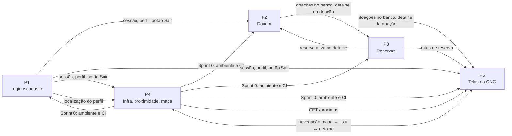

# 03 — Alinhamentos entre pessoas

Cada pessoa trabalha nas **próprias pastas**, mas algumas telas e rotas **dependem do trabalho de outra pessoa**. Este documento diz, para cada tela ou funcionalidade, **quem precisa conversar com quem, sobre o quê e quando**. Se esses combinados forem feitos no momento certo, ninguém descobre na véspera da entrega que "a minha tela esperava um campo que a sua rota não manda".

> **O que é "se alinhar":** uma conversa curta (10 a 15 min, chamada ou no grupo) em que as duas pessoas abrem juntas o contrato ([docs/08 — API](../docs/08-backend-apis.md)) e respondem às perguntas da tabela. O resultado é anotado como **comentário na issue** das duas pessoas. Se alguém quiser mudar o contrato, a mudança vai primeiro para o `docs/08`, num PR revisado pelas duas.

## Mapa de dependências



Leitura: a seta vai de quem **entrega** para quem **usa**.

## Tela por tela

### Login e cadastro (tela da P1)

| Com quem | Sobre o quê | Quando |
|---|---|---|
| **P1 + P4** | A localização gravada no cadastro é o **centro** da busca de doações próximas e do mapa. Combinem: a ordem é sempre **latitude, longitude**; como definir a posição no emulador (Mogi das Cruzes: `-23.5235, -46.1870`); o que acontece se a pessoa negar o GPS (ela digita os números) | antes da P1 começar a tela de cadastro |
| **P1 + P2 + P5** | O botão **Sair**: mesmo ícone (`Icons.logout`), mesmo texto ("Sair"), sempre no canto da AppBar da tela inicial; usa `sessao.encerrar()` e volta para a escolha do perfil | antes das telas iniciais do doador e da ONG |
| **P1 + todos** | Quando o backend de login (etapa 12) for mesclado, a P1 avisa no grupo: a partir daí todos podem testar no **modo API** com os usuários do seed | no dia do merge |

**Prova de que está alinhado:** a P4 cadastra uma ONG nova pelo app e ela aparece no lugar certo no mapa.

### Minhas doações e Nova doação (telas da P2)

| Com quem | Sobre o quê | Quando |
|---|---|---|
| **P2 + P5** | O `DoacaoCard` é compartilhado (fundação). Se alguém quiser mudar o visual do cartão, combinem antes, porque ele aparece nas duas telas iniciais | antes de qualquer mudança no `shared/widgets/doacao_card.dart` |
| **P2 + P4** | A doação nova, sem latitude/longitude, usa a **localização do perfil** do doador. Confiram juntos que uma doação criada pela P2 aparece no `GET /proximas` da P4 com a distância correta | quando as rotas 13 e 14 estiverem prontas |
| **P2 + P5** | O **prazo de retirada** (janela) da doação limita o prazo da reserva. A P5 precisa saber que uma doação com janela de 30 min gera uma reserva de 30 min, não de 2 h | antes da tela de detalhe da ONG |

**Prova:** a P2 publica uma doação no app do doador e, em até 15 s, a P5 vê a etiqueta **NOVA** no app da ONG.

### Detalhe da doação — lado do doador (tela da P2)

| Com quem | Sobre o quê | Quando |
|---|---|---|
| **P2 + P3** | O `GET /doacoes/{id}` (rota da P2) devolve a **reserva ativa**, que é uma linha da tabela da P3. Combinem os nomes das colunas no `SELECT` (aliases `titulo_doacao` e `nome_ong`) e o que conta como "ativa" | quando a P3 começar a etapa 15 |
| **P2 + P3** | O botão **Confirmar retirada** do doador chama a rota da P3 (`POST /reservas/{id}/retirada`). Combinem as respostas de erro: `409 RESERVA_NAO_ATIVA` (prazo acabou) e `404` (não é dono) e a mensagem que aparece na tela | antes da P2 fazer o botão |

**Prova:** com uma reserva ativa, o doador vê o nome da ONG e o contador; confirma a retirada e o status vira "Concluída" nas duas telas.

### Doações próximas — início da ONG (tela da P5)

| Com quem | Sobre o quê | Quando |
|---|---|---|
| **P5 + P4** | A rota `GET /proximas` da P4: parâmetro `raioKm` (as opções do menu são 2, 5, 10 e 20 km; o servidor limita entre 0,5 e 50), campo `distanciaKm` em todas as doações, **ordem** da mais perto para a mais longe, `403` se um doador chamar | antes da P5 começar a tela |
| **P5 + P4** | O ícone de **mapa** na AppBar da P5 abre a tela da P4. Combinem o ícone (`Icons.map_outlined`) e que a lista recarrega quando o usuário volta do mapa | quando a P4 começar a etapa 20 |

**Prova:** com `maosamigas@`, as 3 doações do seed aparecem na mesma ordem e com a mesma distância na lista (P5) e no mapa (P4).

### Detalhe da doação — lado da ONG (tela da P5): alinhamento de TRÊS pessoas

Esta é a tela com mais dependências: ela lê uma rota da **P2** e usa as rotas da **P3**. Façam uma conversa **com as três pessoas juntas**.

| Com quem | Sobre o quê | Quando |
|---|---|---|
| **P5 + P3** | `POST /reservas`: o corpo (`{"doacaoId": 1}`), a resposta (`Reserva` com `expiraEm`) e o erro **`409 DOACAO_INDISPONIVEL`** (outra ONG reservou antes). A P5 mostra uma tela própria para esse caso | antes da P5 fazer o botão Reservar |
| **P5 + P3** | `DELETE /reservas/{id}` (desistir) e `POST /reservas/{id}/retirada`: quais erros podem voltar e o que a tela mostra em cada um | idem |
| **P5 + P2 + P3** | **Quem a ONG pode ver** no `GET /doacoes/{id}` (rota da P2): a doação que ainda pode ser reservada **ou** a que ela mesma reservou. Consequência combinada: depois de **confirmar a retirada**, a doação fica `concluida` e o detalhe responde **404** para a ONG, por isso a tela da P5 **não recarrega** e mostra "Retirada confirmada" | antes da P5 terminar a tela |
| **P5 + P3** | O **prazo**: o contador da tela usa o `expiraEm` da reserva; quando chega a zero, a tela recarrega. A P3 confirma que, a partir desse momento, o servidor já trata a reserva como vencida (mesmo antes do job rodar) | antes de testar a expiração |

**Prova:** o teste de concorrência — P3 e P5, cada uma com uma ONG, tocam em **Reservar** na mesma doação ao mesmo tempo. Uma vê o contador; a outra vê "Outra ONG reservou...". Depois, uma reserva expira sozinha com `RESERVA_MINUTOS=2`.

### Minhas reservas (tela da P5)

| Com quem | Sobre o quê | Quando |
|---|---|---|
| **P5 + P3** | `GET /reservas`: devolve `{"reservas": [...]}` com `tituloDoacao` e `nomeOng`, mais recentes primeiro; reservas vencidas já vêm como `expirada`. Os quatro status e os textos que aparecem nas abas (Ativa / Retirada / Expirada / Cancelada) | antes da P5 fazer a tela |

**Prova:** depois do roteiro de testes, o Histórico mostra uma reserva de cada status.

### Mapa (tela da P4)

| Com quem | Sobre o quê | Quando |
|---|---|---|
| **P4 + P5** | Tocar em "Ver detalhes" abre a tela de detalhe **da P5** (`AppRoutes.detalheDoacaoOng`, argumento = id da doação). A P4 não muda essa tela; se precisar de algo nela, pede à P5 | antes da P4 fazer o cartão do mapa |
| **P4 + P1** | O centro do mapa é `sessao.perfil`, preenchido no login/cadastro da P1 | quando o login estiver pronto |

**Prova:** reservar uma doação a partir do mapa faz o marcador sumir ao voltar.

### Rotas e arquivos de fundação

| Com quem | Sobre o quê | Quando |
|---|---|---|
| **P3 + líder (+ P4)** | O `backend/main.dart` é fundação: a P3 só **descomenta** o bloco do job de expiração, num commit separado, e o líder revisa | no PR da etapa 15 |
| **Qualquer pessoa + líder** | Mudança em `pubspec.yaml`, `core/`, `data/`, `AppRouter`, `Dependencias` ou no **construtor** de uma página: abrir uma issue, combinar no grupo e fazer um PR só para isso | sempre que surgir a necessidade |
| **Dono da fatia + líder** | O `BancoFake` (modo Fake) precisa se comportar **igual** ao backend. Se uma pessoa descobrir uma diferença (um código de erro, uma regra), avisa o líder e o ajuste é feito no Fake **e** num teste | na integração (trilha 21) |
| **P5 (lidera) + todos** | Padrões visuais da [trilha/09](../trilha/09-design-de-telas.md): cores, textos de botão, estados de carregando/erro/vazio | antes de qualquer tela (Sprint 0) |
| **P4 + todos** | CI e `CODEOWNERS`: quem revisa o quê | Sprint 0 |

## Calendário de alinhamentos

| Quando | Conversa | Quem |
|---|---|---|
| Sprint 0, fim | Padrões visuais; botão Sair; quem revisa o quê | todos |
| Sprint 1, início | Localização do cadastro × proximidade | P1 + P4 |
| Sprint 1, meio | Reserva ativa no detalhe do doador; retirada pelo doador | P2 + P3 |
| Sprint 2, início | `GET /proximas` × tela inicial da ONG; mapa × lista | P4 + P5 |
| Sprint 2, início | **Detalhe da ONG** (rotas de reserva + visibilidade do detalhe) | **P2 + P3 + P5** |
| Sprint 2, meio | Minhas reservas; prazo e expiração | P3 + P5 |
| Sprint 3, início | Diferenças entre Fake e API encontradas na integração | todos |

> **Dica:** levem o `api.http` aberto para a conversa. Rodar a requisição juntos e olhar o JSON de verdade resolve 90% das dúvidas.

## Modelo de anotação (cole na issue)

```text
Alinhamento: <tela/funcionalidade>
Data: __/__  Quem: P_ + P_
Combinado:
- rota/método: ...
- campos usados pela tela: ...
- erros e o que a tela mostra: ...
- quem avisa quando estiver pronto: ...
Prova: <o teste que mostra que funcionou>
```
