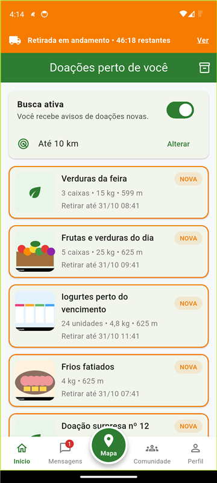
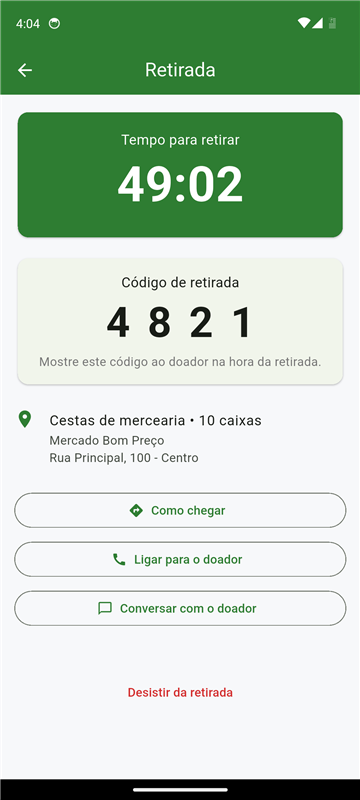
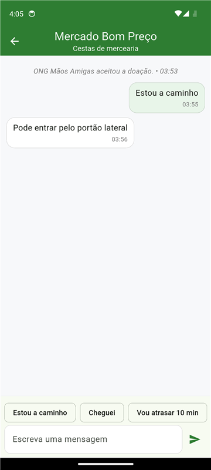
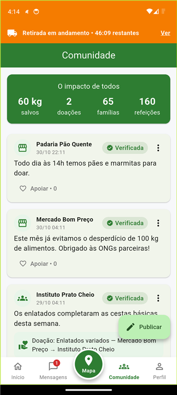

# Doação de Alimentos — conectando excedentes a quem precisa

> Projeto acadêmico de Engenharia de Software apresentado no **Summit**. Um aplicativo que conecta estabelecimentos com **excedente de alimentos** (mercados, feiras, sacolões, padarias) a **ONGs próximas**, combatendo a fome e o desperdício. Alinhado aos **ODS 2 (Fome Zero)** e **ODS 12 (Consumo e Produção Responsáveis)**.

**Primeira vez aqui? Comece por [`00_COMECE_AQUI`](00_COMECE_AQUI/README.md).**

| Doações perto | Mapa | Retirada | Chat | Comunidade | Perfil |
|---|---|---|---|---|---|
|  |  |  |  |  |  |

## Como funciona

1. O **doador** (mercado, feira, padaria, restaurante) anuncia o excedente, com fotos, validade e horário de retirada. Alimento vencido não é aceito, e o doador declara que está próprio para consumo.
2. As **ONGs próximas** (dentro do raio de cada uma) veem a doação na lista e no mapa e recebem uma **notificação**.
3. A primeira ONG que tocar em **Vou retirar** fica com a doação e tem um **prazo** para buscar, com contador regressivo e um **código de 4 dígitos**. Duas ONGs nunca ficam com a mesma doação.
4. Doador e ONG combinam pelo **chat** da retirada. Na hora, o doador digita o código da ONG e a retirada é **confirmada**. Se o prazo acabar, a doação volta para as outras ONGs, e desistências demais suspendem a ONG por 48 h.
5. Na **Comunidade**, as organizações contam o que fizeram com a doação, e o painel mostra o impacto de todos (kg salvos, famílias, refeições).

## Tecnologias

| Camada | Tecnologia | Por quê |
|---|---|---|
| App | **Flutter** (Dart), MVVM com `ChangeNotifier` | um código para Android e iOS; arquitetura orientada a objetos ([ADR-005](docs/adr/ADR-005-app-mvvm-changenotifier.md)) |
| Backend | **Dart Frog** (Dart) | mesma linguagem do app; rotas por arquivo ([ADR-002](docs/adr/ADR-002-backend-dart-frog.md)) |
| Banco | **MySQL 8.4 LTS** | relacional, com regras garantidas pelo banco ([ADR-003](docs/adr/ADR-003-mysql-84-nativo-docker-opcional.md)) |
| Compartilhado | pacote `shared_models` | modelos, contratos da API e validações iguais no app e no backend |
| Segurança | JWT + bcrypt + armazenamento seguro | [ADR-009](docs/adr/ADR-009-jwt-bcrypt-secure-storage.md) |
| Qualidade | testes automatizados + GitHub Actions | CI a cada Pull Request |

Todas as decisões: [docs/adr](docs/adr/README.md).

## Como rodar

Pré-requisitos e instalação passo a passo: [trilha/03](trilha/03-ambiente-windows-vscode.md). Resumo para quem já tem tudo instalado:

1. MySQL Workbench (como root): rodar `database/schema.sql` e `database/criar_usuario.sql`. **Já tinha o banco?** Rode também as migrações de `database/migracoes/` (hoje, a `002_preferencias_de_aviso.sql`).
2. `cd desenvolvimento_app\backend` · `Copy-Item .env.example .env` · preencher `DB_SENHA` e `JWT_SEGREDO`.
3. VS Code → *Tasks: Run Task* → **Tudo: baixar dependências (pub get)**.
4. Tarefas **Backend: recriar dados de exemplo (seed)** e **Backend: iniciar (dart_frog dev)**.
5. *Run and Debug* → **App — API local (emulador)** → `F5`. (Sem backend: **App — dados fictícios**.)

### Diferenças da máquina pessoal do Pedro (registradas na Etapa 0)

O projeto foi planejado para **MySQL 8.4 LTS** em `C:\dev\Summit`. Na máquina onde o app está sendo construído:

| Item | Planejado | Nesta máquina | Impacto |
|---|---|---|---|
| Banco | MySQL 8.4 LTS | **MySQL 8.0** (8.0.44, serviço `MySQL80`, porta 3306) | nenhum: o `schema.sql` usa só recursos que o 8.0 já tem (coluna gerada, `utf8mb4_0900_ai_ci`, TLS e o login `caching_sha2_password`) |
| Pasta do projeto | `C:\dev\Summit` | `C:\Users\user\Documents\dev\Summit` | nenhum: o caminho não tem espaço nem acento |
| NDK do Android | baixado sozinho pelo Gradle | instalado à mão: `android sdk install ndk/28.2.13676358` | só na primeira compilação (o novo *Android CLI* substituiu o `sdkmanager`) |

Quem usar MySQL 8.4 não precisa fazer nada diferente.

### Usuários de teste

Senha de todos: `senha123`. Os mesmos usuários existem no modo Fake.

| E-mail | Perfil | Para mostrar |
|---|---|---|
| `mercado@exemplo.com` | doador (Mercado Bom Preço) | histórico, "Cestas de mercearia" reservada (código **4821**), chat |
| `padaria@exemplo.com` | doador (Padaria Pão Quente) | publicar uma doação |
| `feirante@exemplo.com` | doador com CPF (Banca do Zé) | o selo "verificação pendente" (CPF não tem consulta pública, RN03) |
| `maosamigas@exemplo.com` | ONG (ONG Mãos Amigas) | lista, mapa, retirada em andamento, chat |
| `pratocheio@exemplo.com` | ONG com 2 desistências | o aviso "mais uma e sua conta será suspensa" |
| `suspensa@exemplo.com` | ONG suspensa | a faixa vermelha e o botão desativado |
| `distante@exemplo.com` | ONG a 45 km | não vê nem é avisada das doações |

## Testes

| O quê | Como |
|---|---|
| Testes automatizados (todas as regras RN) | tarefa **Tudo: verificar antes do PR** |
| Roteiro de ponta a ponta contra o servidor de verdade | `dart run tool/seed.dart` e, com o servidor rodando, `dart run tool/roteiro_ponta_a_ponta.dart` (pasta `backend`) |
| Passo a passo manual e cobertura de cada RN | [docs/relatorio-de-testes.md](docs/relatorio-de-testes.md) |

## Apresentação: os dois APKs

Na pasta `desenvolvimento_app\app`:

| APK | Comando | Para quê |
|---|---|---|
| **API** (debug) | `flutter build apk --debug --dart-define=API_URL=http://<IP do notebook>:8080` | o celular conversa com o backend do notebook pela rede local. No `backend\.env`, `ESCUTAR_NA_REDE=true`. O IP sai no `ipconfig` (Wi-Fi). |
| **Fake** (plano B) | `flutter build apk --release --dart-define=USAR_FAKE=true` | roda sem servidor nem internet, com os mesmos dados de exemplo |

Os arquivos ficam em `build\app\outputs\flutter-apk\`. Instale com `adb install -r <arquivo>.apk` ou copiando para o celular.

## Estrutura

```text
00_COMECE_AQUI/        por onde começar, regras do grupo, guia de cada pessoa
trilha/                passo a passo do zero à entrega (com código e checklists)
docs/                  referência: requisitos, API, banco, arquitetura, ADRs
database/              scripts SQL (MySQL 8.4)
desenvolvimento_app/
├── shared_models/     modelos e validações (Dart puro)
├── backend/           API (Dart Frog)
└── app/               aplicativo (Flutter)
```

Detalhes: [docs/06 — Estrutura do projeto](docs/06-estrutura-projeto.md).

## Documentação

| Para... | Veja |
|---|---|
| começar | [00_COMECE_AQUI](00_COMECE_AQUI/README.md) |
| desenvolver (passo a passo) | [trilha](trilha/README.md) |
| consultar (API, banco, regras) | [docs](docs/00-indice.md) |
| contribuir (Git, PR) | [CONTRIBUTING.md](CONTRIBUTING.md) |

## Equipe

<!-- TODO(grupo): preencher com os nomes e usuários do GitHub. -->

| Integrante | GitHub | Responsabilidade |
|---|---|---|
| Pessoa 1 | @ | Autenticação (backend + app) |
| Pessoa 2 | @ | Doador (backend + app) |
| Pessoa 3 | @ | Reservas e expiração (backend) |
| Pessoa 4 | @ | Infraestrutura, proximidade e mapa |
| Pessoa 5 | @ | Telas da ONG (app) |

## Uso de inteligência artificial

<!-- TODO(grupo): conferir a política da disciplina e ajustar este texto (trilha/22, passo 3). -->

Este projeto foi desenvolvido pelo grupo com apoio de ferramentas de IA generativa, usadas na estrutura inicial do repositório, na documentação e na escrita do código. Cada etapa foi revisada, testada no emulador e estudada pelo grupo, que é capaz de ler, explicar e defender todo o código apresentado.
