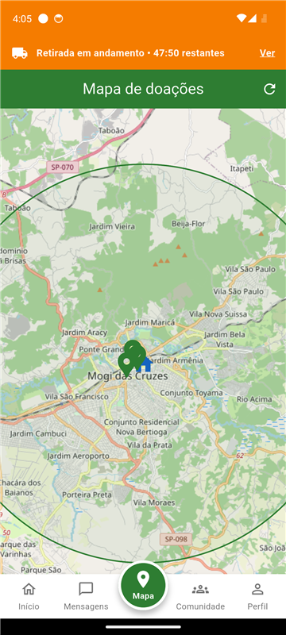
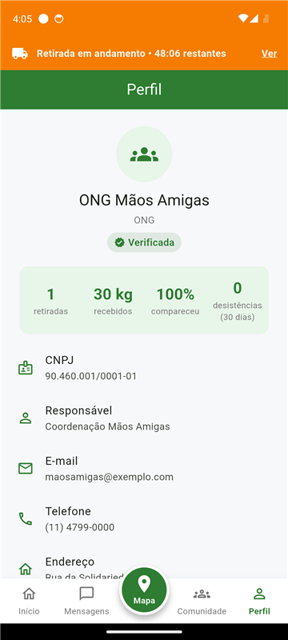

# ConectaFood — conectando excedentes a quem precisa

> Projeto acadêmico de Engenharia de Software (UMC) apresentado no **Summit**. O **ConectaFood** é um aplicativo de doação de alimentos que conecta estabelecimentos com **excedente de alimentos** (restaurantes, padarias, mercados, feiras e sacolões) a **ONGs e cozinhas solidárias próximas**, combatendo a fome e o desperdício. Alinhado aos **ODS 2 (Fome Zero)** e **ODS 12 (Consumo e Produção Responsáveis)**.

**Conectamos quem tem sobra a quem tem fome, com segurança e em poucos cliques.**

**Primeira vez aqui? Comece por [`00_COMECE_AQUI`](00_COMECE_AQUI/README.md).**

| Doações perto | Mapa | Retirada | Chat | Comunidade | Perfil |
|---|---|---|---|---|---|
|  |  |  |  |  |  |

## Como funciona

1. O **doador** (restaurante, padaria, mercado, feira) anuncia o excedente, com fotos, validade e horário de retirada. Alimento vencido não é aceito, e o doador declara que está próprio para consumo.
2. As **ONGs próximas** (dentro do raio de cada uma) veem a doação na lista e no mapa e recebem uma **notificação**.
3. A primeira ONG que tocar em **Vou retirar** fica com a doação e tem um **prazo** para buscar, com contador regressivo e um **código de 4 dígitos**. Duas ONGs nunca ficam com a mesma doação.
4. Doador e ONG combinam pelo **chat** da retirada. Na hora, o doador digita o código da ONG e a retirada é **confirmada**. Se o prazo acabar, a doação volta para as outras ONGs, e desistências demais suspendem a ONG por 48 h.
5. Na **Comunidade**, as organizações contam o que fizeram com a doação, e o painel mostra o impacto de todos (kg salvos, famílias, refeições).

## Tecnologias

| Camada | Tecnologia | Por quê |
|---|---|---|
| App | **Flutter** (Dart), MVVM com `ChangeNotifier` | um código para Android e iOS; arquitetura orientada a objetos ([ADR-005](docs/adr/ADR-005-app-mvvm-changenotifier.md)) |
| Backend | **Dart Frog** (Dart) | mesma linguagem do app; rotas por arquivo ([ADR-002](docs/adr/ADR-002-backend-dart-frog.md)) |
| Banco | **MySQL 8.4 LTS** | relacional, com regras garantidas pelo banco ([ADR-003](docs/adr/ADR-003-mysql-84-nativo-docker-opcional.md)) |
| Compartilhado | pacote `shared_models` | modelos, contratos da API e validações iguais no app e no backend |
| Segurança | JWT + bcrypt + armazenamento seguro | [ADR-009](docs/adr/ADR-009-jwt-bcrypt-secure-storage.md) |
| Qualidade | testes automatizados + GitHub Actions | CI a cada Pull Request |

Todas as decisões: [docs/adr](docs/adr/README.md).

## Como rodar

**Pré-requisitos:** [Flutter](https://docs.flutter.dev/get-started/install) 3.35 ou mais novo (Dart 3.9+) e um emulador Android ou celular com depuração USB. Para o modo completo, também **MySQL 8.x** e o pacote `dart_frog_cli` (`dart pub global activate dart_frog_cli`). Instalação detalhada no Windows com VS Code: [trilha/03](trilha/03-ambiente-windows-vscode.md).

### Opção A: só o app, sem banco e sem servidor (mais rápida)

O app traz um "backend de mentira" em memória com os mesmos dados de exemplo e as mesmas regras. Serve para conhecer todas as telas em poucos minutos.

```bash
cd desenvolvimento_app/app
flutter pub get
flutter run --dart-define=USAR_FAKE=true
```

Entre com qualquer usuário da tabela [Usuários de teste](#usuários-de-teste) (senha `senha123`).

### Opção B: completo (app + API + MySQL)

1. **Banco.** No MySQL Workbench (como root), rode `database/schema.sql` e depois `database/criar_usuario.sql` (troque a senha dentro dele). Já tinha o banco de uma versão anterior? Rode também as migrações de `database/migracoes/`.
2. **Configuração do servidor.** Em `desenvolvimento_app/backend`, copie `.env.example` para `.env` e preencha `DB_SENHA` (a mesma do passo 1) e `JWT_SEGREDO` (texto aleatório com 32+ caracteres).
3. **Dependências e dados de exemplo.**

   ```bash
   cd desenvolvimento_app/shared_models && dart pub get
   cd ../backend && dart pub get && dart run tool/seed.dart
   cd ../app && flutter pub get
   ```

4. **Servidor** (deixe este terminal aberto; sobe em <http://localhost:8080>):

   ```bash
   cd desenvolvimento_app/backend
   dart_frog dev
   ```

5. **App**, em outro terminal. No emulador Android, `10.0.2.2` é o computador onde o servidor roda:

   ```bash
   cd desenvolvimento_app/app
   flutter run --dart-define=API_URL=http://10.0.2.2:8080
   ```

   Em celular físico, use o IP do computador na rede (`ipconfig`/`ifconfig`) no lugar de `10.0.2.2` e ponha `ESCUTAR_NA_REDE=true` no `.env`.

No VS Code, os mesmos passos existem como tarefas (*Tasks: Run Task*) e perfis de execução (*Run and Debug*).

### Usuários de teste

Senha de todos: `senha123`. Os mesmos usuários existem no modo Fake.

| E-mail | Perfil | Para mostrar |
|---|---|---|
| `mercado@exemplo.com` | doador (Mercado Bom Preço) | "Mantimentos não perecíveis" reservada pela Mãos Amigas (código **4821**), chat |
| `padaria@exemplo.com` | doador (Padaria Pão Quente) | "Pão francês do dia" disponível; publicar uma doação |
| `feirante@exemplo.com` | doador com CPF (Banca do Zé) | o selo "verificação pendente" (CPF não tem consulta pública, RN03) |
| `maosamigas@exemplo.com` | ONG (ONG Mãos Amigas) | lista, mapa, retirada em andamento, chat |
| `pratocheio@exemplo.com` | ONG com 2 desistências (uma em cada doação de exemplo) | o aviso "mais uma e sua conta será suspensa" (bloqueada nas 2 doações de exemplo, RN22: para ver o aviso, publique uma doação nova) |
| `suspensa@exemplo.com` | ONG suspensa | a faixa vermelha e o botão desativado |
| `distante@exemplo.com` | ONG a 45 km | não vê nem é avisada das doações |

## Testes

| O quê | Como |
|---|---|
| Análise estática do app | `cd desenvolvimento_app/app && flutter analyze` |
| Testes automatizados do app | `cd desenvolvimento_app/app && flutter test` |
| Testes do backend e dos modelos | `dart test` em `desenvolvimento_app/backend` e em `desenvolvimento_app/shared_models` (não precisam de MySQL) |
| Tudo de uma vez (formatação + análise + testes) | tarefa **Tudo: verificar antes do PR** no VS Code |
| Roteiro de ponta a ponta contra o servidor de verdade | `dart run tool/seed.dart` e, com o servidor rodando, `dart run tool/roteiro_ponta_a_ponta.dart` (pasta `backend`) |
| Passo a passo manual e cobertura de cada RN | [docs/relatorio-de-testes.md](docs/relatorio-de-testes.md) |

## Apresentação: os dois APKs

Na pasta `desenvolvimento_app\app`:

| APK | Comando | Para quê |
|---|---|---|
| **API** (debug) | `flutter build apk --debug --dart-define=API_URL=http://<IP do notebook>:8080` | o celular conversa com o backend do notebook pela rede local. No `backend\.env`, `ESCUTAR_NA_REDE=true`. O IP sai no `ipconfig` (Wi-Fi). |
| **Fake** (plano B) | `flutter build apk --release --dart-define=USAR_FAKE=true` | roda sem servidor nem internet, com os mesmos dados de exemplo |

Os arquivos ficam em `build\app\outputs\flutter-apk\`. Instale com `adb install -r <arquivo>.apk` ou copiando para o celular.

## Estrutura

```text
00_COMECE_AQUI/        por onde começar, regras do grupo, guia de cada pessoa
trilha/                passo a passo do zero à entrega (com código e checklists)
docs/                  referência: requisitos, API, banco, arquitetura, ADRs
database/              scripts SQL (MySQL 8.4)
desenvolvimento_app/
├── shared_models/     modelos e validações (Dart puro)
├── backend/           API (Dart Frog)
└── app/               aplicativo (Flutter)
```

Detalhes: [docs/06 — Estrutura do projeto](docs/06-estrutura-projeto.md).

## Documentação

| Para... | Veja |
|---|---|
| começar | [00_COMECE_AQUI](00_COMECE_AQUI/README.md) |
| desenvolver (passo a passo) | [trilha](trilha/README.md) |
| consultar (API, banco, regras) | [docs](docs/00-indice.md) |
| contribuir (Git, PR) | [CONTRIBUTING.md](CONTRIBUTING.md) |

## Visão de negócio (pitch)

Resumo do pitch apresentado à banca. Preço, pedido e metas são **estimativas da equipe**; o plano Pro e o patrocínio são o plano de receita e **ainda não estão implementados** no app.

| Tema | Resumo |
|---|---|
| Problema | O Brasil gera cerca de 20 milhões de toneladas de resíduos alimentares por ano (PNUMA, 2024), e 2,5 milhões de domicílios viveram insegurança alimentar grave em 2024 (IBGE, PNAD Contínua). Quem tem excedente e quem precisa ainda se encontram por telefone e WhatsApp. |
| Público-alvo | Quem doa: restaurantes, padarias e mercados. Quem recebe: ONGs e cozinhas solidárias. |
| Mercado | TAM: 2,03 milhões de estabelecimentos de alimentação fora do lar no Brasil. SAM: 559 mil no estado de São Paulo (Fhoresp, com dados do Mapa de Empresas, abr. 2026). SOM: 5,6 mil em 3 anos (1% do SAM), a partir de Mogi das Cruzes e do Alto Tietê. |
| Modelo de negócio | Gratuito para ONGs e pequenos doadores. Plano Pro de R$ 49/mês por estabelecimento (relatório de impacto, comprovantes de doação, apoio ao Selo Doador da Lei nº 15.224/2025) e patrocínio de empresas e prefeituras. |
| Concorrência | Diretos: Comida Invisível e Connecting Food. Indiretos: Food To Save, Sesc Mesa Brasil, WhatsApp e telefone. |
| O pedido | R$ 150 mil por 10%, para 12 meses de piloto em Mogi das Cruzes: 50% produto e tecnologia, 30% aquisição e parcerias, 20% operação e conformidade. Meta: 260 assinantes Pro (ponto de equilíbrio). |

## Equipe

| Integrante | Função | GitHub | Responsabilidade |
|---|---|---|---|
| Vitor Yuki Ouchi | Product Owner | [@VitorYuki](https://github.com/VitorYuki) | Define a visão do produto e prioriza o backlog (o que entra no app e em que ordem). |
| Bryan Palacio | Scrum Master | [@bryanrubinho](https://github.com/bryanrubinho) | Organiza as sprints, acompanha as entregas e remove impedimentos da equipe. |
| Davi Lopes | Desenvolvedor | [@davilspa](https://github.com/davilspa) | Desenvolvimento e testes do aplicativo. |
| Pedro Carmo | Desenvolvedor | [@PedroCarmo01](https://github.com/PedroCarmo01) | Desenvolvimento e testes do aplicativo; mantém o repositório. |
| Gabriel Candido | Desenvolvedor | [@bielccandido](https://github.com/bielccandido) | Desenvolvimento e testes do aplicativo. |


## Uso de inteligência artificial

Este projeto foi desenvolvido pelo grupo com apoio de ferramentas de IA generativa, usadas na estrutura inicial do repositório, na documentação e na escrita do código. Cada etapa foi revisada, testada no emulador e estudada pelo grupo, que é capaz de ler, explicar e defender todo o código apresentado.
