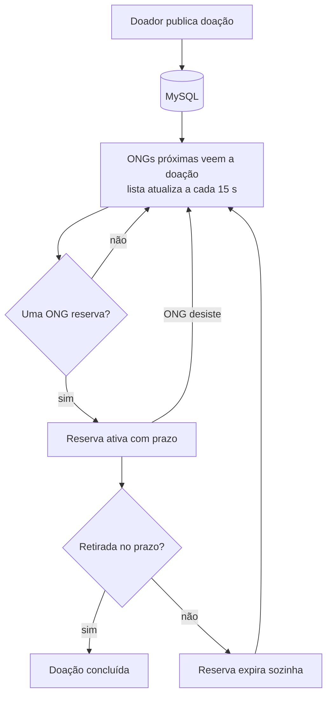
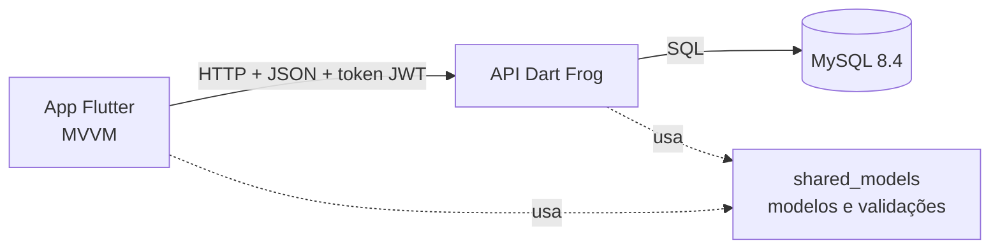

# 01 — Visão geral

## O problema

Todos os dias, mercados, feiras, sacolões e padarias descartam alimentos ainda **próprios para consumo**: perto do vencimento, com aparência "feia" para a venda ou que simplesmente sobraram. Ao mesmo tempo, ONGs que alimentam famílias em vulnerabilidade não sabem **onde** e **quando** esse excedente existe. Hoje o encontro acontece por telefone ou grupos de mensagem, de forma lenta e informal.

O projeto se alinha aos **ODS 2 (Fome Zero)** e **ODS 12 (Consumo e Produção Responsáveis)** da ONU.

## A solução

Um aplicativo que funciona como um **"iFood da doação"**:

1. O **doador** anuncia o excedente: o que é, quanto, validade e a **janela** em que pode ser retirado.
2. As **ONGs próximas** veem a doação (e são **avisadas** quando surge uma nova, com o app aberto).
3. A primeira ONG que **reservar** fica com a doação por um **prazo** (padrão: 2 horas).
4. A ONG busca e a retirada é **confirmada** (pela ONG ou pelo doador).
5. Se o prazo acabar sem retirada, a reserva **expira sozinha** e a doação volta a ficar disponível para as outras ONGs.

> A plataforma **não aceita alimentos vencidos ou impróprios** (exigência do escopo aprovado na inscrição): a validade não pode ser anterior a hoje e o doador precisa **declarar** que os alimentos estão próprios para consumo.

> **Nome:** "Summit" é o nome do **evento** de entrega, não do aplicativo. O nome exibido no app fica em `AppConfig.nomeApp` (hoje, "Doação de Alimentos") e pode ser trocado pelo grupo.

## Personas

### Doador (estabelecimento comercial)

- **Quem é:** gerente de mercado, feirante, dono de sacolão ou padaria.
- **Quer:** dar destino útil ao excedente rapidamente, sem burocracia.
- **Dores:** não sabe para quem doar; não tem tempo de ligar para várias ONGs; medo de o alimento estragar antes de alguém buscar.
- **No app:** publica doações, acompanha quem reservou, confirma a retirada, cancela se precisar.

### ONG (organização assistencial)

- **Quem é:** responsável por ONG, associação de bairro ou projeto social.
- **Quer:** conseguir alimentos de forma previsível e perto da sua base.
- **Dores:** não sabe onde há doações; chega tarde e o alimento já foi.
- **No app:** vê doações próximas (lista e mapa), reserva, acompanha o prazo, confirma a retirada, consulta o histórico.

> **Escopo:** dois tipos de usuário, com fluxos separados. Um perfil de administrador fica para o futuro ([roadmap](20-roadmap.md)).

## Funcionalidades do MVP

| Funcionalidade | Doador | ONG |
|---|:---:|:---:|
| Cadastro (com localização) e login | ✅ | ✅ |
| Continuar logado ao reabrir o app | ✅ | ✅ |
| Publicar doação (validade + declaração) | ✅ | — |
| Ver minhas doações e o status | ✅ | — |
| Cancelar doação ainda não reservada | ✅ | — |
| Ver doações próximas (lista, da mais perto para a mais longe) | — | ✅ |
| Aviso de doação nova (com o app aberto) | — | ✅ |
| Ver doações no mapa | — | ✅ |
| Reservar com prazo (contador regressivo) | — | ✅ |
| Desistir da reserva | — | ✅ |
| Confirmar retirada | ✅ | ✅ |
| Expiração automática da reserva | regra do sistema | regra do sistema |
| Histórico de reservas | — | ✅ |

## Fluxo geral

## Como o sistema é montado (resumo)

- O **app** só fala com a **API**; nunca acessa o banco.
- O pacote **`shared_models`** tem os modelos, os contratos da API e as **validações**, usados pelos dois lados. Assim o JSON e as regras são sempre os mesmos.
- Detalhes em [04 — Arquitetura](04-arquitetura.md) e [03 — Stack](03-stack.md).

## Decisões de escopo já tomadas

| Decisão | Por quê | Onde está registrada |
|---|---|---|
| Aviso de novidade por **atualização periódica** (15 s), não WebSocket | Muito mais simples para o grupo; atende ao MVP | [ADR-008](adr/ADR-008-polling-no-mvp.md) |
| **Android** como plataforma principal da demonstração | Emulador e celulares do grupo | [03 — Stack](03-stack.md) |
| Interface em **português** | Público-alvo | — |
| Docker **opcional** | Não resolve problema real deste projeto | [ADR-003](adr/ADR-003-mysql-84-nativo-docker-opcional.md) |
