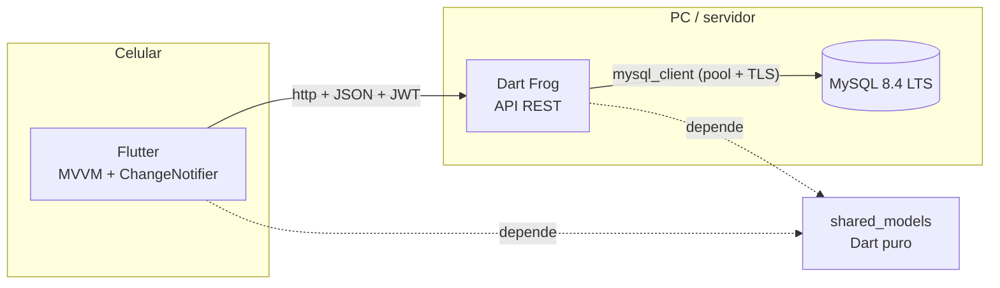

# 03 — Stack tecnológica

Todas as tecnologias do projeto, para que servem e por que foram escolhidas. Como instalar: [trilha/03](../trilha/03-ambiente-windows-vscode.md). Decisões detalhadas: [ADRs](adr/README.md).

## Visão geral

## Ferramentas de desenvolvimento

| Ferramenta | Versão | Para quê |
|---|---|---|
| Windows 10/11 + **PowerShell** | — | Sistema do grupo; todos os comandos da documentação são para ele |
| **VS Code** | atual | Editor. Extensões em `.vscode/extensions.json` (Flutter/Dart, Dart Frog, REST Client, Error Lens, Git Graph, Mermaid) |
| **Git** + **GitHub** | atual | Versionamento, Pull Requests, revisão, quadro do Projects, CI |
| **Flutter SDK** | stable, **3.35 ou mais novo** (traz o **Dart 3.9+**) | App e ferramentas de Dart |
| **Android Studio** | atual | Só para o SDK do Android e o emulador (o código é editado no VS Code) |
| **Dart Frog CLI** | 1.x (`dart pub global activate dart_frog_cli`) | `dart_frog dev` sobe a API com recarga automática |
| **MySQL Server** | **8.4 LTS** | Banco de dados (8.0 saiu de suporte em abril/2026) |
| **MySQL Workbench** | 8.x | Rodar os scripts SQL e consultar os dados |
| **REST Client** (extensão) | — | Testar a API pelo arquivo `backend/api.http`, sem Postman |
| Docker Desktop | — | **Opcional** ([apêndice A](../trilha/apendice-a-docker-opcional.md)) |

> Por que Flutter 3.35+? O `shared_models` e o backend exigem Dart `^3.9.0`, e o app usa APIs recentes do Material (`DropdownButtonFormField.initialValue`, `Color.withValues`). Rode `flutter --version` e, se for mais antigo, `flutter upgrade`.

## Pacotes (dependências)

### `shared_models` (Dart puro)

Sem dependências de produção. Só `lints` e `test` para desenvolvimento. **Regra:** não pode depender de Flutter, HTTP ou banco, porque é usado pelos dois lados.

### Backend (`desenvolvimento_app/backend/pubspec.yaml`)

| Pacote | Para quê | Por quê este |
|---|---|---|
| `dart_frog` | Framework HTTP, rotas por arquivo | Simples, rotas fáceis de dividir entre pessoas ([ADR-002](adr/ADR-002-backend-dart-frog.md)) |
| `mysql_client` | Driver MySQL com **pool** e **TLS** | Reconecta sozinho; TLS exigido pelo login padrão do MySQL 8.4 ([ADR-004](adr/ADR-004-driver-mysql-pool-tls.md)) |
| `dart_jsonwebtoken` | Emitir e validar JWT | Padrão de mercado ([ADR-009](adr/ADR-009-jwt-bcrypt-secure-storage.md)) |
| `bcrypt` | Hash de senha | Lento de propósito; com sal |
| `dotenv` | Ler o arquivo `.env` | O `dart_frog dev` não carrega o `.env` sozinho ([ADR-012](adr/ADR-012-configuracao-dotenv-dart-define.md)) |
| `shared_models` | Modelos, contratos e validações | `path: ../shared_models` |
| `test`, `lints` | Testes e análise | Oficiais do Dart |

### App (`desenvolvimento_app/app/pubspec.yaml`)

| Pacote | Para quê | Por quê este |
|---|---|---|
| `http` | Chamadas à API | Oficial do time do Dart ([ADR-007](adr/ADR-007-pacote-http.md)) |
| `flutter_secure_storage` | Guardar o token JWT | Usa o Keystore do Android (criptografado) |
| `geolocator` | GPS do aparelho (cadastro) | O mais usado e mantido |
| `flutter_map` + `latlong2` | Mapa com OpenStreetMap | Gratuito, sem chave de API |
| `shared_models` | Modelos e validações | `path: ../shared_models` |
| `flutter_test`, `flutter_lints` | Testes e análise | Oficiais do Flutter |

**Gerência de estado:** nenhuma biblioteca. Usamos `ChangeNotifier` + `ListenableBuilder`, que já vêm no Flutter ([ADR-005](adr/ADR-005-app-mvvm-changenotifier.md)).

> **Não adicione pacotes sem combinar com o grupo.** O `pubspec.lock` é versionado para todos usarem as mesmas versões. Uma mudança de pacote é um PR próprio, revisado pelo líder.

## O que foi removido (e por quê)

| Removido | Motivo | Substituído por |
|---|---|---|
| Riverpod | API mudou na versão 3; estilo pouco orientado a objetos para quem está aprendendo POO | MVVM com `ChangeNotifier` |
| dio | Usado só para interceptar o token | `http` + `ApiClient` |
| intl | Só formatava datas numéricas | `Formatador` (20 linhas) |
| WebSocket (`dart_frog_web_socket`, `web_socket_channel`) | Complexo demais para o MVP | Atualização a cada 15 s ([ADR-008](adr/ADR-008-polling-no-mvp.md)) |
| mocktail | Outra API para aprender | Fakes escritos à mão (ensinam polimorfismo) |
| Docker obrigatório | Custo alto no Windows, nenhum ganho real | MySQL nativo; Docker opcional |

Detalhes: [23 — Análise técnica](23-analise-tecnica.md), seção 4.

## Integração contínua (CI)

GitHub Actions (`.github/workflows/ci.yml`), a cada Pull Request e push na `main`, em três jobs: `shared_models`, `backend` e `app`. Cada um roda `dart format --set-exit-if-changed`, `analyze` e os testes. Os testes **não** precisam de MySQL (usam Fakes).
