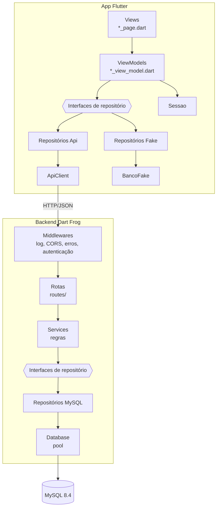

# 04 — Arquitetura

Como o sistema é dividido e como as partes conversam. A explicação didática, com os pilares da POO e os padrões de projeto, está na [trilha/07](../trilha/07-arquitetura-e-poo.md).

## 1. Três pacotes num só repositório (monorepo)

| Pacote | Tipo | Responsabilidade |
|---|---|---|
| `desenvolvimento_app/shared_models` | Dart puro | Modelos (`Usuario`, `Perfil`, `Conta`, `Doacao`, `Reserva`, `DetalheDoacao`), contratos da API (`DadosCadastro`, `DadosLogin`, `RespostaAutenticacao`, `DadosNovaDoacao`, `DadosReserva`), validações (`ValidadorUsuario`, `ValidadorDoacao`), `Relogio`, `Calendario`, `Geo` |
| `desenvolvimento_app/backend` | Dart Frog | API REST, regras de negócio, acesso ao MySQL |
| `desenvolvimento_app/app` | Flutter | Telas, ViewModels, repositórios (API e Fake) |

Por que monorepo: um único `git clone`, os três pacotes sempre na mesma versão e o `shared_models` referenciado por caminho ([ADR-001](adr/ADR-001-monorepo-tres-pacotes.md)).

## 2. Visão de componentes



## 3. Camadas do backend

| Camada | Onde | Faz | Não faz |
|---|---|---|---|
| **Middleware** | `routes/_middleware.dart` (global) e `routes/<pasta>/_middleware.dart` | log, CORS, tratamento de erros, exigir login, criar o Service da fatia | regra de negócio |
| **Rota** | `routes/**` | lê o HTTP, chama o Service, devolve JSON | `if` de regra, SQL |
| **Service** | `lib/<fatia>/*_service.dart` | regras de negócio e autorização por papel | HTTP, SQL |
| **Repository** | `lib/<fatia>/*_repository*.dart` | SQL (interface + implementação MySQL) | regras |
| **Core** | `lib/core/**` | `Env`, `Database`, `Mapeador`, exceções, segurança, datas | — |

Caminho de uma requisição:

```text
main.dart (providers: Env, Database, Relogio, TokenService, SenhaService)
 └─ routes/_middleware.dart          requestLogger → cors → tratarErros
     └─ routes/reservas/_middleware.dart   exigirAutenticacao + provider<ReservaService>
         └─ routes/reservas/index.dart     onRequest → ReservaService → ReservaRepositoryMysql
```

**Erros:** Services e rotas **lançam** exceções (`ValidacaoException` 400, `NaoAutenticadoException` 401, `SemPermissaoException` 403, `NaoEncontradoException` 404, `MetodoNaoPermitidoException` 405, `ConflitoException` 409). O middleware `tratarErros` converte em `{"erro": {"codigo", "mensagem"}}`. "Não é seu" responde 404, para não revelar ids de outros usuários.

## 4. Camadas do app (MVVM)

| Camada | Onde | Faz |
|---|---|---|
| **View** | `features/<area>/presentation/*_page.dart` | desenha, navega, mostra SnackBar/diálogos |
| **ViewModel** | `features/<area>/presentation/*_view_model.dart` | estado da tela e ações; estende `ViewModelBase` |
| **Repositório** | `data/<recurso>/*_repository.dart` | interface + `...Api` + `...Fake` |
| **Core** | `core/**` | `ApiClient`, `Sessao`, `Dependencias`, `AppRouter`, `AppConfig`, tema, `Formatador` |
| **Widgets compartilhados** | `shared/widgets/` | `PrimaryButton`, `AppTextField`, `DoacaoCard`, `ContadorRegressivo`, estados |

- **Raiz de composição:** `core/dependencias.dart` é o único lugar que conhece as classes concretas. `Dependencias.api()` ou `Dependencias.fake()` ([ADR-006](adr/ADR-006-injecao-por-construtor.md)).
- **Contrato das telas:** o `AppRouter` cria cada página com as dependências. Os **construtores das páginas** não mudam; cada pessoa troca só o conteúdo.
- **Modo Fake:** `--dart-define=USAR_FAKE=true` usa o `BancoFake`, que aplica as mesmas regras e lança os mesmos códigos de erro do backend.

Detalhes: [09 — Frontend](09-frontend.md).

## 5. Comunicação

| Aspecto | Decisão |
|---|---|
| Protocolo | HTTP + JSON (UTF-8) |
| Autenticação | `Authorization: Bearer <JWT>`; o token tem só `uid` e `tipo` |
| Formato de erro | `{"erro": {"codigo": "DOACAO_INDISPONIVEL", "mensagem": "...", "detalhes": [...]}}` |
| Datas | ISO-8601 em UTC (`2026-09-15T14:30:00.000Z`); validade como `AAAA-MM-DD` |
| Novidades para a ONG | Atualização periódica (15 s) de `GET /proximas` |
| Contrato completo | [08 — API](08-backend-apis.md) |

## 6. Dados

Quatro tabelas: `usuarios`, `perfis` (1:1, chave primária compartilhada), `doacoes`, `reservas`. Datas em UTC. Exclusão lógica por status. A regra "uma reserva ativa por doação" é garantida por um índice único sobre uma coluna gerada. Detalhes: [07 — Banco](07-banco-de-dados.md).

## 7. Divisão por pessoa (fatias verticais)

| Pessoa | Backend | App |
|---|---|---|
| P1 — Autenticação | `lib/auth`, `routes/auth` | `features/auth` |
| P2 — Doador | `lib/doacoes`, `routes/doacoes` | `features/doador` |
| P3 — Reservas | `lib/reservas`, `routes/reservas` (+ job no `main.dart`) | dupla com P5 |
| P4 — Infra, proximidade e mapa | `lib/proximidade`, `routes/proximas`, `database/`, `.github/` | `features/mapa` |
| P5 — ONG | dupla com P3 | `features/ong` |

Cada pessoa cria arquivos só nas próprias pastas; os arquivos de **fundação** (core, roteador, `Dependencias`, `main.dart`, pubspecs) já vêm prontos. Ver [ADR-011](adr/ADR-011-walking-skeleton-fatias-fakes.md).
