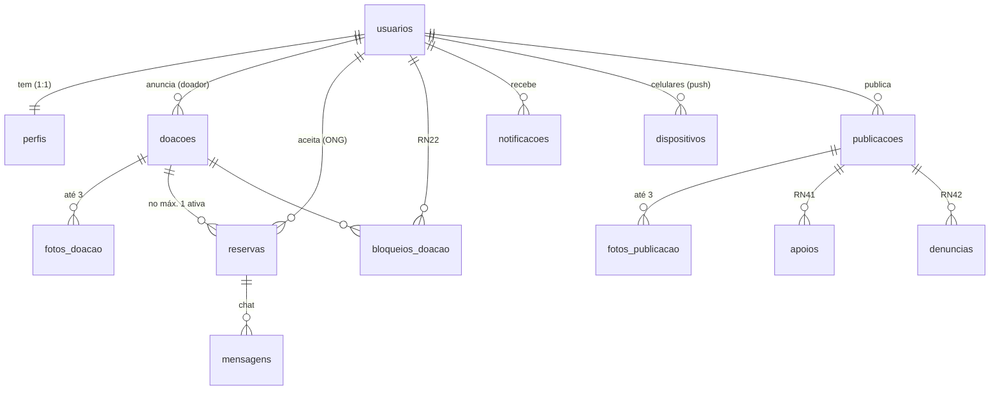
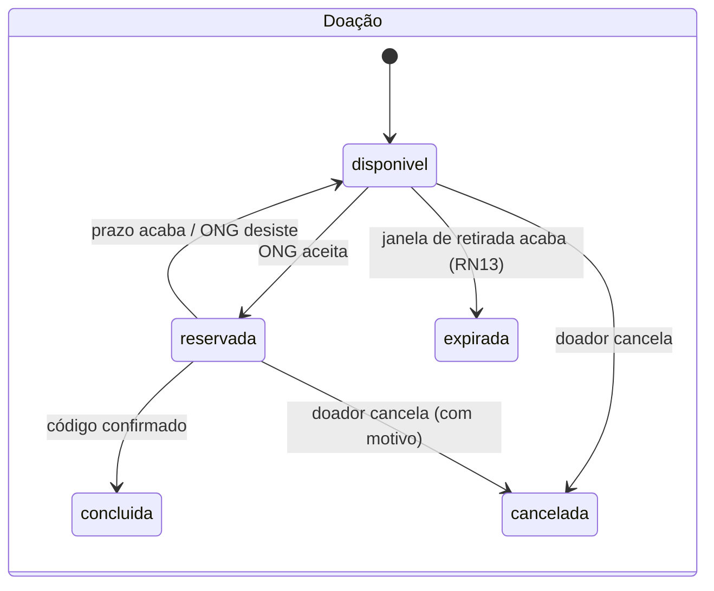
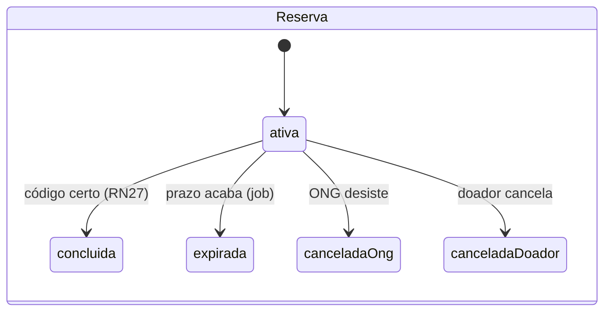

# 07 — Banco de dados

Referência das tabelas. O passo a passo (modelo conceitual, normalização, como rodar os scripts) está na [trilha/08](../trilha/08-banco-de-dados-passo-a-passo.md). Os scripts estão em [`database/`](../database/README.md).

- **SGBD:** MySQL **8.4 LTS** (funciona no 8.0.16+; ver README da raiz), banco `summit`, `utf8mb4` ([ADR-003](adr/ADR-003-mysql-84-nativo-docker-opcional.md)).
- **Usuário do backend:** `summit_app`, só com `SELECT, INSERT, UPDATE, DELETE` (privilégio mínimo).
- **Datas:** todo `DATETIME` guarda **UTC**, enviado pelo backend (nada de `NOW()`) ([ADR-010](adr/ADR-010-datas-utc-relogio.md)).
- **Nada é apagado:** registros de negócio mudam de **status**. Por isso as chaves estrangeiras usam `RESTRICT`.
- **ENUMs = nomes dos enums do Dart:** `'produtorRural'`, `'canceladaOng'`, `'refeicoesProntas'`... O backend converte com `Enum.values.byName(...)`, sem tabela de tradução.
- **Dados de exemplo:** `backend/tool/seed.dart` (gera hashes bcrypt reais; ver [08](08-backend-apis.md#usuários-do-seed-dart-run-toolseeddart)).
- **Etapa 1:** o `schema.sql` foi reescrito com **todas** as tabelas do app de uma vez (13). As de etapas futuras (notificações, chat, comunidade) já existem, vazias ou só com o seed, para não ser preciso mexer no banco de novo.

## Diagrama

## Contas

### `usuarios` — identidade e login

| Coluna | Tipo | Regra |
|---|---|---|
| `id` | `INT UNSIGNED` PK auto | usado em **todo** o sistema (token, perfis, doações, reservas) |
| `nome` | `VARCHAR(120)` | pessoa responsável |
| `email` | `VARCHAR(160)` | **único** (`uk_usuarios_email`, RN04), sempre em minúsculas |
| `senha_hash` | `VARCHAR(100)` | hash bcrypt (`$2a$...`), **nunca** a senha |
| `tipo` | `ENUM('doador','ong')` | RN01: cada conta é de um tipo só |
| `criado_em` | `DATETIME` | UTC |

### `perfis` — dados da organização (1:1 com `usuarios`)

| Coluna | Tipo | Regra |
|---|---|---|
| `usuario_id` | `INT UNSIGNED` | **PK e FK** ao mesmo tempo (chave primária compartilhada); `ON DELETE CASCADE` |
| `nome_organizacao` | `VARCHAR(160)` | mercado, padaria, ONG... |
| `tipo_estabelecimento` | `ENUM(... 'produtorRural','outro')` NULL | só doador (RN02 decide o documento aceito) |
| `tipo_documento` | `ENUM('cnpj','cpf')` | |
| `documento` | `VARCHAR(14)` | só números; **único** (`uk_perfis_documento`, RN04) |
| `razao_social` | `VARCHAR(200)` NULL | da BrasilAPI |
| `verificacao` | `ENUM('verificada','pendente')` | RN03; índice para o job de reverificação |
| `telefone`, `endereco` | `VARCHAR` NULL | |
| `cep` | `CHAR(8)` NULL | só números |
| `latitude`, `longitude` | `DECIMAL(9,6)` | `CHECK` de faixa |
| `familias_atendidas` | `INT UNSIGNED` NULL | só ONG |
| `transporte` | `ENUM('aPe','carro','van')` NULL | só ONG |
| `busca_ativa` | `BOOLEAN` padrão `TRUE` | só ONG (T20) |
| `raio_km` | `DECIMAL(5,2)` padrão `10` | só ONG; o app oferece 2, 5, 10 ou 20 |
| `suspensa_ate` | `DATETIME` NULL | só ONG; RN24 (UTC) |
| `info_extra` | `VARCHAR(255)` NULL | "nome e dias da feira", "qual tipo", horários da ONG |

> **Por que uma tabela só para doador e ONG?** A maior parte dos atributos é a mesma e o tipo já está em `usuarios`. Duas tabelas criariam dois ids para a mesma pessoa (problema A11 da [análise](23-analise-tecnica.md)). As colunas que são de um tipo só aceitam `NULL` ou têm valor padrão.

## Doações e retiradas

### `doacoes` — excedente anunciado

| Coluna | Tipo | Regra |
|---|---|---|
| `id` | PK auto | |
| `doador_id` | FK → `usuarios.id` | o tipo "doador" é conferido pelo Service |
| `titulo`, `descricao` | `VARCHAR(120)`, `VARCHAR(500)` NULL | |
| `categoria` | `ENUM('hortifruti','padaria','laticinios','mercearia','refeicoesProntas','carnesFrios','bebidas','outros')` | |
| `quantidade_numero` + `unidade` | `DECIMAL(10,2)` + `ENUM('kg','unidades','caixas','pacotes','litros')` | `CHECK > 0` |
| `peso_kg` | `DECIMAL(8,2)` | soma no painel de impacto |
| `conservacao` | `ENUM('ambiente','refrigerado','congelado')` | |
| `precisa_veiculo` | `ENUM('sacola','carro','van')` NULL | |
| `validade` | `DATE` | não pode ser antes de hoje (RN10, no Service) |
| `preparado_em` | `DATETIME` NULL | refeições prontas |
| `janela_inicio`, `janela_fim` | `DATETIME` | UTC; `CHECK (janela_fim > janela_inicio)` |
| `endereco`, `latitude`, `longitude` | | copiados do perfil se o app não mandar |
| `status` | `ENUM('disponivel','reservada','concluida','cancelada','expirada')` | padrão `disponivel`; `expirada` = RN13 |
| `motivo_cancelamento` | `VARCHAR(255)` NULL | RN12 |
| `criado_em` | `DATETIME` | UTC |

Índices: `(status, janela_fim)` para "disponíveis agora"; `(doador_id)` para "minhas doações"; `(latitude, longitude)` para a busca por proximidade.

> Na etapa 1 só o **banco** mudou: o modelo `Doacao` do Dart e as rotas de doação são atualizados na etapa 2.

### `fotos_doacao`

`id`, `doacao_id` FK, `arquivo` (nome aleatório em `backend/arquivos/`), `ordem` (1 a 3, `UNIQUE (doacao_id, ordem)`).

### `reservas` — uma ONG aceita uma doação e tem um prazo

| Coluna | Tipo | Regra |
|---|---|---|
| `id` | PK auto | |
| `doacao_id`, `ong_id` | FKs | |
| `status` | `ENUM('ativa','concluida','expirada','canceladaOng','canceladaDoador')` | padrão `ativa` |
| `codigo_retirada` | `CHAR(4)` | RN26 |
| `tentativas_codigo`, `bloqueado_ate` | `TINYINT`, `DATETIME` NULL | RN27 (5 erros → 10 min) |
| `reservado_em`, `expira_em` | `DATETIME` | UTC; RN21; `CHECK (expira_em > reservado_em)` |
| `encerrada_em` | `DATETIME` NULL | quando saiu de `ativa` |
| `motivo` | `VARCHAR(255)` NULL | motivo do cancelamento |
| `conta_desistencia` | `BOOLEAN` | RN22–RN24 |
| `doacao_ativa_id` | coluna **gerada** | `IF(status='ativa', doacao_id, NULL)` com índice **UNIQUE** |

> **A regra mais importante do banco (RN20):** `uk_reservas_uma_ativa_por_doacao` impede duas reservas **ativas** para a mesma doação. Como o `UNIQUE` aceita vários `NULL`, o histórico continua permitido. Explicação completa: [12 — Partes complexas](12-partes-complexas.md#1-duas-ongs-reservando-ao-mesmo-tempo).

Índices: `(status, expira_em)` para o job de expiração; `(ong_id, status)`; `(ong_id, conta_desistencia, encerrada_em)` para contar desistências em 30 dias (RN24); `(doacao_id)`.

### `bloqueios_doacao` — RN22

PK composta (`ong_id`, `doacao_id`) + `criado_em`. A ONG que deixou o prazo acabar não aceita **a mesma** doação de novo.

## Notificações

- **`notificacoes`:** `id`, `usuario_id`, `tipo` (`ENUM` com os 10 eventos da seção 9 da especificação: `doacaoNova`, `doacaoAceita`, `prazoAcabando`, `prazoAcabouOng`, `prazoAcabouDoador`, `doacaoDisponivelDeNovo`, `retiradaConfirmada`, `mensagemNova`, `doacaoCancelada`, `suspensao`), `titulo`, `corpo`, `doacao_id` NULL, `reserva_id` NULL, `lida`, `criado_em`. Índice `(usuario_id, id)` para `GET /notificacoes?depois=`.
- **`dispositivos`:** `id`, `usuario_id`, `token` (**único**), `plataforma` (`'android'`), `atualizado_em`. Para o push real (etapa 9); a rota `POST /dispositivos` já grava aqui.

## Chat

**`mensagens`:** `id`, `reserva_id` FK, `autor_id` FK NULL (**NULL = mensagem do sistema**), `texto` `VARCHAR(1000)`, `criado_em`, `lida_em` NULL. Índice `(reserva_id, id)`.

## Comunidade

- **`publicacoes`:** `id`, `autor_id`, `texto` `VARCHAR(1000)`, `doacao_id` NULL, `familias_ajudadas`, `refeicoes`, `oculta` (RN42), `criado_em`. Índice `(oculta, id)` para o feed.
- **`fotos_publicacao`:** como `fotos_doacao`.
- **`apoios`:** PK composta (`publicacao_id`, `usuario_id`): cada conta apoia uma vez (RN41).
- **`denuncias`:** PK composta (`publicacao_id`, `usuario_id`) + `motivo` `ENUM('improprio','falso','outro')` (RN42).

## Estados

## Mudanças de estrutura

Depois que todos criaram o banco, mudanças entram como **migração** numerada em `database/migracoes/` **e** no `schema.sql` (ver [`database/migracoes/README.md`](../database/migracoes/README.md)). A reescrita da etapa 1 não tem migração porque ninguém do grupo tinha criado o banco ainda.
