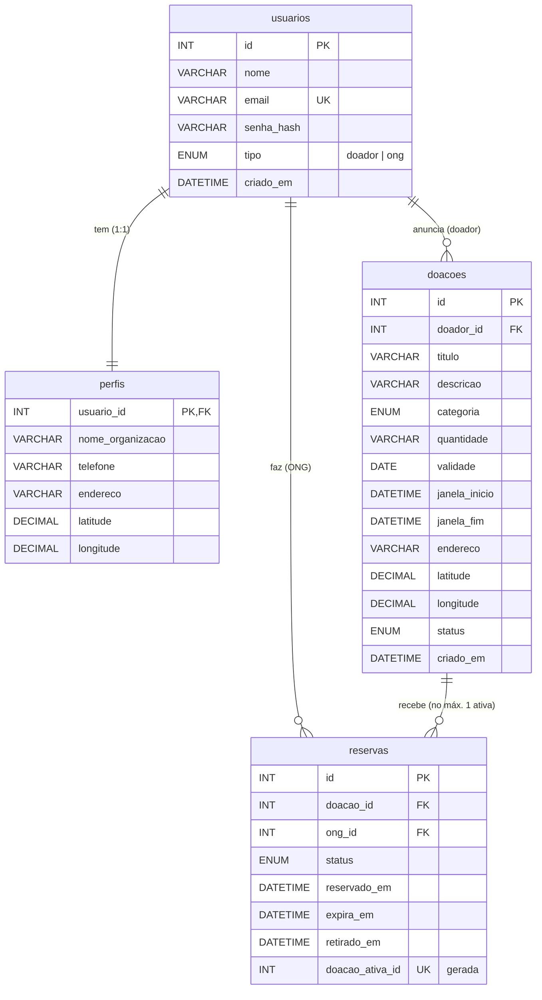
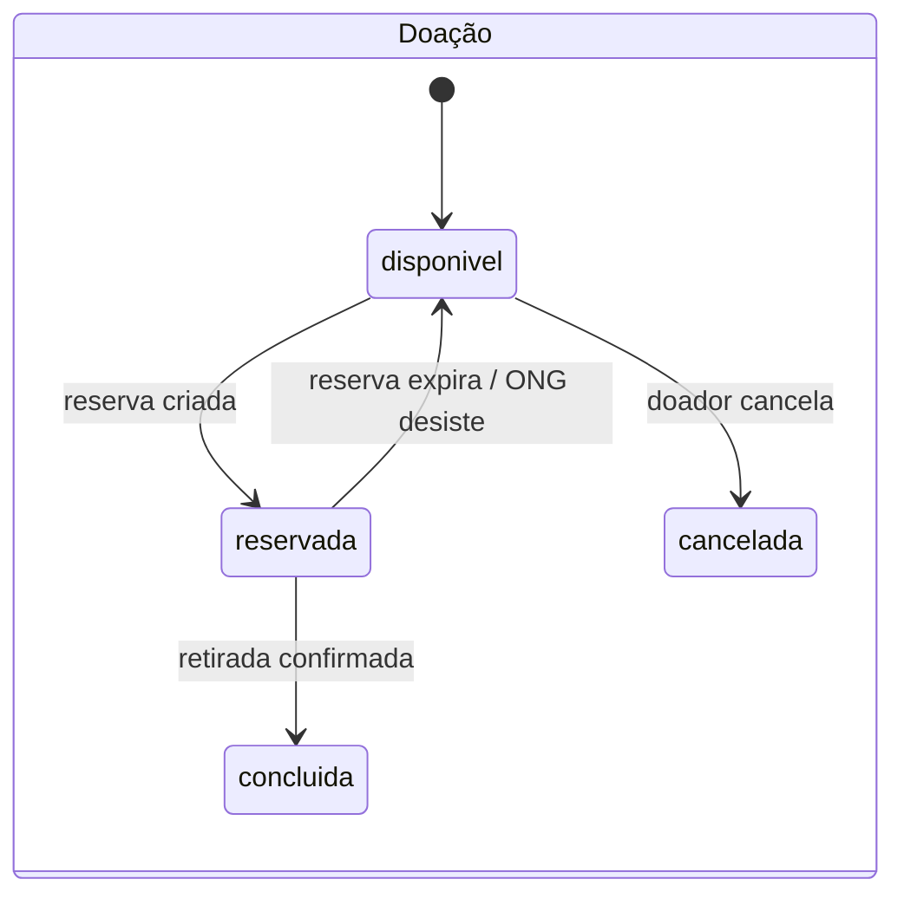
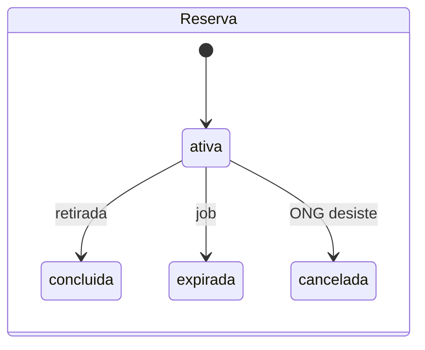

# 07 — Banco de dados

Referência das tabelas. O passo a passo (modelo conceitual, normalização, como rodar os scripts) está na [trilha/08](../trilha/08-banco-de-dados-passo-a-passo.md). Os scripts estão em [`database/`](../database/README.md).

- **SGBD:** MySQL **8.4 LTS**, banco `summit`, `utf8mb4` ([ADR-003](adr/ADR-003-mysql-84-nativo-docker-opcional.md)).
- **Usuário do backend:** `summit_app`, só com `SELECT, INSERT, UPDATE, DELETE` (privilégio mínimo).
- **Datas:** todo `DATETIME` guarda **UTC**, enviado pelo backend (nada de `NOW()`) ([ADR-010](adr/ADR-010-datas-utc-relogio.md)).
- **Nada é apagado:** registros de negócio mudam de **status**. Por isso as chaves estrangeiras usam `RESTRICT`.
- **Dados de exemplo:** `backend/tool/seed.dart` (gera hashes bcrypt reais).

## Diagrama

## Tabelas

### `usuarios` — identidade e login

| Coluna | Tipo | Regra |
|---|---|---|
| `id` | `INT UNSIGNED` PK auto | usado em **todo** o sistema (token, perfis, doações, reservas) |
| `nome` | `VARCHAR(120)` | pessoa responsável |
| `email` | `VARCHAR(160)` | **único** (`uk_usuarios_email`), sempre em minúsculas |
| `senha_hash` | `VARCHAR(100)` | hash bcrypt (`$2a$...`), **nunca** a senha |
| `tipo` | `ENUM('doador','ong')` | define o papel |
| `criado_em` | `DATETIME` | UTC |

### `perfis` — dados da organização

| Coluna | Tipo | Regra |
|---|---|---|
| `usuario_id` | `INT UNSIGNED` | **PK e FK** ao mesmo tempo (chave primária compartilhada, 1:1); `ON DELETE CASCADE` |
| `nome_organizacao` | `VARCHAR(160)` | mercado, padaria, ONG... |
| `telefone`, `endereco` | `VARCHAR` NULL | opcionais |
| `latitude`, `longitude` | `DECIMAL(9,6)` | `CHECK` de faixa (-90..90, -180..180) |

> **Por que uma tabela só para doador e ONG?** Os atributos são os mesmos; o tipo já está em `usuarios`. Duas tabelas criariam dois ids para a mesma pessoa (problema A11 da [análise](23-analise-tecnica.md)).

### `doacoes` — excedente anunciado

| Coluna | Tipo | Regra |
|---|---|---|
| `id` | PK auto | |
| `doador_id` | FK → `usuarios.id` | o tipo "doador" é conferido pelo Service |
| `titulo` | `VARCHAR(120)` | 3 a 120 caracteres |
| `descricao` | `VARCHAR(500)` NULL | |
| `categoria` | `ENUM('hortifruti','padaria','laticinios','mercearia','refeicoesProntas','outros')` | igual ao enum `CategoriaAlimento` |
| `quantidade` | `VARCHAR(60)` | texto livre ("5 caixas") |
| `validade` | `DATE` | não pode ser antes de hoje (regra no Service) |
| `janela_inicio`, `janela_fim` | `DATETIME` | UTC; `CHECK (janela_fim > janela_inicio)` |
| `endereco`, `latitude`, `longitude` | | copiados do perfil se o app não mandar |
| `status` | `ENUM('disponivel','reservada','concluida','cancelada')` | padrão `disponivel` |
| `criado_em` | `DATETIME` | UTC |

Índices: `(status, janela_fim)` para "disponíveis agora"; `(doador_id)` para "minhas doações"; `(latitude, longitude)` para a caixa da busca por proximidade.

### `reservas` — uma ONG segura uma doação

| Coluna | Tipo | Regra |
|---|---|---|
| `id` | PK auto | |
| `doacao_id` | FK → `doacoes.id` | |
| `ong_id` | FK → `usuarios.id` | |
| `status` | `ENUM('ativa','concluida','expirada','cancelada')` | padrão `ativa` |
| `reservado_em`, `expira_em` | `DATETIME` | UTC; `CHECK (expira_em > reservado_em)` |
| `retirado_em` | `DATETIME` NULL | preenchido na retirada |
| `doacao_ativa_id` | coluna **gerada** | `IF(status='ativa', doacao_id, NULL)` com índice **UNIQUE** |

> **A regra mais importante do banco:** `uk_reservas_uma_ativa_por_doacao` impede duas reservas **ativas** para a mesma doação. Como o `UNIQUE` aceita vários `NULL`, o histórico (expiradas, canceladas, concluídas) continua permitido. Explicação completa: [12 — Partes complexas](12-partes-complexas.md#1-duas-ongs-reservando-ao-mesmo-tempo).

Índices: `(status, expira_em)` para o job de expiração; `(ong_id)` para "minhas reservas"; `(doacao_id)`.

## Estados

## Mudanças de estrutura

Depois que todos criaram o banco, mudanças entram como **migração** numerada em `database/migracoes/` **e** no `schema.sql` (ver [`database/migracoes/README.md`](../database/migracoes/README.md)).
