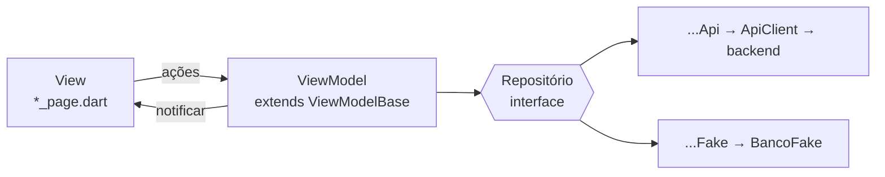

# 09 — Frontend (app Flutter)

Referência da arquitetura do app. O passo a passo com a "receita" de uma tela está na [trilha/16](../trilha/16-app-fundamentos.md); a introdução ao MVVM, na [trilha/06](../trilha/06-flutter-essencial-e-mvvm.md).

## Padrão: MVVM com `ChangeNotifier`

| Peça | Responsabilidade | Regra |
|---|---|---|
| **View** (`StatefulWidget`) | desenhar, navegar, SnackBar, diálogos | cria o ViewModel no `initState`, descarta no `dispose`, redesenha com `ListenableBuilder` |
| **ViewModel** | estado da tela e ações | estende `ViewModelBase`; dependências pelo construtor, tipadas pela **interface**; estado privado + getters; ações com `executar(...)` |
| **Repositório** | buscar e gravar | interface + `...Api` + `...Fake` no mesmo arquivo |

Por que não Riverpod/Bloc/Provider: [ADR-005](adr/ADR-005-app-mvvm-changenotifier.md).

## `ViewModelBase` (`core/mvvm/view_model_base.dart`)

| Membro | Para quê |
|---|---|
| `bool ocupado` | ação em andamento (spinner, botão desabilitado) |
| `String? erro` | mensagem pronta para exibir |
| `Future<bool> executar(acao)` | liga `ocupado`, roda a ação, converte `ErroAmigavel` em `erro`, desliga `ocupado`, notifica. Ignora chamadas enquanto ocupado |
| `limparErro()`, `definirErro()` | controle manual do erro |
| `notificar()` | `notifyListeners()` só se o ViewModel ainda não foi descartado |

> Dentro de um `executar`, não chame outro método que também use `executar`: use um método privado (`_buscar()`). Ver a "armadilha nº 1" da [trilha/16](../trilha/16-app-fundamentos.md).

Erros "amigáveis" (`ErroAmigavel`): `ApiException` (API), `LocalizacaoException` (GPS), `ErroDeRegra` (regra do app). Qualquer outro erro vira "Algo deu errado. Tente novamente." e é registrado no console.

## Repositórios (`lib/data/`)

| Interface | Métodos | Rotas |
|---|---|---|
| `AuthRepository` | `cadastrar`, `entrar`, `contaAtual` | `/auth/*` |
| `DoacaoRepository` | `criar`, `listarMinhas`, `detalhar`, `cancelar`, `listarProximas({raioKm})` | `/doacoes*`, `/proximas` |
| `ReservaRepository` | `reservar`, `listarMinhas`, `cancelar`, `confirmarRetirada` | `/reservas*` |
| `SistemaRepository` | `verificar` | `GET /` |
| `LocalizacaoService` | `obterAtual` | GPS do aparelho |

O `BancoFake` aplica **as mesmas regras e códigos de erro** do backend (usa os validadores do `shared_models`), com duas diferenças propositais: prazo de reserva de 2 minutos e uma "doação surpresa" a cada 45 s.

## `ApiClient` (`core/api/api_client.dart`)

Único ponto que faz HTTP: monta a URL a partir de `AppConfig.urlApi`, coloca `Authorization: Bearer` com o token salvo, codifica/decodifica JSON em **UTF-8**, aplica tempo limite de 15 s e converte erros em `ApiException` (`SEM_CONEXAO`, `TEMPO_ESGOTADO`, `RESPOSTA_INVALIDA` ou o `codigo` do backend).

## Sessão (`core/sessao/`)

- `Sessao`: `iniciar(resposta)` (salva o token e a conta), `restaurar(conta)`, `encerrar()`, getters `conta`, `usuario`, `perfil`, `logado`.
- `ArmazenamentoToken`: `ArmazenamentoTokenSeguro` (Keystore, via `flutter_secure_storage`) ou `ArmazenamentoTokenMemoria` (Fake e testes).
- Ao abrir o app, a `EscolhaPerfilPage` chama `GET /auth/me`; se o token for válido, pula para o início do perfil.

## Rotas (`core/routing/`)

| Constante | Caminho | Página | Argumento |
|---|---|---|---|
| `AppRoutes.inicio` | `/` | `EscolhaPerfilPage` | — |
| `AppRoutes.login` | `/login` | `LoginPage` | `TipoUsuario` |
| `AppRoutes.cadastro` | `/cadastro` | `CadastroPage` | `TipoUsuario` |
| `AppRoutes.inicioDoador` | `/doador` | `HomeDoadorPage` | — |
| `AppRoutes.novaDoacao` | `/doador/nova-doacao` | `NovaDoacaoPage` | — |
| `AppRoutes.detalheDoacaoDoador` | `/doador/doacao` | `DetalheDoacaoDoadorPage` | `int` (id) |
| `AppRoutes.inicioOng` | `/ong` | `HomeOngPage` | — |
| `AppRoutes.detalheDoacaoOng` | `/ong/doacao` | `DetalheDoacaoOngPage` | `int` (id) |
| `AppRoutes.minhasReservas` | `/ong/reservas` | `MinhasReservasPage` | — |
| `AppRoutes.mapa` | `/ong/mapa` | `MapaPage` | — |

O `AppRouter` protege as rotas: sem login, só `inicio`, `login` e `cadastro` abrem. **Os construtores das páginas são o contrato** e não mudam.

## Configuração (`core/config/app_config.dart`)

| Constante | Origem | Padrão |
|---|---|---|
| `urlApi` | `--dart-define=API_URL=...` | `http://10.0.2.2:8080` |
| `usarFake` | `--dart-define=USAR_FAKE=true` | `false` |
| `nomeApp` | código | `Doação de Alimentos` |
| `intervaloAtualizacao` | código | 15 s |
| `identificadorApp` | código | `br.edu.umc.summit_app` (exigido pelo OpenStreetMap) |

Perfis prontos no `.vscode/launch.json`. Ver [13 — Variáveis](13-variaveis-ambiente.md).

## Componentes compartilhados (`shared/widgets/`)

| Widget | Uso |
|---|---|
| `PrimaryButton(texto, onPressed, carregando)` | botão principal com spinner |
| `AppTextField(label, controller, validator, obscure, keyboardType, prefixIcon)` | campo de formulário padrão |
| `DoacaoCard(doacao, onTap, novidade)` | cartão das listas; `novidade: true` mostra a etiqueta NOVA |
| `ContadorRegressivo(expiraEm, aoExpirar)` | HH:MM:SS atualizado a cada segundo |
| `CarregandoWidget`, `ErroWidget(mensagem, onTentar)`, `VazioWidget(texto, icone)` | os estados de uma lista |
| `EmConstrucao` | placeholder do Sprint 0 |

Utilitários: `Formatador.data/hora/diaHora/duracao/distancia` (converte UTC para o horário do aparelho) e `AppColors` (`verde`, `verdeClaro`, `laranja`, `cinza`, `erro`, `fundo`).

## Testes do app

- ViewModels: `Dependencias.fake(banco: BancoFake(atrasoDeRede: Duration.zero, simularNovasDoacoes: false))`.
- `ApiClient`: `MockClient` do pacote `http`.
- Widgets: `testWidgets` com `MaterialApp(home: ...)` (evite telas com mapa ou contador).

Ver [16 — Testes](16-testes.md).
