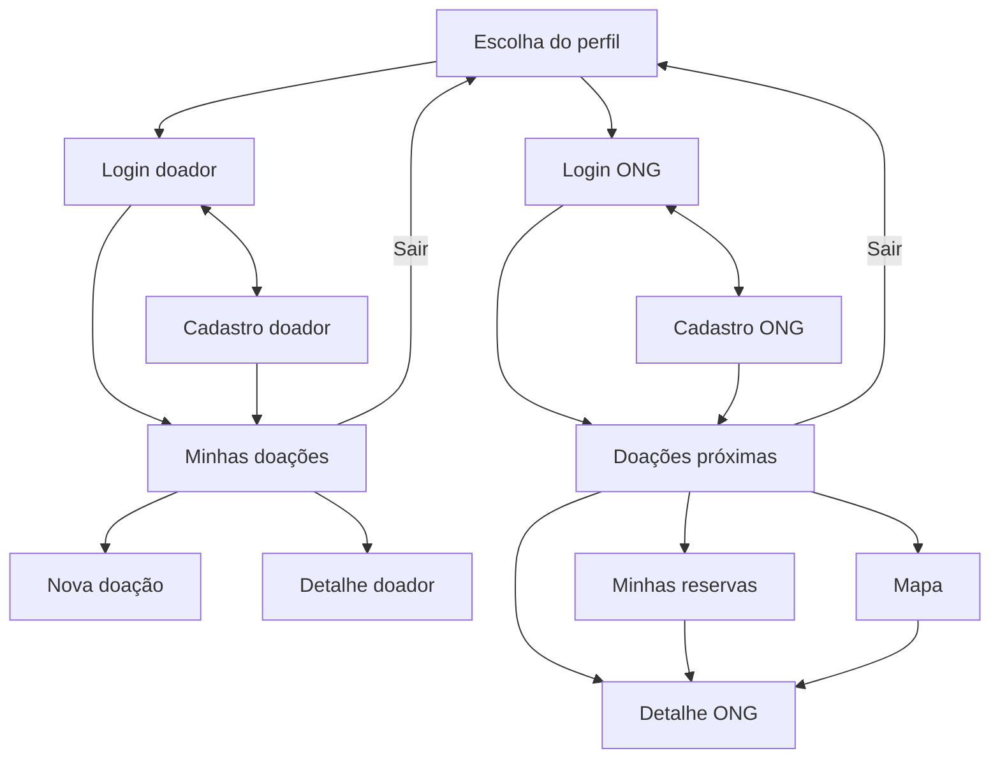

# 10 — Telas

Todas as telas do app, com o que cada uma mostra e faz. O passo a passo de design (wireframes, cores, acessibilidade) está na [trilha/09](../trilha/09-design-de-telas.md); o código, nas etapas indicadas.

## Mapa de navegação

## Telas

| # | Tela | Arquivo (`features/...`) | Quem usa | Responsável | Trilha |
|---|---|---|---|---|---|
| T1 | Escolha do perfil | `auth/presentation/escolha_perfil_page.dart` | todos | fundação (pronta) | 16 |
| T2 | Login | `auth/presentation/login_page.dart` | todos | P1 | 17 |
| T3 | Cadastro | `auth/presentation/cadastro_page.dart` | todos | P1 | 17 |
| T4 | Minhas doações | `doador/presentation/home_doador_page.dart` | doador | P2 | 18 |
| T5 | Nova doação | `doador/presentation/nova_doacao_page.dart` | doador | P2 | 18 |
| T6 | Detalhe (doador) | `doador/presentation/detalhe_doacao_doador_page.dart` | doador | P2 | 18 |
| T7 | Doações próximas | `ong/presentation/home_ong_page.dart` | ONG | P5 | 19 |
| T8 | Detalhe (ONG) | `ong/presentation/detalhe_doacao_ong_page.dart` | ONG | P5 (+P3) | 19 |
| T9 | Minhas reservas | `ong/presentation/minhas_reservas_page.dart` | ONG | P5 | 19 |
| T10 | Mapa | `mapa/presentation/mapa_page.dart` | ONG | P4 | 20 |

### T1 — Escolha do perfil
Logo, nome do app, frase de apresentação, botões **Sou estabelecimento doador** e **Sou ONG**, status do servidor ("Servidor online", "Modo demonstração" ou erro com "Tentar de novo"). Com sessão salva válida, pula direto para T4 ou T7.

### T2 — Login
E-mail, senha, **Entrar** (spinner), mensagem de erro, link **Ainda não tenho conta**. Recusa conta de outro tipo ("Esta conta é de Doador...").

### T3 — Cadastro
Seus dados (nome, e-mail, senha), dados da organização (nome, telefone e endereço opcionais), localização (**Usar minha localização** + latitude/longitude editáveis), **Criar conta**. Entra logado ao concluir.

### T4 — Minhas doações
Cabeçalho "*Organização* • *n* aguardando ONG", lista de `DoacaoCard` com o status, puxar para atualizar, botão flutuante **Nova doação**, **Sair**. Estados: carregando, erro com "Tentar novamente", vazio com orientação.

### T5 — Nova doação
Título, quantidade, descrição, categoria (lista), validade (calendário), retirar a partir de / até (calendário + relógio), **declaração** obrigatória, **Publicar doação**. Mensagem de erro com a primeira regra violada.

### T6 — Detalhe (doador)
Dados da doação e status. Se reservada: nome da ONG e **contador regressivo**, botão **Confirmar retirada**. Se disponível: **Cancelar doação** (com confirmação).

### T7 — Doações próximas
Cabeçalho com organização e raio, lista ordenada pela distância, etiqueta **NOVA** e SnackBar para doações novas (atualização a cada 15 s), menu de raio (2/5/10/20 km), atalhos para **Mapa** e **Minhas reservas**, **Sair**.

### T8 — Detalhe (ONG)
Dados da doação, nome do doador, endereço. **Reservar**; depois de reservar, contador, **Confirmar retirada** e **Desistir da reserva**. Tela própria para "Outra ONG reservou antes" e para "Retirada confirmada".

### T9 — Minhas reservas
Abas **Ativas** (com contador; toque abre T8) e **Histórico** (Retirada, Expirada, Cancelada com data).

### T10 — Mapa
OpenStreetMap centrado na ONG (casa azul), marcadores verdes das doações, chip com a quantidade, cartão da doação tocada com **Ver detalhes**, créditos do OpenStreetMap.

## Padrões visuais

| Item | Padrão |
|---|---|
| Cor principal | `AppColors.verde` (#2E7D32) — app bar, botões |
| Destaque | `AppColors.laranja` — novidade, contador, reservada |
| Erro | `AppColors.erro` |
| Botões | altura 52, cantos de 12 |
| Status | etiqueta com **texto** + cor (nunca só cor) |
| Ícones sem texto | sempre com `tooltip` |
| Datas | `Formatador` (horário do aparelho) |
