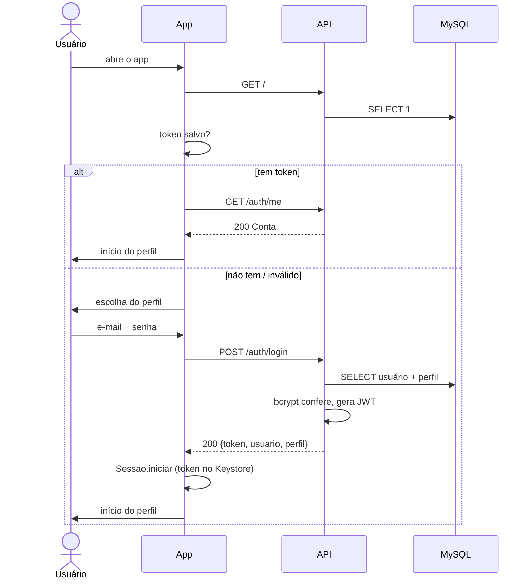
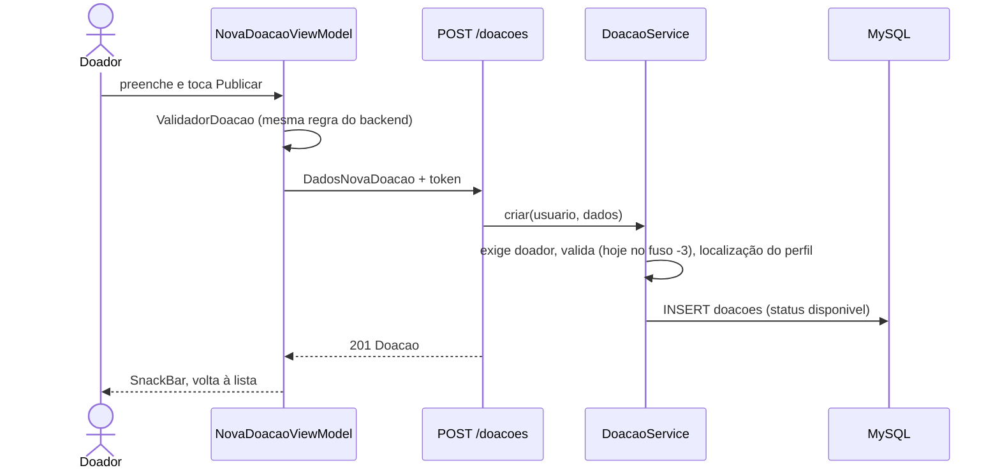
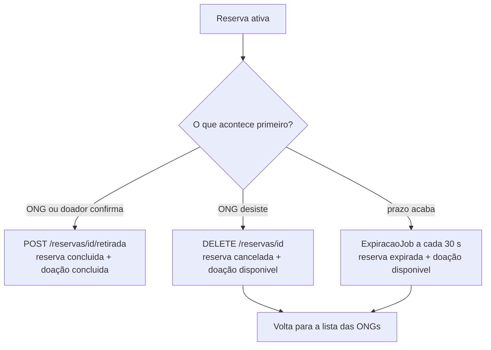
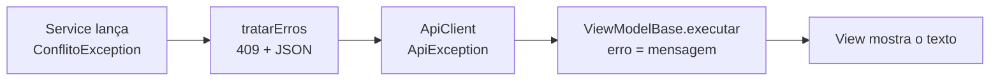

# 11 — Fluxos

Os principais fluxos do sistema, do toque na tela até o banco.

## 1. Primeiro acesso e login



## 2. Doador publica uma doação



## 3. ONG descobre e reserva

```mermaid
sequenceDiagram
    actor O as ONG
    participant H as HomeOngViewModel
    participant P as GET /proximas
    participant R as POST /reservas
    participant DB as MySQL
    loop a cada 15 s
        H->>P: listarProximas(raioKm)
        P->>DB: caixa de lat/lng + status + janela
        P-->>H: lista com distanciaKm (ordenada)
        H->>H: ids novos? → etiqueta NOVA + SnackBar
    end
    O->>R: reservar(doacaoId)
    R->>DB: BEGIN; SELECT ... FOR UPDATE
    alt ainda disponível
        R->>DB: UPDATE doacoes → reservada; INSERT reserva; COMMIT
        R-->>O: 201 Reserva (contador)
    else outra ONG chegou antes
        R->>DB: ROLLBACK
        R-->>O: 409 DOACAO_INDISPONIVEL
    end
```

## 4. Fim de uma reserva



## 5. Estados

| Doação | Significa | Pode ir para |
|---|---|---|
| `disponivel` | ONGs podem reservar (se a janela estiver aberta) | `reservada`, `cancelada` |
| `reservada` | uma ONG está com ela | `disponivel` (expirou / desistiu), `concluida` |
| `concluida` | retirada feita | — |
| `cancelada` | o doador cancelou | — |

| Reserva | Significa | Pode ir para |
|---|---|---|
| `ativa` | prazo correndo | `concluida`, `expirada`, `cancelada` |
| `concluida` | retirada feita | — |
| `expirada` | prazo acabou | — |
| `cancelada` | a ONG desistiu | — |

## 6. Tratamento de erros (qualquer fluxo)



A mensagem que o usuário vê é a mesma que o Service escreveu. No modo Fake, o `BancoFake` lança a mesma `ApiException` com o mesmo código.
