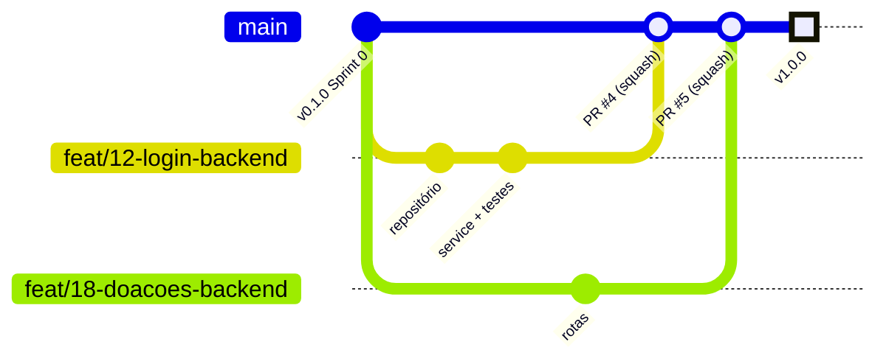

# 14 — Git e trabalho em equipe

Referência rápida. O passo a passo para quem nunca usou Git (instalar, configurar, primeiro PR, resolver conflito) está na [trilha/04](../trilha/04-git-e-github-do-zero.md). As regras curtas estão no [CONTRIBUTING.md](../CONTRIBUTING.md).

## Modelo: GitHub Flow



- A `main` está **sempre funcionando** e protegida: só entra por **Pull Request** com 1 aprovação e **CI verde**.
- Cada tarefa = 1 issue = 1 branch = 1 PR.
- Merge sempre com **Squash and merge** (um commit limpo por PR, autor preservado).

## Nomes

| O quê | Padrão | Exemplo |
|---|---|---|
| Branch | `tipo/numero-descricao` | `feat/12-login-backend`, `fix/30-contador-negativo`, `docs/41-manual` |
| Commit | Conventional Commits, em português, verbo no presente | `feat(reservas): expira reservas vencidas` |
| PR | título igual ao commit principal; descrição com `Fecha #12` | |

Tipos: `feat`, `fix`, `test`, `docs`, `refactor`, `chore`.

## Ciclo de uma tarefa

```powershell
git switch main; git pull
git switch -c feat/12-login-backend
# programa em commits pequenos
git add desenvolvimento_app/backend/lib/auth
git commit -m "feat(auth): repositório de usuários"
# antes do PR: tarefa "Tudo: verificar antes do PR"
git push -u origin feat/12-login-backend
```

No GitHub: **Compare & pull request** → preencha o modelo → peça revisão (o `CODEOWNERS` já sugere o dono da pasta).

## Revisão de código (quem revisa)

Use o modelo do PR como roteiro. Verifique:

- [ ] Faz o que a issue pede (critérios de aceite)?
- [ ] Mexeu só nos arquivos da própria fatia? Se mexeu em fundação, foi combinado?
- [ ] Tem testes para as regras?
- [ ] Sem `.env`, senha, token ou `print` esquecido?
- [ ] Nomes claros e em português?
- [ ] Você conseguiu rodar a branch na sua máquina?

Comente com gentileza e sugestão concreta ("que tal extrair para `_buscar()`?"). Aprovar com pequenos ajustes é permitido.

## Quem é dono de quê

| Pasta | Dono |
|---|---|
| `backend/lib/auth`, `routes/auth`, `app/lib/features/auth`, `shared_models` | P1 |
| `backend/lib/doacoes`, `routes/doacoes`, `app/lib/features/doador` | P2 |
| `backend/lib/reservas`, `routes/reservas` | P3 |
| `backend/lib/proximidade`, `routes/proximas`, `app/lib/features/mapa`, `database/`, `.github/` | P4 |
| `app/lib/features/ong` | P5 |
| Fundação (`core/`, `data/`, `main.dart`, `app.dart`, roteador, pubspecs) e `docs/` | líder (todos combinam) |

Configurado em `.github/CODEOWNERS` (trocar os usuários no Sprint 0).

## Conflitos de merge

Com as pastas por dono, conflitos devem ser raros. Quando acontecerem:

1. `git switch main; git pull; git switch <sua-branch>; git merge main`
2. O VS Code mostra os trechos com **Accept Current / Incoming / Both**. Escolha com calma; na dúvida, chame o dono do outro trecho.
3. Rode a tarefa de verificação, faça `git commit` e `git push`.

Passo a passo com exemplo: [trilha/04](../trilha/04-git-e-github-do-zero.md).

## Versões e tags

| Tag | Quando |
|---|---|
| `v0.1.0` | fim do Sprint 0 (esqueleto funcional) |
| `v0.2.0`, `v0.3.0` | fim das sprints 1 e 2 (opcional) |
| `v0.9.0` | integração concluída, funcionalidades congeladas |
| `v1.0.0` | entrega final, com release e APK |

Registre cada versão no `CHANGELOG.md`.

## Nunca

- Commitar direto na `main` ou usar `git push --force` nela.
- Subir o `.env`.
- Mesclar PR com a CI vermelha.
- Editar o arquivo de outra pessoa sem combinar.
