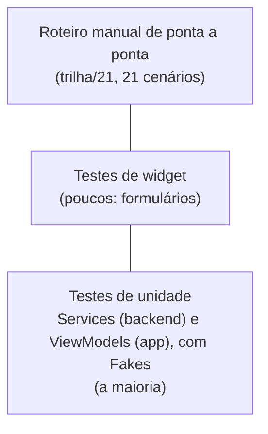

# 16 — Testes

Estratégia proporcional a um projeto acadêmico: **todas as regras de negócio** têm teste automático; telas, SQL e infraestrutura são verificados por um **roteiro manual** de ponta a ponta.

## A pirâmide do projeto



| Tipo | O que prova | Onde | Ferramenta |
|---|---|---|---|
| Unidade — modelos e validações | regras do `shared_models` (validade, janela, Haversine, fuso) | `shared_models/test/` | `package:test` |
| Unidade — Services | regras de negócio e autorização do backend | `backend/test/<fatia>/` | `package:test` + repositório **em memória** |
| Unidade — core do backend | datas, mapeador, token, exceções | `backend/test/core/` | `package:test` |
| Unidade — ViewModels | estado e ações das telas | `app/test/features/<area>/` | `flutter_test` + `Dependencias.fake(...)` |
| Unidade — `ApiClient` e `BancoFake` | HTTP, erros, regras do Fake | `app/test/core/`, `app/test/data/` | `MockClient` do pacote `http` |
| Widget | validação de formulário, elementos na tela | `app/test/features/auth/` | `testWidgets` |
| Manual (integração) | app + API + MySQL juntos, concorrência real, `FOR UPDATE`, índice único | [trilha/21](../trilha/21-integracao-e-testes.md) | roteiro + `api.http` |

## Princípios

1. **Sem banco nos testes automáticos.** Os Services recebem a **interface** do repositório; nos testes entregamos uma versão em memória. Por isso a CI roda sem MySQL.
2. **Sem relógio real.** `RelogioFixo` com datas fixas; `relogio.avancar(...)` simula a passagem do tempo (expiração em milissegundos).
3. **Sem rede no app.** `Dependencias.fake(banco: BancoFake(atrasoDeRede: Duration.zero, simularNovasDoacoes: false))`.
4. **Fakes escritos à mão**, sem bibliotecas de mock: ensinam polimorfismo e são fáceis de ler.
5. **Bug encontrado = teste novo** que falha antes da correção (teste de regressão).

## Testes por fatia

| Fatia | Arquivo | Quantos | Etapa |
|---|---|---|---|
| Auth (backend) | `backend/test/auth/auth_service_test.dart` | 5 | 12 |
| Doações (backend) | `backend/test/doacoes/doacao_service_test.dart` | 7 | 13 |
| Proximidade (backend) | `backend/test/proximidade/proximidade_service_test.dart` | 5 | 14 |
| Reservas (backend) | `backend/test/reservas/reserva_service_test.dart` | 8 | 15 |
| Auth (app) | `app/test/features/auth/login_cadastro_test.dart` | 7 | 17 |
| Doador (app) | `app/test/features/doador/doador_view_models_test.dart` | 7 | 18 |
| ONG (app) | `app/test/features/ong/ong_view_models_test.dart` | 6 | 19 |
| Mapa (app) | `app/test/features/mapa/mapa_view_model_test.dart` | 3 | 20 |

Os testes de **fundação** já existentes (`shared_models/test`, `backend/test/core`, `app/test/core`, `app/test/data`, `app/test/features/auth/escolha_perfil_test.dart`) servem de exemplo.

## Como rodar

| Onde | Comando | Tarefa do VS Code |
|---|---|---|
| Tudo | — | **Tudo: verificar antes do PR** |
| `shared_models` | `dart test` | **Modelos: testes** |
| `backend` | `dart test` | **Backend: testes** |
| `app` | `flutter test` | **App: testes** |
| Um arquivo | `dart test test/reservas/reserva_service_test.dart` | — |
| Cobertura do app | `flutter test --coverage` | — |

A **CI** roda tudo a cada Pull Request. PR com teste vermelho não é mesclado.

## Exemplo mínimo (Arrange → Act → Assert)

```dart
test('reserva com prazo de agora + 2 h', () async {
  // Arrange
  final relogio = RelogioFixo(DateTime.utc(2026, 9, 15, 12));
  final service = ReservaService(
    reservas: ReservaRepositoryEmMemoria([doacaoDisponivel]),
    relogio: relogio,
    prazo: const Duration(hours: 2),
  );

  // Act
  final reserva = await service.reservar(ong, doacaoDisponivel.id);

  // Assert
  expect(reserva.expiraEm, DateTime.utc(2026, 9, 15, 14));
});
```

## O que NÃO é testado automaticamente (e por quê)

| Item | Motivo | Como é verificado |
|---|---|---|
| SQL dos repositórios MySQL | exigiria MySQL na CI | roteiro manual + `api.http` |
| `FOR UPDATE` e o índice único | comportamento do MySQL | teste com duas ONGs e o `INSERT` direto no Workbench (trilha 15) |
| Tela do mapa | baixa tiles da internet | roteiro manual (trilha 20) |
| GPS real | depende do aparelho | emulador com posição definida |

Registrar essas decisões no relatório de testes ([trilha/21](../trilha/21-integracao-e-testes.md)) mostra maturidade: testar não é "cobrir 100%", é saber **o que** cada teste prova.
