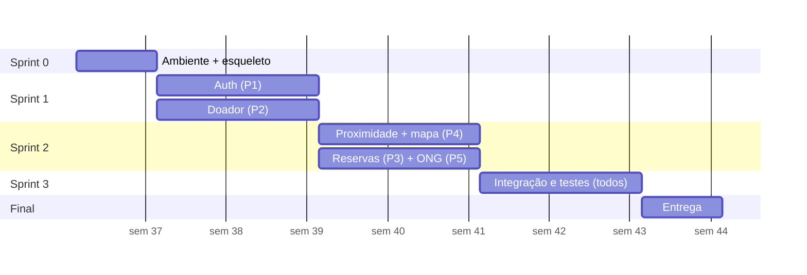

# 20 — Roadmap

## Princípio

> Primeiro o **caminho feliz ponta a ponta** (cadastro → doação → reserva → retirada), depois os detalhes. Um app simples que funciona inteiro vale mais que muitas telas pela metade.

## Calendário (8 semanas)

Detalhes do processo (Scrum adaptado, cerimônias, histórias) na [trilha/02](../trilha/02-processo-e-planejamento.md).

| Sprint | Semanas | Entrega | Etapas da trilha | Tag |
|---|---|---|---|---|
| 0 | 1 | Ambiente de todos funcionando; esqueleto rodando app → API → banco; CI verde | 01 a 11 | `v0.1.0` |
| 1 | 2–3 | Autenticação e doações no backend; login, cadastro e telas do doador | 12, 13, 17, 18 | `v0.2.0` |
| 2 | 4–5 | Proximidade e reservas no backend; telas da ONG e mapa | 14, 15, 19, 20 | `v0.3.0` |
| 3 | 6–7 | Integração no modo API; roteiro de testes; correções; acessibilidade | 21 | `v0.9.0` |
| Final | 8 | Documentação, release, ensaio da apresentação (semana de folga proposital) | 22 | `v1.0.0` |

> As datas do gráfico são ilustrativas: ajustem ao calendário real da disciplina. Na prática, as fatias **andam em paralelo** desde a semana 2 (modo Fake e `gerar_token.dart`), então P4 e P3 podem começar no Sprint 1 se tiverem tempo.

## MVP (entrega)

Todos os requisitos marcados como **MVP** em [02 — Requisitos](02-requisitos.md): cadastro e login, doações com validade e declaração, doações próximas com aviso de novidade, mapa, reserva com prazo e expiração automática, desistência, confirmação de retirada e histórico.

## Se sobrar tempo (antes do congelamento)

| Ideia | Dono natural | Esforço |
|---|---|---|
| Filtro por categoria na lista da ONG | P5 | P |
| Vibração/som ao chegar doação nova | P5 | P |
| Tela de perfil (editar telefone/endereço) | P1 | M |
| Contador de impacto ("X doações concluídas") no início do doador | P2 | P |
| Raio preferido salvo por ONG | P4 | M |

## Evoluções futuras (pós-entrega)

- **Push com o app fechado** (Firebase Cloud Messaging).
- **WebSocket** para avisos instantâneos ([apêndice B](../trilha/apendice-b-websocket-opcional.md)).
- **Fotos** das doações.
- **Administrador**: moderação e **métricas de impacto** (kg de alimento salvos, famílias atendidas), reforçando os ODS 2 e 12.
- Avaliações entre doadores e ONGs; chat.
- Recuperação de senha; exclusão de conta (LGPD).
- Publicação da API ([19 — Deploy](19-deploy.md)) e do app na Play Store.
