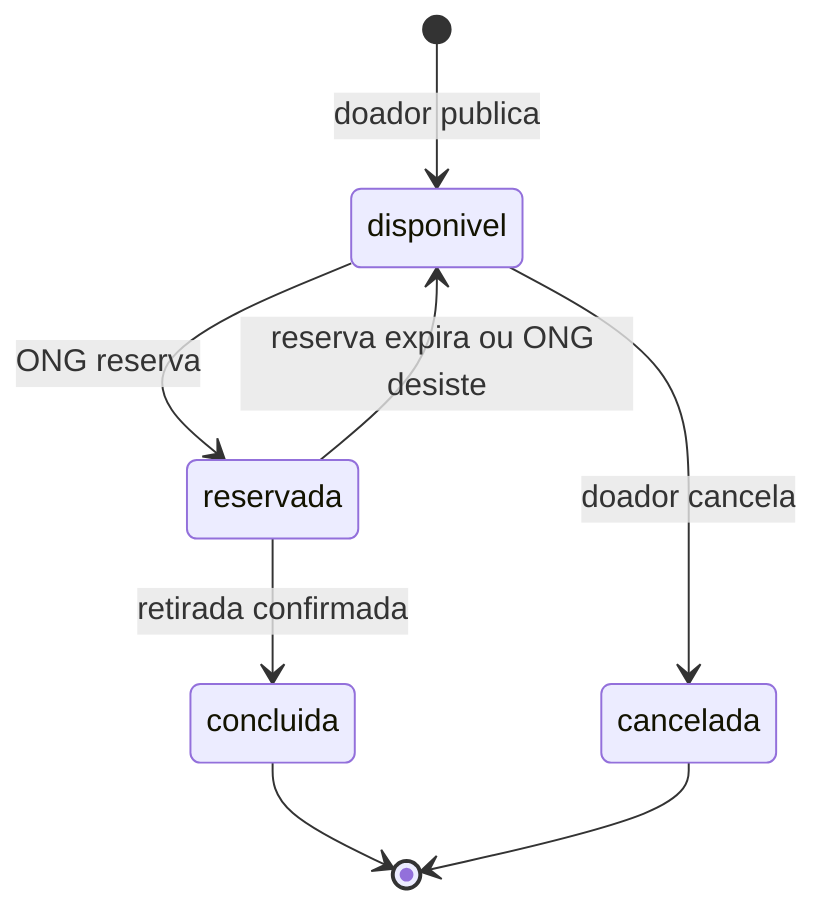

# 01 — Entendendo o projeto

**Objetivo:** todos saberem o que será construído, para quem e o que está fora do escopo.
**Quem:** todos, juntos (na reunião de kickoff).

---

## 1. O problema

Supermercados, feiras, sacolões e padarias descartam diariamente alimentos ainda próprios para consumo, porque estão perto do vencimento ou fora do padrão estético de venda. Ao mesmo tempo, ONGs que alimentam famílias vulneráveis não sabem **onde** e **quando** esse excedente está disponível.

O projeto está ligado a dois Objetivos de Desenvolvimento Sustentável da ONU:

- **ODS 2 — Fome Zero**
- **ODS 12 — Consumo e Produção Responsáveis**

> Contexto legal (para o relatório): a **Lei nº 14.016/2020** trata do combate ao desperdício e da doação de excedentes de alimentos para consumo humano. Vale citar na introdução do trabalho.

## 2. A solução (escopo aprovado)

Uma **plataforma digital** (app Android) que intermedia doações de alimentos entre estabelecimentos e organizações sociais. Em resumo, um "iFood da doação":

1. O **doador** anuncia um excedente: o que é, quantidade, validade, onde e até quando retirar.
2. As **ONGs próximas** veem a doação aparecer na lista, com um aviso de novidade.
3. Uma ONG **reserva** a doação e ganha um **prazo** para buscar.
4. Na retirada, a ONG (ou o doador) **confirma** e a doação é concluída.
5. Se o prazo **expirar** sem retirada, a reserva cai e a doação **volta a aparecer** para as outras ONGs.

O escopo aprovado também diz que a plataforma **não se destina a produtos vencidos ou impróprios**. Por isso:

- a validade não pode ser anterior a hoje;
- o doador precisa **declarar** que os alimentos estão próprios para consumo.

## 3. Personas

| Persona | Quem é | Objetivo | Dor |
|---|---|---|---|
| **Doador** | Gerente de mercado, feirante, dono de padaria | Destinar o excedente rápido, sem burocracia | Não sabe para quem doar; o alimento estraga antes de alguém buscar |
| **ONG** | Coordenador(a) de ONG ou projeto social | Conseguir alimentos perto da sua sede | Não sabe onde há doações; chega tarde |

## 4. O que está no MVP e o que não está

| No MVP | Fora do MVP (evoluções futuras) |
|---|---|
| Cadastro e login de doador e de ONG | Recuperação de senha por e-mail |
| Doador cria, lista, vê e cancela doações | Fotos das doações |
| ONG vê doações próximas (raio configurável) e mapa | Notificação push com o app fechado |
| Aviso de nova doação **com o app aberto** (a cada 15 s) | Chat entre doador e ONG |
| Reserva com prazo; expiração automática; cancelamento | Avaliações e reputação |
| Confirmação de retirada (ONG ou doador) | Painel de administração e relatórios de impacto |
| Histórico de reservas da ONG | Publicação na Play Store |

> Por que o aviso é "com o app aberto"? Avisar com o app fechado exige push notification (Firebase), que está fora do escopo. A decisão está no [ADR-008](../docs/adr/ADR-008-polling-no-mvp.md).

## 5. Glossário

| Termo | Significado no projeto |
|---|---|
| **Doação** | Um anúncio de excedente feito por um doador |
| **Janela de retirada** | Intervalo (início e fim) em que a ONG pode buscar |
| **Reserva** | Uma ONG "segura" a doação para si |
| **Prazo da reserva** | Tempo para a ONG retirar (padrão 120 min; nunca passa do fim da janela) |
| **Expiração** | O prazo acabou sem retirada; a doação volta a ficar disponível |
| **Raio** | Distância máxima (km) para uma doação ser "próxima" da ONG |
| **Perfil** | Dados da organização (nome, telefone, endereço, localização) |

## 6. Ciclo de vida (o coração do sistema)

Leia o diagrama com o grupo e respondam juntos:

1. Uma doação **reservada** pode ser cancelada pelo doador? (Não: só "disponível".)
2. O que acontece quando a ONG desiste? (A doação volta a "disponível".)
3. Duas ONGs podem reservar a mesma doação? (Não; o banco e o código impedem.)

## 7. Tecnologias (resumo)

| Parte | Tecnologia | Detalhe |
|---|---|---|
| App | Flutter (Dart) | MVVM, Android |
| Backend | Dart Frog (Dart) | API REST |
| Banco | MySQL 8.4 LTS | Instalado na máquina; Docker é opcional |
| Compartilhado | `shared_models` (Dart) | Modelos e validações usados pelo app e pelo backend |
| Equipe | Git + GitHub | Branches, Pull Requests, CI |
| Editor | VS Code | Extensões e configurações no repositório |

A justificativa de cada escolha está em [docs/23 — Análise técnica](../docs/23-analise-tecnica.md).

---

## Checklist

- [ ] Todos sabem explicar o ciclo de vida da doação sem olhar o diagrama
- [ ] Todos sabem o que está fora do MVP
- [ ] O grupo leu o glossário e usa os mesmos termos
