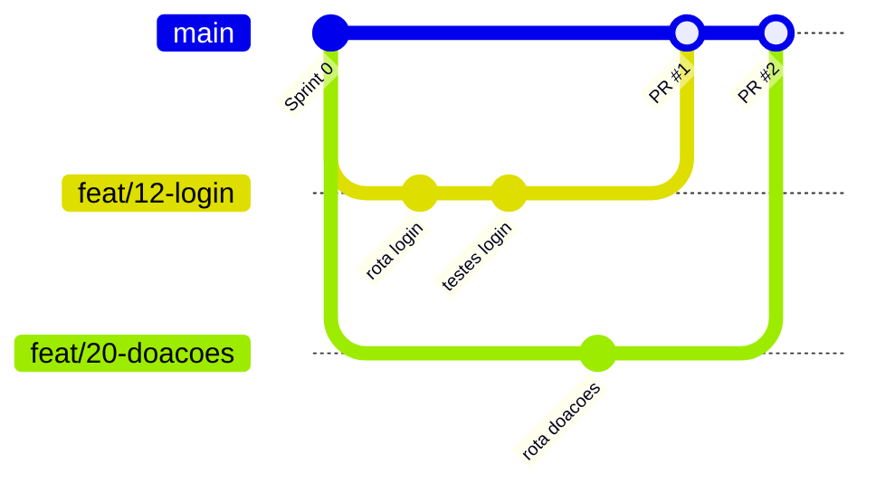

# 04 — Git e GitHub do zero (trabalhando em 5 sem atrapalhar ninguém)

**Objetivo:** entender os conceitos, configurar o repositório da equipe e praticar o fluxo completo, incluindo resolver um conflito.
**Quem:** todos. A parte 3 é feita pelo **líder**; as partes 4 a 7, por todos.

---

## 1. Conceitos com analogias

| Conceito | Analogia | O que é de verdade |
|---|---|---|
| **Repositório** | Pasta do projeto com "máquina do tempo" | Pasta com o histórico completo de mudanças (`.git`) |
| **Commit** | Uma foto salva do projeto, com legenda | Registro de um conjunto de mudanças, com autor, data e mensagem |
| **Branch** | Uma cópia de rascunho, só sua | Linha de desenvolvimento independente; a principal é a `main` |
| **Remoto (origin)** | A cópia "oficial" na nuvem | O repositório no GitHub |
| **push / pull** | Enviar / buscar fotos novas | Sincronizar commits com o GitHub |
| **Pull Request (PR)** | "Posso juntar meu rascunho ao oficial?" | Pedido de revisão e mesclagem de uma branch na `main` |
| **Merge** | Juntar o rascunho ao oficial | Incorporar os commits de uma branch em outra |
| **Conflito** | Duas pessoas mudaram a mesma frase | O Git não sabe qual versão manter e pede ajuda |



**Por que quase não haverá conflitos aqui:** cada pessoa trabalha em pastas próprias (a sua fatia), e os arquivos usados por todos (roteador, `main.dart`, `pubspec`) já vêm prontos do Sprint 0. Conflito só acontece quando duas pessoas mudam a **mesma linha** do **mesmo arquivo**.

## 2. Contas

Cada integrante cria uma conta gratuita em [github.com](https://github.com/). Estudantes podem pedir o **GitHub Student Developer Pack** (opcional).

## 3. Criando o repositório da equipe (líder)

1. Em [github.com/new](https://github.com/new): nome do repositório (ex.: `doacao-alimentos`), **Private**, **sem** README, .gitignore ou licença (já temos).
2. No seu computador, na pasta do projeto (onde está o `README.md` principal):
   ```powershell
   git init
   git add .
   git status            # confira: NÃO pode aparecer nenhum arquivo .env
   ```
3. **Antes do primeiro commit**, rode a tarefa do VS Code **"Tudo: verificar antes do PR"** (`Ctrl+Shift+P` > *Tasks: Run Task*). Isso formata o código; sem isso a CI falha logo no primeiro push. Detalhes na [etapa 10](10-sprint-0-esqueleto-funcional.md).
4. Primeiro commit e envio:
   ```powershell
   git add .
   git commit -m "chore: estrutura inicial do projeto (Sprint 0)"
   git branch -M main
   git remote add origin https://github.com/USUARIO/doacao-alimentos.git
   git push -u origin main
   ```
5. **Settings > Collaborators > Add people**: convide os 4 colegas.
6. **Settings > Branches > Add branch ruleset** (ou *Add rule*) para a `main`:
   - ✅ *Require a pull request before merging*, com **1 approval**
   - ✅ *Require status checks to pass*: selecione os 3 jobs da **CI** (aparecem depois da primeira execução)
   - ✅ *Block force pushes*
7. **Settings > General > Pull Requests**: deixe só **Allow squash merging** marcado e ative **Automatically delete head branches**.
8. Edite `.github/CODEOWNERS` com os usuários reais de cada um (em um PR!).

> Por que *squash merge*? Cada PR vira **um** commit na `main`, com o autor do PR. O histórico fica limpo e mostra claramente quem entregou cada funcionalidade.

## 4. Clonando (todos os outros)

```powershell
cd C:\dev
git clone https://github.com/USUARIO/doacao-alimentos.git
cd doacao-alimentos
code .
```

O VS Code abre e oferece instalar as extensões recomendadas: aceite.

## 5. O fluxo de todo dia

Você pode usar o terminal **ou** a aba **Source Control** do VS Code (`Ctrl+Shift+G`). Os dois fazem a mesma coisa.

| Passo | Terminal | VS Code |
|---|---|---|
| 1. Atualizar a main | `git switch main` e `git pull` | Barra inferior: clique no nome da branch > `main`; depois ⟳ (Sync) |
| 2. Criar branch | `git switch -c feat/12-login-backend` | Nome da branch > *Create new branch...* |
| 3. Ver mudanças | `git status` / `git diff` | Aba Source Control mostra os arquivos |
| 4. Preparar | `git add caminho/do/arquivo` | `+` ao lado do arquivo |
| 5. Commit | `git commit -m "feat: rota de login"` | Escreva a mensagem e ✓ Commit |
| 6. Enviar | `git push -u origin feat/12-login-backend` (1ª vez) e `git push` | *Publish Branch* / Sync |
| 7. PR | No GitHub: *Compare & pull request* | Idem |

Regras do PR:
- Título no padrão de commit: `feat: login no backend (HU02)`.
- Descrição com **"Fecha #12"** e **como testar** (o modelo já pede isso).
- Peça revisão (o `CODEOWNERS` faz isso sozinho).
- Espere a **CI verde** e **1 aprovação**; então **Squash and merge**.

### Convenção de nomes e commits

- Branch: `feat/NUMERO-descricao`, `fix/NUMERO-descricao`, `docs/...`, `test/...`.
- Commit: `feat:`, `fix:`, `test:`, `docs:`, `refactor:`, `chore:` (ver [CONTRIBUTING.md](../CONTRIBUTING.md)).

## 6. Revisando o PR de um colega (code review)

1. Aba **Files changed** do PR.
2. Clique no **+** ao lado de uma linha para comentar. Seja específico e gentil: *"Aqui a rota faz SQL direto; pela nossa regra deveria ficar no Repository. Pode mover?"*
3. Se quiser testar: `git fetch` e `git switch nome-da-branch`.
4. **Review changes**: *Approve* ou *Request changes*.

O que conferir: segue a arquitetura ([07](07-arquitetura-e-poo.md))? Tem teste? Nomes claros? Algum segredo no código? A CI passou?

## 7. Treino obrigatório: provocar e resolver um conflito

Façam juntos, em chamada, **antes** de começar a programar. Assim o primeiro conflito real não assusta.

1. O líder cria o arquivo `00_COMECE_AQUI/treino.md` com uma linha `Lanche da reunião: ?` e faz merge na `main`.
2. **Pessoa A** e **Pessoa B** atualizam a `main` e criam branches: `treino/a` e `treino/b`.
3. As duas mudam **a mesma linha** (`Lanche: pizza` e `Lanche: pastel`), fazem commit, push e abrem PR.
4. O líder faz merge do PR da Pessoa A. O PR da Pessoa B passa a mostrar **"This branch has conflicts"**.
5. A Pessoa B resolve na própria máquina:
   ```powershell
   git switch main
   git pull
   git switch treino/b
   git merge main
   ```
6. O VS Code mostra o arquivo com os marcadores:
   ```text
   <<<<<<< HEAD
   Lanche: pastel
   =======
   Lanche: pizza
   >>>>>>> main
   ```
   Clique em **Resolve in Merge Editor**, escolha (ou combine: `Lanche: pizza e pastel`) e clique em **Complete Merge**.
7. `git add 00_COMECE_AQUI/treino.md`, `git commit` (a mensagem já vem pronta) e `git push`. O PR fica sem conflito.
8. Repitam trocando as pessoas até todos terem resolvido um conflito. No fim, apaguem o arquivo em um PR.

## 8. Desfazendo erros comuns

| Situação | Comando |
|---|---|
| Descartar mudanças de um arquivo (ainda sem commit) | `git restore caminho/arquivo` |
| Tirar um arquivo do `git add` | `git restore --staged caminho/arquivo` |
| Corrigir a mensagem do último commit (antes do push) | `git commit --amend -m "nova mensagem"` |
| Desfazer um commit que **já foi enviado** | `git revert <id-do-commit>` (cria um commit que desfaz) |
| Comecei na `main` por engano (sem commit) | `git switch -c feat/minha-branch` (as mudanças vão junto) |
| Commitei o `.env` por engano | Avise o grupo, `git rm --cached .env`, commit, e **troque** a senha e o `JWT_SEGREDO` |

> Nunca use `git push --force` na `main`. A proteção da branch já bloqueia, mas não tente contornar.

---

## Checklist

- [ ] Repositório criado, privado, com os 5 integrantes
- [ ] `main` protegida (PR + 1 aprovação + CI + sem force push)
- [ ] Somente *squash merge* habilitado e branches apagadas após o merge
- [ ] Todos clonaram e abriram no VS Code
- [ ] Todos fizeram o treino de conflito
- [ ] `CODEOWNERS` com os usuários reais
