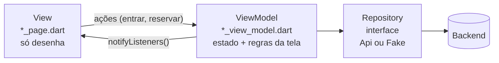

# 06 — Flutter essencial e MVVM

**Objetivo:** entender widgets, layout, navegação e formulários, e montar um primeiro ViewModel com `ChangeNotifier`, exatamente como no projeto.
**Quem:** todos.
**Como praticar:** crie um projeto de treino **fora** da pasta do repositório:

```powershell
cd C:\dev
flutter create treino_flutter
cd treino_flutter
code .
```

Rode com F5 (escolha o dispositivo no canto inferior direito do VS Code). Edite `lib/main.dart` e **salve**: o *hot reload* atualiza a tela na hora.

---

## 1. Tudo é widget

Uma tela Flutter é uma **árvore de widgets**: um widget dentro do outro.

```dart
import 'package:flutter/material.dart';

void main() => runApp(const MeuApp());

class MeuApp extends StatelessWidget {
  const MeuApp({super.key});

  @override
  Widget build(BuildContext context) {
    return MaterialApp(
      home: Scaffold(
        appBar: AppBar(title: const Text('Treino')),
        body: const Center(child: Text('Olá, Flutter!')),
      ),
    );
  }
}
```

- `MaterialApp`: o app, com tema e navegação.
- `Scaffold`: a estrutura de uma tela (barra superior, corpo, botão flutuante).
- `build()`: devolve o que aparece. O Flutter chama esse método sempre que precisa redesenhar.

## 2. `StatelessWidget` x `StatefulWidget`

| | `StatelessWidget` | `StatefulWidget` |
|---|---|---|
| Tem estado próprio? | Não | Sim, em uma classe `State` |
| Ciclo de vida | Só `build` | `initState` → `build` (várias vezes) → `dispose` |
| No projeto | Componentes simples (`DoacaoCard`) | Páginas (criam e descartam o ViewModel) |

```dart
class Contador extends StatefulWidget {
  const Contador({super.key});
  @override
  State<Contador> createState() => _ContadorState();
}

class _ContadorState extends State<Contador> {
  int _valor = 0;

  @override
  void initState() {
    super.initState(); // roda UMA vez, quando a tela nasce
  }

  @override
  void dispose() {
    super.dispose(); // roda UMA vez, quando a tela some: libere recursos aqui
  }

  @override
  Widget build(BuildContext context) => ElevatedButton(
        onPressed: () => setState(() => _valor++), // setState redesenha
        child: Text('Cliques: $_valor'),
      );
}
```

## 3. Layout

| Widget | Para quê |
|---|---|
| `Column` / `Row` | Empilhar na vertical / horizontal |
| `Padding`, `SizedBox` | Espaço interno / espaço fixo entre widgets |
| `Expanded` | Ocupar o espaço que sobra em uma `Row`/`Column` |
| `Center`, `Align` | Posicionar |
| `ListView.builder` | Listas longas e roláveis (cria os itens sob demanda) |
| `Card`, `ListTile` | Cartões e linhas de lista prontos |
| `SingleChildScrollView` | Rolar telas com formulário (o teclado ocupa espaço) |

```dart
Padding(
  padding: const EdgeInsets.all(16),
  child: Column(
    crossAxisAlignment: CrossAxisAlignment.stretch,
    children: [
      const Text('Título', style: TextStyle(fontSize: 20)),
      const SizedBox(height: 8),
      Row(children: const [Icon(Icons.place), SizedBox(width: 4), Text('1,2 km')]),
    ],
  ),
)
```

> Use o **Widget Inspector** (ícone na barra de debug do VS Code) para ver a árvore e os limites de cada widget.

## 4. Navegação

```dart
// Ir para outra tela (empilha)
Navigator.push(context, MaterialPageRoute(builder: (_) => const OutraTela()));

// Voltar
Navigator.pop(context);

// No projeto usamos ROTAS NOMEADAS com argumentos:
Navigator.pushNamed(context, AppRoutes.detalheDoacaoOng, arguments: 12);

// Trocar de tela sem deixar voltar (depois do login):
Navigator.pushNamedAndRemoveUntil(context, AppRoutes.inicioOng, (_) => false);
```

## 5. Formulários e validação

```dart
final _formulario = GlobalKey<FormState>();
final _email = TextEditingController();

Form(
  key: _formulario,
  child: Column(children: [
    TextFormField(
      controller: _email,
      decoration: const InputDecoration(labelText: 'E-mail'),
      validator: (valor) =>
          (valor == null || !valor.contains('@')) ? 'E-mail inválido' : null,
    ),
    ElevatedButton(
      onPressed: () {
        if (_formulario.currentState!.validate()) {
          print('válido: ${_email.text}');
        }
      },
      child: const Text('Enviar'),
    ),
  ]),
);
```

- O `validator` devolve `null` (válido) ou a mensagem de erro.
- **Sempre** chame `_email.dispose()` no `dispose()` da tela.
- No projeto, os validadores vêm prontos do `shared_models`: `validator: ValidadorUsuario.email`.

## 6. Mensagens e diálogos

```dart
ScaffoldMessenger.of(context).showSnackBar(
  const SnackBar(content: Text('Doação publicada!')),
);

final confirmou = await showDialog<bool>(
  context: context,
  builder: (context) => AlertDialog(
    title: const Text('Cancelar doação?'),
    actions: [
      TextButton(onPressed: () => Navigator.pop(context, false), child: const Text('Não')),
      TextButton(onPressed: () => Navigator.pop(context, true), child: const Text('Sim')),
    ],
  ),
);
```

> Depois de um `await`, confira `if (!mounted) return;` antes de usar o `context`: a tela pode ter sido fechada enquanto esperava.

## 7. O padrão MVVM (o jeito do projeto)

`setState` funciona para estado visual simples (um contador). Para dados que vêm da API, misturar tudo na tela vira bagunça. Por isso separamos:



| Camada | Responsabilidade | Não pode |
|---|---|---|
| **View** | Montar widgets e repassar ações | Chamar API, guardar dados de negócio |
| **ViewModel** | Guardar o estado da tela e executar ações | Importar widgets (exceto `foundation`) |
| **Repository** | Buscar e enviar dados | Saber que existe tela |

O **ViewModel** estende `ChangeNotifier` (padrão de projeto **Observer**): a View se "inscreve" e é avisada a cada `notifyListeners()`.

### Exercício guiado: contador em MVVM

Substitua o `lib/main.dart` do projeto de treino:

```dart
import 'package:flutter/material.dart';

// ---------------- ViewModel: estado + ações, sem widgets ----------------
class ContadorViewModel extends ChangeNotifier {
  int _valor = 0;
  bool _carregando = false;

  int get valor => _valor;
  bool get carregando => _carregando;

  Future<void> incrementarDevagar() async {
    _carregando = true;
    notifyListeners(); // avisa a View: mostre o "carregando"
    await Future.delayed(const Duration(seconds: 1)); // simula a API
    _valor++;
    _carregando = false;
    notifyListeners(); // avisa de novo: mostre o novo valor
  }
}

// ---------------- View: só desenha o que o ViewModel tem ----------------
class ContadorPage extends StatefulWidget {
  const ContadorPage({super.key});
  @override
  State<ContadorPage> createState() => _ContadorPageState();
}

class _ContadorPageState extends State<ContadorPage> {
  final _viewModel = ContadorViewModel();

  @override
  void dispose() {
    _viewModel.dispose(); // a página é dona do ViewModel
    super.dispose();
  }

  @override
  Widget build(BuildContext context) {
    return Scaffold(
      appBar: AppBar(title: const Text('MVVM')),
      body: Center(
        child: ListenableBuilder(
          listenable: _viewModel, // redesenha SÓ este trecho quando avisar
          builder: (context, _) => _viewModel.carregando
              ? const CircularProgressIndicator()
              : Text('${_viewModel.valor}', style: const TextStyle(fontSize: 48)),
        ),
      ),
      floatingActionButton: FloatingActionButton(
        onPressed: _viewModel.incrementarDevagar,
        child: const Icon(Icons.add),
      ),
    );
  }
}

void main() => runApp(const MaterialApp(home: ContadorPage()));
```

Repare: a View **não tem `setState`**. Quem muda é o ViewModel, e o `ListenableBuilder` redesenha.

### Testando o ViewModel sem tela

Crie `test/contador_view_model_test.dart` no projeto de treino (mova a classe `ContadorViewModel` para `lib/contador_view_model.dart` e importe):

```dart
import 'package:flutter_test/flutter_test.dart';
import 'package:treino_flutter/contador_view_model.dart';

void main() {
  test('incrementa e para de carregar', () async {
    final vm = ContadorViewModel();
    final futuro = vm.incrementarDevagar();
    expect(vm.carregando, isTrue);
    await futuro;
    expect(vm.valor, 1);
    expect(vm.carregando, isFalse);
  });
}
```

```powershell
flutter test
```

No projeto, a classe-mãe `ViewModelBase` já faz o trabalho de "carregando" e "erro" para você, com o método `executar(...)`. Veja a [etapa 16](16-app-fundamentos.md).

## 8. Hot reload x hot restart

| | Atalho | Quando usar |
|---|---|---|
| **Hot reload** | salvar (ou `r` no terminal) | Mudou a aparência ou o código de um método |
| **Hot restart** | `Ctrl+Shift+F5` (ou `R`) | Mudou `main`, `initState`, campos estáticos ou algo "não pegou" |
| **Parar e rodar de novo** | — | Mudou o `pubspec.yaml`, o `AndroidManifest.xml` ou os `--dart-define` |

---

## Checklist

- [ ] Rodei o projeto de treino no meu dispositivo e usei hot reload
- [ ] Sei a diferença entre Stateless e Stateful e quando usar `dispose`
- [ ] Montei uma tela com `Column`, `Row`, `Padding` e `ListView`
- [ ] Fiz um formulário com validação
- [ ] Fiz o contador em MVVM e o teste do ViewModel passou
