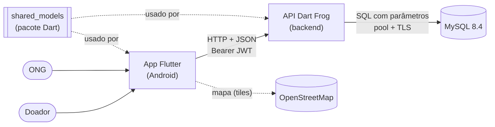
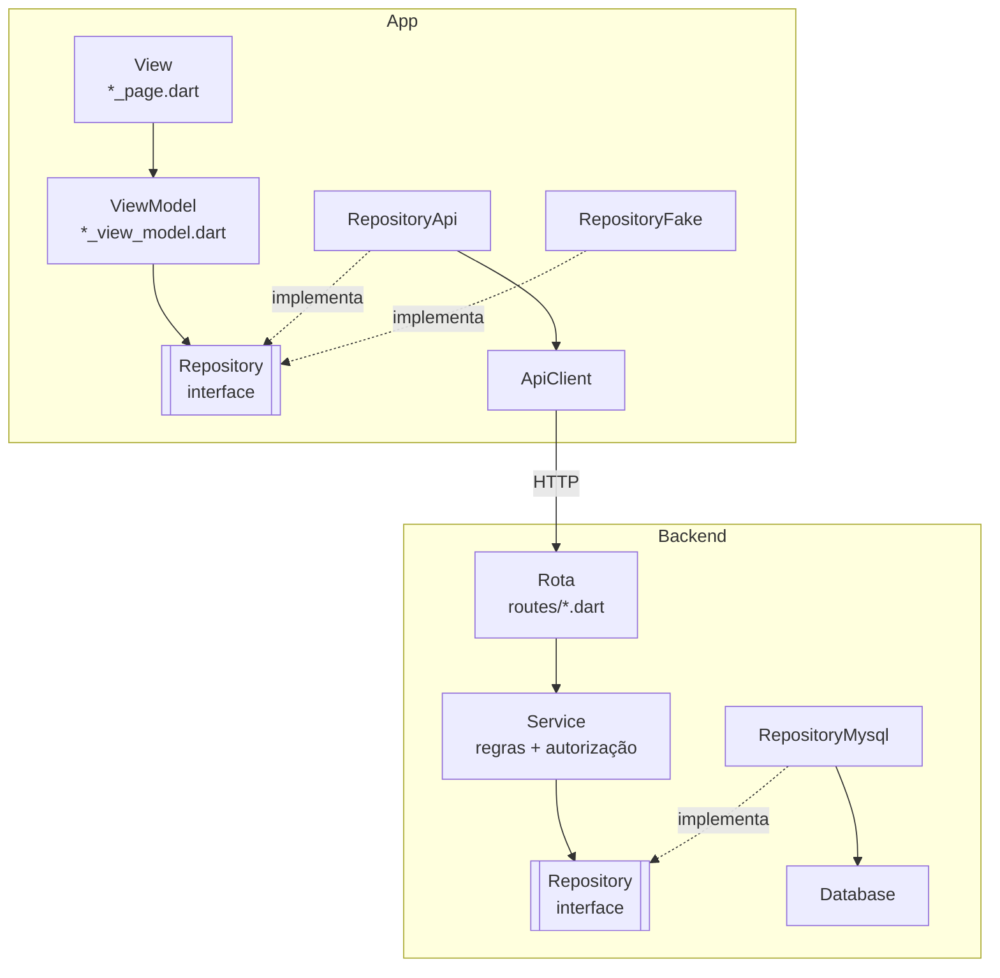
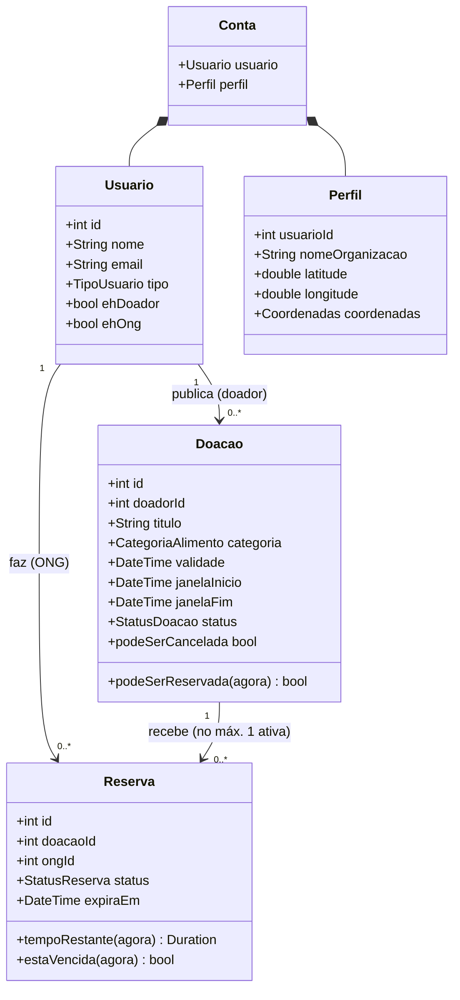
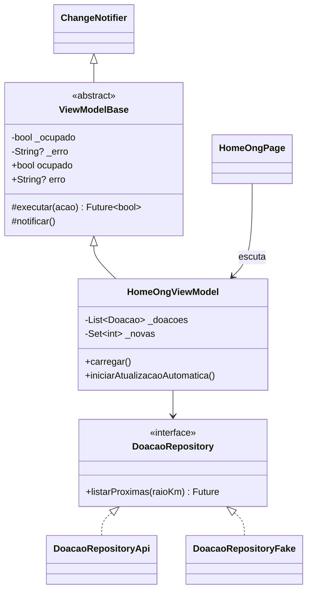
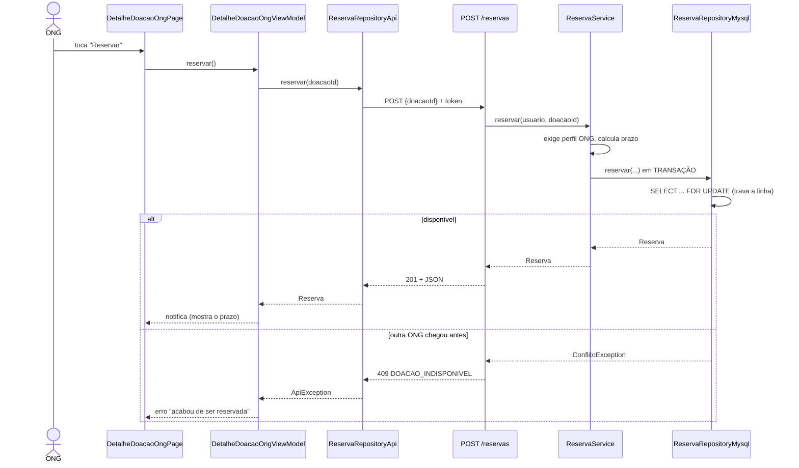

# 07 — Arquitetura e POO no projeto

**Objetivo:** entender como o sistema é dividido, quais princípios de orientação a objetos e padrões de projeto aparecem em cada parte e por que essa divisão permite 5 pessoas trabalharem em paralelo.
**Quem:** todos. Este conteúdo também serve para o capítulo de arquitetura do relatório e para a apresentação.

---

## 1. Visão geral (C4 — nível de contêineres)

- O app **nunca** acessa o banco: só a API.
- O `shared_models` é o **contrato**: as mesmas classes (`Doacao`, `Reserva`...) e as mesmas validações nos dois lados. Se o formato mudar, os dois lados param de compilar juntos, e o erro aparece cedo.

## 2. Camadas e a regra de dependência

**Regra:** cada camada só conhece a camada **abaixo**, e sempre pela **interface**. A View não sabe que existe HTTP; o Service não sabe que existe Dart Frog nem SQL.

| Camada | App | Backend |
|---|---|---|
| Entrada | View (widgets) | Rota (lê a requisição, devolve a resposta) |
| Regras | ViewModel (regras **da tela**) | Service (regras **de negócio** e autorização) |
| Dados | Repository (Api / Fake) | Repository (MySQL) |
| Infra | ApiClient, Sessao, ArmazenamentoToken | Database, Env, TokenService, SenhaService |

## 3. Os 4 pilares da POO no código do projeto

| Pilar | Onde está | Arquivo |
|---|---|---|
| **Encapsulamento** | ViewModels guardam estado em campos `_privados` e expõem getters; o `ApiClient` esconde token, cabeçalhos e tradução de erros | `core/mvvm/view_model_base.dart`, `core/api/api_client.dart` |
| **Abstração** | Interfaces de repositório descrevem *o quê*, não *como* | `data/doacoes/doacao_repository.dart`, `backend/lib/*/..._repository.dart` |
| **Herança** | Todos os ViewModels estendem `ViewModelBase`; todas as exceções do backend estendem `AppException` | `view_model_base.dart`, `core/erros/app_exception.dart` |
| **Polimorfismo** | `DoacaoRepositoryApi` e `DoacaoRepositoryFake` usados pelo mesmo ViewModel; cada `AppException` informa o próprio status HTTP | `dependencias.dart`, `middlewares.dart` |

## 4. SOLID com exemplos reais

| Princípio | Significado | No projeto |
|---|---|---|
| **S** — Responsabilidade única | Cada classe tem um motivo para mudar | `Mapeador` só converte linhas do banco; `TokenService` só lida com JWT |
| **O** — Aberto/fechado | Estender sem modificar | Nova exceção = nova subclasse de `AppException`; o middleware de erros não muda |
| **L** — Substituição de Liskov | Implementações trocáveis sem quebrar quem usa | O `BancoFake` lança os **mesmos códigos** de erro da API, então as telas funcionam igual nos dois modos |
| **I** — Segregação de interfaces | Interfaces pequenas e focadas | `AuthRepository`, `DoacaoRepository` e `ReservaRepository` separados, em vez de um "Repositório geral" |
| **D** — Inversão de dependência | Depender de abstrações | ViewModels e Services recebem interfaces pelo construtor; só a `Dependencias` (app) e os `_middleware.dart` (backend) conhecem as classes concretas |

## 5. Padrões de projeto usados

| Padrão | Onde | Para quê |
|---|---|---|
| **MVVM** | Todas as telas | Separar UI, estado e dados |
| **Observer** | `ChangeNotifier` + `ListenableBuilder` | A View é avisada quando o ViewModel muda |
| **Repository** | `lib/data/` (app) e `lib/<fatia>/` (backend) | Isolar a origem dos dados |
| **Service Layer** | `*_service.dart` do backend | Concentrar regras de negócio, testáveis sem servidor |
| **Dependency Injection** | Construtores; `provider` do Dart Frog | Trocar implementações (Fake, testes) |
| **Composition Root** | `Dependencias` (app), `main.dart` (backend) | Um único lugar que monta o grafo de objetos |
| **Factory** | `Doacao.fromJson`, `Database.conectar`, `Dependencias.fake()` | Criação controlada de objetos |
| **Template Method** | `ViewModelBase.executar(acao)` | O "esqueleto" (carregando → ação → erro) é fixo; a ação varia |
| **Middleware / Chain of Responsibility** | `routes/_middleware.dart` | Log → CORS → erros → autenticação → rota |
| **Value Object** | `Coordenadas` | Igualdade por valor (`==` sobrescrito) |
| **Strategy** | `Relogio` (`RelogioSistema` x `RelogioFixo`) | Trocar a fonte do "agora" nos testes |

## 6. Diagrama de classes (domínio)

## 7. Diagrama de classes (MVVM no app — exemplo da ONG)

## 8. Sequência: reservar uma doação

## 9. Como a arquitetura permite trabalho em paralelo

1. **Contratos primeiro.** Os modelos, as interfaces de repositório, o formato da API ([docs/08](../docs/08-backend-apis.md)) e os **construtores das páginas** já existem no Sprint 0.
2. **Pastas por dono.** Cada fatia cria arquivos novos dentro da sua pasta. O `CODEOWNERS` pede a revisão do dono.
3. **Arquivos de fundação congelados.** Roteador, `Dependencias`, `main.dart` e `pubspec` já estão prontos; ninguém precisa editá-los para entregar a própria fatia.
4. **Fakes.** Com `USAR_FAKE=true`, quem faz telas não espera o backend.
5. **Ferramentas.** `tool/seed.dart` cria dados; `tool/gerar_token.dart` gera token antes do login existir.

| Pessoa | Cria arquivos em |
|---|---|
| P1 | `backend/lib/auth/`, `backend/routes/auth/`, `app/lib/features/auth/` |
| P2 | `backend/lib/doacoes/`, `backend/routes/doacoes/`, `app/lib/features/doador/` |
| P3 | `backend/lib/reservas/`, `backend/routes/reservas/` (+ 1 linha combinada no `backend/main.dart`) |
| P4 | `backend/lib/proximidade/`, `backend/routes/proximas/`, `app/lib/features/mapa/`, `database/`, `.github/` |
| P5 | `app/lib/features/ong/` |

---

## Checklist

- [ ] Sei dizer qual camada pode chamar qual
- [ ] Sei apontar um exemplo de cada pilar da POO no projeto
- [ ] Entendi por que o ViewModel recebe a **interface** e não a classe concreta
- [ ] Sei em quais pastas eu vou criar arquivos
