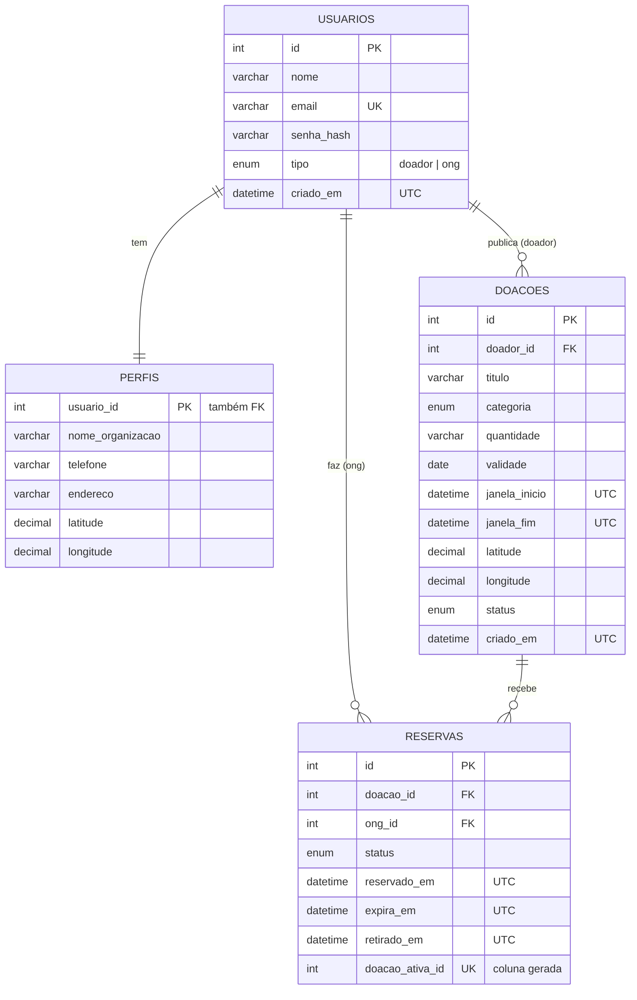

# 08 — Banco de dados passo a passo

**Objetivo:** entender a modelagem (conceitual → lógica → física), criar o banco na sua máquina e ver na prática por que transações e restrições protegem as regras de negócio.
**Quem:** todos (cada um cria o próprio banco local). A **Pessoa 4** é a referência para dúvidas.
**Pré-requisito:** MySQL 8.4 e Workbench instalados ([etapa 03](03-ambiente-windows-vscode.md)).

---

## 1. Modelo conceitual

Entidades e relacionamentos, sem pensar em tabelas ainda:

- Um **usuário** é doador **ou** ONG e tem **um** perfil (organização e localização).
- Um **doador** publica **várias** doações.
- Uma **ONG** faz **várias** reservas.
- Uma **doação** pode ter **várias** reservas ao longo do tempo (uma expira, outra ONG reserva), mas **no máximo uma ativa**.

## 2. Modelo lógico (diagrama ER)



## 3. Decisões de modelagem (e normalização)

| Decisão | Por quê |
|---|---|
| `perfis` separado de `usuarios`, com **chave primária compartilhada** (`usuario_id` é PK e FK) | Separa autenticação de dados da organização; a relação 1:1 é garantida pela própria PK. O mesmo id do usuário é usado no app, no token e no banco |
| Uma única tabela `perfis` para doador e ONG | Os atributos são os mesmos; o tipo já está em `usuarios` (evita duplicar tabelas) |
| Localização na doação **e** no perfil | A doação pode ser retirada em outro endereço; o perfil é o padrão |
| Nada é apagado: muda o `status` (exclusão lógica) | Mantém histórico e evita quebrar chaves estrangeiras |
| `ENUM` para status e categoria | O banco recusa valores inválidos |

**Normalização:**
- **1FN:** todos os campos são atômicos (sem listas dentro de uma coluna).
- **2FN:** as tabelas têm chave simples, então não há dependência parcial.
- **3FN:** nenhum campo depende de outro que não seja a chave. Por exemplo, o nome da organização fica só em `perfis`; as doações apontam para o usuário, em vez de copiar o nome.

## 4. Proteções no próprio banco

O código pode ter bugs; o banco é a última linha de defesa:

| Restrição | Protege |
|---|---|
| `UNIQUE (email)` | Dois cadastros com o mesmo e-mail |
| `CHECK (janela_fim > janela_inicio)` | Janela de retirada impossível |
| `CHECK (latitude BETWEEN -90 AND 90)` | Coordenadas inválidas |
| `CHECK (expira_em > reservado_em)` | Prazo de reserva no passado |
| Coluna gerada `doacao_ativa_id` + `UNIQUE` | **Duas reservas ativas para a mesma doação** |

Como funciona a última: `doacao_ativa_id` vale `doacao_id` enquanto a reserva está `ativa`, e `NULL` nos outros status. Um índice `UNIQUE` aceita vários `NULL`, mas não dois valores iguais. Resultado: o banco recusa a segunda reserva ativa da mesma doação.

## 5. Criando o banco (Workbench)

1. Abra o Workbench e entre na conexão local como **root**.
2. **File > Open SQL Script...** > `database/schema.sql` > clique no **raio** (⚡).
3. Na lateral **Schemas**, clique em atualizar (🔄): aparece `summit` com 4 tabelas.
4. Abra `database/criar_usuario.sql`, **troque a senha** nas duas linhas `CREATE USER` (use a mesma nas duas) e execute.
5. Guarde essa senha: ela vai no `backend/.env` (`DB_SENHA`) na [etapa 10](10-sprint-0-esqueleto-funcional.md).

> **Por que um usuário só para o backend?** Princípio do **privilégio mínimo**: se alguém conseguir explorar a API, ainda assim não consegue apagar tabelas, porque o `summit_app` só tem `SELECT, INSERT, UPDATE, DELETE`.

## 6. Dados de exemplo (seed)

Os dados de exemplo são criados por um programa Dart, porque as senhas precisam de hash bcrypt real (um `INSERT` com senha em texto seria uma falha de segurança):

```powershell
cd desenvolvimento_app/backend
dart run tool/seed.dart
```

(Isso exige o `.env` configurado, o que é feito na etapa 10.) Depois, explore com `database/consultas_uteis.sql`: posicione o cursor em uma consulta e aperte `Ctrl+Enter`.

## 7. Experimento: transação e trava de linha

Este experimento mostra, ao vivo, como o backend impede que duas ONGs reservem a mesma doação. Faça depois do seed.

1. No Workbench, abra **duas abas de consulta** (ícone **SQL+** duas vezes).
2. **Aba 1:**
   ```sql
   USE summit;
   START TRANSACTION;
   SELECT id, status FROM doacoes WHERE id = 1 FOR UPDATE;
   ```
   A linha 1 fica **travada** por esta transação.
3. **Aba 2:**
   ```sql
   USE summit;
   START TRANSACTION;
   SELECT id, status FROM doacoes WHERE id = 1 FOR UPDATE;
   ```
   Repare: a aba 2 fica **esperando** (ícone girando).
4. **Aba 1:**
   ```sql
   UPDATE doacoes SET status = 'reservada' WHERE id = 1;
   COMMIT;
   ```
5. A aba 2 é liberada e enxerga `status = 'reservada'`. É exatamente aqui que o backend responde **409 — Esta doação acabou de ser reservada**.
6. **Aba 2:** `ROLLBACK;` e, para voltar ao estado inicial, rode o seed de novo.

> **ACID:** a transação é **A**tômica (tudo ou nada), **C**onsistente (respeita as restrições), **I**solada (uma não vê a outra pela metade) e **D**urável (depois do `COMMIT`, não se perde).

## 8. Busca por proximidade (Haversine)

A distância entre dois pontos na Terra é calculada com a fórmula de **Haversine**. Veja a consulta 5 de `consultas_uteis.sql`:

```sql
6371 * ACOS(LEAST(1, GREATEST(-1,
  COS(RADIANS(@lat)) * COS(RADIANS(d.latitude)) *
  COS(RADIANS(d.longitude) - RADIANS(@lng)) +
  SIN(RADIANS(@lat)) * SIN(RADIANS(d.latitude))
)))
```

- `6371` é o raio da Terra em km.
- `LEAST(1, GREATEST(-1, ...))` evita erro de arredondamento (o `ACOS` só aceita valores entre -1 e 1).
- O mesmo cálculo existe em Dart (`Geo.distanciaKm`, no `shared_models`), usado nos testes e no modo Fake.

## 9. Mudando o banco depois que todos já criaram

Não edite o `schema.sql` sozinho. Siga `database/migracoes/README.md`: crie um script numerado (`002_adicionar_coluna_x.sql`), abra um PR, e cada pessoa roda o script na própria máquina depois do merge.

---

## Checklist

- [ ] Banco `summit` criado com as 4 tabelas
- [ ] Usuário `summit_app` criado com senha anotada
- [ ] Sei explicar a chave primária compartilhada de `perfis`
- [ ] Sei explicar como o banco impede duas reservas ativas
- [ ] (Depois da etapa 10) Seed executado e experimento de trava feito
