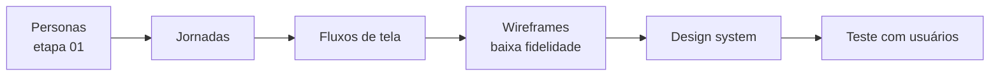
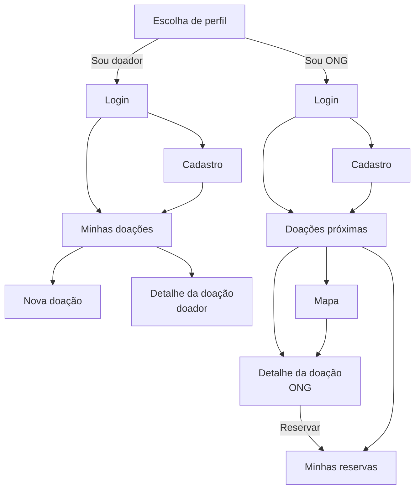

# 09 — Design de telas (UX/UI)

**Objetivo:** definir fluxos, wireframes, padrões visuais e acessibilidade **antes** de programar as telas.
**Quem:** todos; a **Pessoa 5** conduz. Cada dono de tela revisa o wireframe da sua.

---

## 1. Processo



> Ferramenta opcional: o **Figma** tem plano gratuito para estudantes. Para o MVP, os wireframes em texto abaixo bastam e ficam versionados no Git.

## 2. Fluxos de tela



## 3. Wireframes (baixa fidelidade)

### Escolha de perfil (pronta)
```text
┌──────────────────────────────┐
│            (♥ ícone)         │
│      Doação de Alimentos     │
│  Conectando quem tem ...     │
│                              │
│ [ 🏪 Sou estabelecimento   ] │
│ [ 👥 Sou ONG               ] │
│                              │
│   ☁ Servidor online          │
└──────────────────────────────┘
```

### Login
```text
┌──────────────────────────────┐
│ ←  Entrar como ONG           │
├──────────────────────────────┤
│ E-mail  [__________________] │
│ Senha   [______________ 👁 ] │
│                              │
│ [        ENTRAR            ] │
│                              │
│   Não tem conta? Cadastre-se │
└──────────────────────────────┘
```

### Minhas doações (doador)
```text
┌──────────────────────────────┐
│ Minhas doações           ⎋   │
├──────────────────────────────┤
│ ┌──────────────────────────┐ │
│ │ 🍽 Frutas do dia [Dispon.]│ │
│ │ Hortifrúti • 5 caixas    │ │
│ │ 🕑 Retirar até 16/09 18:00│ │
│ └──────────────────────────┘ │
│ ┌──────────────────────────┐ │
│ │ 🍽 Cestas    [Reservada] │ │
│ └──────────────────────────┘ │
│                   ( + Nova ) │
└──────────────────────────────┘
```

### Nova doação
```text
┌──────────────────────────────┐
│ ←  Nova doação               │
├──────────────────────────────┤
│ Título      [______________] │
│ Categoria   [Hortifrúti   ▼] │
│ Quantidade  [______________] │
│ Descrição   [______________] │
│ Validade    [ 18/09/2026  📅]│
│ Retirada de [ 16/09 14:00 🕑]│
│ Retirada até[ 16/09 18:00 🕑]│
│ ☐ Declaro que os alimentos   │
│   estão próprios p/ consumo  │
│ [       PUBLICAR           ] │
└──────────────────────────────┘
```

### Doações próximas (ONG)
```text
┌──────────────────────────────┐
│ Doações próximas   🗺 📋 ⎋  │
├──────────────────────────────┤
│ ⓘ 1 nova doação perto de você│
│ ┌──────────────────────────┐ │
│ │ 🍽 Pães do dia    [NOVA] │ │  ← borda laranja
│ │ Padaria • 30 unidades    │ │
│ │ 🕑 até 18:00  📍 850 m   │ │
│ └──────────────────────────┘ │
│  (puxe para atualizar)       │
└──────────────────────────────┘
```

### Detalhe (ONG)
```text
┌──────────────────────────────┐
│ ←  Pães do dia               │
├──────────────────────────────┤
│ Padaria Pão Quente           │
│ Avenida das Flores, 250      │
│ 📍 850 m  •  30 unidades     │
│ Validade: 17/09/2026         │
│ Retirada: 16/09 14:00–18:00  │
│ Descrição...                 │
│ [        RESERVAR          ] │
└──────────────────────────────┘
```

### Minhas reservas (ONG)
```text
┌──────────────────────────────┐
│ ←  Minhas reservas           │
│ [ Ativas ] [ Histórico ]     │
├──────────────────────────────┤
│ Cestas de mercearia          │
│ ⏱ 01:43:12                   │
│ [Confirmar retirada][Desistir]│
└──────────────────────────────┘
```

## 4. Design system

| Elemento | Padrão | Onde está no código |
|---|---|---|
| Cor primária | Verde `#2E7D32` (alimento, sustentabilidade) | `AppColors.verde` |
| Destaque / alerta de tempo | Laranja `#F57C00` | `AppColors.laranja` |
| Erro | Vermelho `#D32F2F` | `AppColors.erro` |
| Texto secundário | Cinza `#757575` | `AppColors.cinza` |
| Tipografia | Escala do Material 3 (`titleLarge`, `bodyMedium`...) | `Theme.of(context).textTheme` |
| Espaçamento | Múltiplos de 8 (8, 16, 24, 32) | `SizedBox`, `EdgeInsets` |
| Cantos | 12 a 14 px | Botões, campos e cards |
| Botão principal | Largura total, 52 px de altura | `PrimaryButton` |
| Estados de lista | Carregando, vazio, erro | `CarregandoWidget`, `VazioWidget`, `ErroWidget` |

Os componentes já existem em `app/lib/shared/widgets/`. **Use-os** em vez de criar outros parecidos.

## 5. Estados de cada tela

Toda tela que busca dados precisa tratar 4 estados:

| Estado | O que mostrar |
|---|---|
| Carregando | `CarregandoWidget` (ou o botão com spinner) |
| Vazio | `VazioWidget` com uma frase que diz o que fazer ("Toque em + para publicar a primeira doação") |
| Erro | `ErroWidget` com a mensagem e "Tentar novamente" |
| Dados | O conteúdo |

## 6. Acessibilidade (checklist)

- [ ] Contraste de texto de pelo menos 4,5:1 (as cores do tema já atendem sobre fundo claro)
- [ ] Áreas de toque de no mínimo 48 × 48 dp
- [ ] Informação nunca só por cor: os status têm **texto** (`Disponível`, `Reservada`)
- [ ] Ícones sem texto têm `tooltip` (ex.: botão "Sair")
- [ ] Elementos dinâmicos têm `Semantics` (o contador regressivo já tem)
- [ ] A tela funciona com a fonte do sistema em tamanho grande (use `SingleChildScrollView`)
- [ ] Teste com o **TalkBack** do Android ligado ao menos uma vez

> Acessibilidade completa exige testes com tecnologias assistivas e revisão especializada; este checklist cobre o essencial do MVP.

## 7. Teste com usuários (sprint 3)

1. Recrute 3 a 5 pessoas fora do grupo.
2. Dê tarefas: "publique uma doação de pães que vence amanhã", "reserve a doação mais próxima".
3. Observe sem ajudar; anote onde a pessoa hesitou.
4. Ao final, aplique o questionário **SUS** (System Usability Scale, 10 perguntas). Resultado acima de 68 é considerado bom.
5. Registre os problemas como issues com a label `ux`.

---

## Checklist

- [ ] Grupo revisou os wireframes; cada dono aprovou o da sua tela
- [ ] Todos sabem quais componentes de `shared/widgets` existem
- [ ] Checklist de acessibilidade copiado para a issue de cada tela
