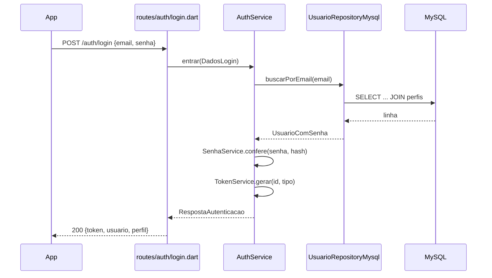

# 12 — Backend: autenticação (cadastro, login, "quem sou eu")

> **Quem:** Pessoa 1. **Tempo:** 3 a 5 dias. **Branch:** `feat/auth-backend`.
> **Pré-requisito:** [11 — Backend: fundamentos](11-backend-fundamentos.md).
> **Contrato:** [docs/08-backend-apis.md](../docs/08-backend-apis.md), seção Autenticação.

## O que vamos construir

| Rota | Faz | Resposta |
|---|---|---|
| `POST /auth/cadastro` | cria usuário + perfil (doador ou ONG) | `201` `{token, usuario, perfil}` |
| `POST /auth/login` | confere e-mail e senha | `200` `{token, usuario, perfil}` |
| `GET /auth/me` | devolve a conta do dono do token | `200` `{usuario, perfil}` |

Erros: `400 VALIDACAO`, `409 EMAIL_EM_USO`, `401 CREDENCIAIS_INVALIDAS`, `401 TOKEN_EXPIRADO`/`TOKEN_INVALIDO`.

Arquivos (todos seus, ninguém mais edita):

```text
backend/
├── lib/auth/
│   ├── usuario_repository.dart        (interface)
│   ├── usuario_repository_mysql.dart  (SQL)
│   └── auth_service.dart              (regras)
├── routes/auth/
│   ├── _middleware.dart
│   ├── cadastro.dart
│   ├── login.dart
│   └── me.dart
└── test/auth/
    └── auth_service_test.dart
```

## Conceitos antes do código

- **Hash de senha (bcrypt):** a senha nunca é gravada. Gravamos um *hash* irreversível. No login, o `SenhaService.confere(senha, hash)` refaz o cálculo e compara. Já está pronto em `lib/core/seguranca/senha_service.dart`.
- **JWT:** depois do login, o backend devolve um *token* assinado com `JWT_SEGREDO`. O app manda esse token em cada requisição (`Authorization: Bearer ...`). O backend confere a assinatura e sabe quem é, sem consultar sessão no banco. Pronto em `token_service.dart`.
- **Mensagem genérica no login:** "E-mail ou senha incorretos." para os dois casos. Dizer "e-mail não existe" ajudaria um atacante a descobrir quem tem conta.
- **Transação:** usuário e perfil são duas tabelas. Se o `INSERT` do perfil falhar, o do usuário precisa ser desfeito. Por isso `db.transacao(...)`.



## Passo 1 — A interface do repositório

```dart
// arquivo: backend/lib/auth/usuario_repository.dart
import 'package:shared_models/shared_models.dart';

/// Conta + hash da senha. Só existe DENTRO do backend: o hash nunca vai
/// para o app (por isso não é um modelo do shared_models).
class UsuarioComSenha {
  const UsuarioComSenha({required this.conta, required this.senhaHash});

  final Conta conta;
  final String senhaHash;
}

/// CONTRATO de acesso aos usuários. O AuthService depende desta interface,
/// não do MySQL: nos testes usamos uma versão em memória.
abstract interface class UsuarioRepository {
  Future<bool> emailEmUso(String email);

  /// Grava usuário e perfil juntos (transação) e devolve a conta criada.
  Future<Conta> criar(
    DadosCadastro dados, {
    required String senhaHash,
    required DateTime criadoEm,
  });

  Future<UsuarioComSenha?> buscarPorEmail(String email);

  Future<Conta?> buscarConta(int usuarioId);
}
```

## Passo 2 — A implementação com MySQL

```dart
// arquivo: backend/lib/auth/usuario_repository_mysql.dart
import 'package:shared_models/shared_models.dart';

import '../core/db/database.dart';
import '../core/db/mapeador.dart';
import '../core/utils/datas.dart';
import 'usuario_repository.dart';

class UsuarioRepositoryMysql implements UsuarioRepository {
  UsuarioRepositoryMysql(this._db);

  final Database _db;

  /// Colunas com os nomes que o Mapeador espera (usuario + perfil).
  static const _selectConta = '''
    SELECT u.id, u.nome, u.email, u.tipo, u.senha_hash,
           p.usuario_id, p.nome_organizacao, p.telefone, p.endereco,
           p.latitude, p.longitude
      FROM usuarios u
      JOIN perfis p ON p.usuario_id = u.id
  ''';

  @override
  Future<bool> emailEmUso(String email) async {
    final linhas = await _db.consultar(
      'SELECT 1 FROM usuarios WHERE email = :email LIMIT 1',
      {'email': email},
    );
    return linhas.isNotEmpty;
  }

  @override
  Future<Conta> criar(
    DadosCadastro dados, {
    required String senhaHash,
    required DateTime criadoEm,
  }) {
    return _db.transacao((t) async {
      final id = await t.inserir(
        '''
        INSERT INTO usuarios (nome, email, senha_hash, tipo, criado_em)
        VALUES (:nome, :email, :hash, :tipo, :criadoEm)
        ''',
        {
          'nome': dados.nome,
          'email': dados.email,
          'hash': senhaHash,
          'tipo': dados.tipo.name,
          'criadoEm': Datas.paraSql(criadoEm),
        },
      );
      await t.executar(
        '''
        INSERT INTO perfis (usuario_id, nome_organizacao, telefone, endereco,
                            latitude, longitude)
        VALUES (:id, :organizacao, :telefone, :endereco, :lat, :lng)
        ''',
        {
          'id': id,
          'organizacao': dados.nomeOrganizacao,
          'telefone': dados.telefone,
          'endereco': dados.endereco,
          'lat': dados.latitude,
          'lng': dados.longitude,
        },
      );
      return Conta(
        usuario: Usuario(
          id: id,
          nome: dados.nome,
          email: dados.email,
          tipo: dados.tipo,
        ),
        perfil: Perfil(
          usuarioId: id,
          nomeOrganizacao: dados.nomeOrganizacao,
          telefone: dados.telefone,
          endereco: dados.endereco,
          latitude: dados.latitude,
          longitude: dados.longitude,
        ),
      );
    });
  }

  @override
  Future<UsuarioComSenha?> buscarPorEmail(String email) async {
    final linhas = await _db.consultar(
      '$_selectConta WHERE u.email = :email',
      {'email': email},
    );
    if (linhas.isEmpty) return null;
    final linha = linhas.first;
    return UsuarioComSenha(
      conta: Mapeador.conta(linha),
      senhaHash: linha['senha_hash']!,
    );
  }

  @override
  Future<Conta?> buscarConta(int usuarioId) async {
    final linhas = await _db.consultar(
      '$_selectConta WHERE u.id = :id',
      {'id': usuarioId},
    );
    return linhas.isEmpty ? null : Mapeador.conta(linhas.first);
  }
}
```

> **Por que `'$_selectConta WHERE ...'` não é SQL Injection?** Porque `_selectConta` é uma constante escrita por nós. O que vem do usuário (`email`, `id`) entra **só** pelos parâmetros `:email` e `:id`.

## Passo 3 — O Service (regras)

```dart
// arquivo: backend/lib/auth/auth_service.dart
import 'package:shared_models/shared_models.dart';

import '../core/erros/app_exception.dart';
import '../core/seguranca/senha_service.dart';
import '../core/seguranca/token_service.dart';
import '../core/seguranca/usuario_autenticado.dart';
import 'usuario_repository.dart';

/// Regras de cadastro e login.
///
/// Não conhece HTTP nem SQL: recebe dados, aplica regras, devolve modelos
/// ou lança exceções. Isso o torna fácil de testar.
class AuthService {
  AuthService({
    required UsuarioRepository usuarios,
    required SenhaService senhas,
    required TokenService tokens,
    required Relogio relogio,
  })  : _usuarios = usuarios,
        _senhas = senhas,
        _tokens = tokens,
        _relogio = relogio;

  final UsuarioRepository _usuarios;
  final SenhaService _senhas;
  final TokenService _tokens;
  final Relogio _relogio;

  static const _credenciaisInvalidas = NaoAutenticadoException(
    codigo: 'CREDENCIAIS_INVALIDAS',
    mensagem: 'E-mail ou senha incorretos.',
  );

  Future<RespostaAutenticacao> cadastrar(DadosCadastro recebidos) async {
    // 1. Limpa espaços e põe o e-mail em minúsculas.
    final dados = recebidos.normalizado();

    // 2. As MESMAS regras do formulário do app (shared_models).
    final erros = ValidadorUsuario.validarCadastro(dados);
    if (erros.isNotEmpty) {
      throw ValidacaoException(erros.first, detalhes: erros);
    }

    // 3. E-mail único (o banco também garante, com uk_usuarios_email).
    if (await _usuarios.emailEmUso(dados.email)) {
      throw const ConflitoException(
        'EMAIL_EM_USO',
        'Este e-mail já está cadastrado.',
      );
    }

    // 4. Grava com a senha transformada em hash.
    final conta = await _usuarios.criar(
      dados,
      senhaHash: _senhas.gerarHash(dados.senha),
      criadoEm: _relogio.agora(),
    );
    return _respostaPara(conta);
  }

  Future<RespostaAutenticacao> entrar(DadosLogin dados) async {
    final email = dados.email.trim().toLowerCase();
    if (email.isEmpty || dados.senha.isEmpty) throw _credenciaisInvalidas;

    final registro = await _usuarios.buscarPorEmail(email);
    if (registro == null || !_senhas.confere(dados.senha, registro.senhaHash)) {
      throw _credenciaisInvalidas; // mesma mensagem nos dois casos
    }
    return _respostaPara(registro.conta);
  }

  /// `GET /auth/me`: a conta do dono do token.
  Future<Conta> contaDe(UsuarioAutenticado usuario) async {
    final conta = await _usuarios.buscarConta(usuario.id);
    if (conta == null) {
      // Token válido, mas o usuário não existe mais (ex.: banco recriado).
      throw const NaoAutenticadoException(
        codigo: 'TOKEN_INVALIDO',
        mensagem: 'Sessão inválida. Entre novamente.',
      );
    }
    return conta;
  }

  RespostaAutenticacao _respostaPara(Conta conta) => RespostaAutenticacao(
        token: _tokens.gerar(
          usuarioId: conta.usuario.id,
          tipo: conta.usuario.tipo,
        ),
        conta: conta,
      );
}
```

## Passo 4 — Middleware da pasta

Nem todas as rotas de `/auth` exigem login (cadastro e login, obviamente, não). Por isso aqui **não** usamos `exigirAutenticacao()`; a rota `me.dart` chama `autenticar(context)` sozinha.

```dart
// arquivo: backend/routes/auth/_middleware.dart
import 'package:dart_frog/dart_frog.dart';
import 'package:shared_models/shared_models.dart';
import 'package:summit_backend/auth/auth_service.dart';
import 'package:summit_backend/auth/usuario_repository_mysql.dart';
import 'package:summit_backend/core/db/database.dart';
import 'package:summit_backend/core/seguranca/senha_service.dart';
import 'package:summit_backend/core/seguranca/token_service.dart';

/// Monta o AuthService com as dependências criadas em main.dart.
Handler middleware(Handler handler) {
  return handler.use(
    provider<AuthService>(
      (context) => AuthService(
        usuarios: UsuarioRepositoryMysql(context.read<Database>()),
        senhas: context.read<SenhaService>(),
        tokens: context.read<TokenService>(),
        relogio: context.read<Relogio>(),
      ),
    ),
  );
}
```

## Passo 5 — As rotas

```dart
// arquivo: backend/routes/auth/cadastro.dart
import 'dart:io';

import 'package:dart_frog/dart_frog.dart';
import 'package:shared_models/shared_models.dart';
import 'package:summit_backend/auth/auth_service.dart';
import 'package:summit_backend/core/erros/app_exception.dart';
import 'package:summit_backend/core/http/requisicao.dart';

/// `POST /auth/cadastro`
Future<Response> onRequest(RequestContext context) async {
  if (context.request.method != HttpMethod.post) {
    throw const MetodoNaoPermitidoException();
  }
  final dados = DadosCadastro.fromJson(await context.lerJson());
  final resposta = await context.read<AuthService>().cadastrar(dados);
  return Response.json(statusCode: HttpStatus.created, body: resposta.toJson());
}
```

```dart
// arquivo: backend/routes/auth/login.dart
import 'package:dart_frog/dart_frog.dart';
import 'package:shared_models/shared_models.dart';
import 'package:summit_backend/auth/auth_service.dart';
import 'package:summit_backend/core/erros/app_exception.dart';
import 'package:summit_backend/core/http/requisicao.dart';

/// `POST /auth/login`
Future<Response> onRequest(RequestContext context) async {
  if (context.request.method != HttpMethod.post) {
    throw const MetodoNaoPermitidoException();
  }
  final dados = DadosLogin.fromJson(await context.lerJson());
  final resposta = await context.read<AuthService>().entrar(dados);
  return Response.json(body: resposta.toJson());
}
```

```dart
// arquivo: backend/routes/auth/me.dart
import 'package:dart_frog/dart_frog.dart';
import 'package:summit_backend/auth/auth_service.dart';
import 'package:summit_backend/core/erros/app_exception.dart';
import 'package:summit_backend/core/seguranca/autenticacao.dart';

/// `GET /auth/me` — usado pelo app ao abrir, para restaurar a sessão.
Future<Response> onRequest(RequestContext context) async {
  if (context.request.method != HttpMethod.get) {
    throw const MetodoNaoPermitidoException();
  }
  final usuario = autenticar(context); // 401 se não houver token válido
  final conta = await context.read<AuthService>().contaDe(usuario);
  return Response.json(body: conta.toJson());
}
```

## Passo 6 — Testar na mão

1. Tarefa **Backend: iniciar**.
2. No `api.http`, rode na ordem: `loginDoador`, *Senha errada*, *Quem sou eu?*, *Cadastro* (duas vezes: 201 e depois 409).

| Teste | Esperado |
|---|---|
| login com `mercado@exemplo.com` / `senha123` | 200 com `token` |
| senha errada | 401 `CREDENCIAIS_INVALIDAS` |
| `/auth/me` com token | 200 com `usuario` e `perfil` |
| `/auth/me` sem token | 401 `NAO_AUTENTICADO` |
| cadastro repetido | 409 `EMAIL_EM_USO` |
| cadastro com `"email": "x"` | 400 `VALIDACAO` com `detalhes` |
| `GET /auth/login` | 405 |

No Workbench, confira: `SELECT id, email, senha_hash FROM usuarios;` — a coluna `senha_hash` deve começar com `$2a$`, nunca a senha em texto.

## Passo 7 — Testes automatizados

O teste usa um repositório **em memória** e um `SenhaService` falso (o bcrypt real é lento de propósito; deixaria o teste demorado).

```dart
// arquivo: backend/test/auth/auth_service_test.dart
import 'package:shared_models/shared_models.dart';
import 'package:summit_backend/auth/auth_service.dart';
import 'package:summit_backend/auth/usuario_repository.dart';
import 'package:summit_backend/core/erros/app_exception.dart';
import 'package:summit_backend/core/seguranca/senha_service.dart';
import 'package:summit_backend/core/seguranca/token_service.dart';
import 'package:test/test.dart';

/// Senha "hash" = senha invertida. Rápido e suficiente para testar regras.
class SenhaServiceFake implements SenhaService {
  @override
  String gerarHash(String senha) => senha.split('').reversed.join();

  @override
  bool confere(String senha, String hash) => gerarHash(senha) == hash;
}

class UsuarioRepositoryEmMemoria implements UsuarioRepository {
  final _registros = <UsuarioComSenha>[];

  @override
  Future<bool> emailEmUso(String email) async =>
      _registros.any((r) => r.conta.usuario.email == email);

  @override
  Future<Conta> criar(
    DadosCadastro dados, {
    required String senhaHash,
    required DateTime criadoEm,
  }) async {
    final id = _registros.length + 1;
    final conta = Conta(
      usuario: Usuario(
        id: id,
        nome: dados.nome,
        email: dados.email,
        tipo: dados.tipo,
      ),
      perfil: Perfil(
        usuarioId: id,
        nomeOrganizacao: dados.nomeOrganizacao,
        latitude: dados.latitude,
        longitude: dados.longitude,
      ),
    );
    _registros.add(UsuarioComSenha(conta: conta, senhaHash: senhaHash));
    return conta;
  }

  @override
  Future<UsuarioComSenha?> buscarPorEmail(String email) async =>
      _registros.where((r) => r.conta.usuario.email == email).firstOrNull;

  @override
  Future<Conta?> buscarConta(int usuarioId) async => _registros
      .where((r) => r.conta.usuario.id == usuarioId)
      .firstOrNull
      ?.conta;
}

void main() {
  late AuthService service;
  late TokenService tokens;

  const cadastroValido = DadosCadastro(
    tipo: TipoUsuario.ong,
    nome: 'Ana Lima',
    email: '  Ana@Exemplo.com ',
    senha: 'senha123',
    nomeOrganizacao: 'ONG Mãos Amigas',
    latitude: -23.52,
    longitude: -46.18,
  );

  setUp(() {
    tokens = TokenService(segredo: 'segredo-de-teste-com-32-caracteres!!');
    service = AuthService(
      usuarios: UsuarioRepositoryEmMemoria(),
      senhas: SenhaServiceFake(),
      tokens: tokens,
      relogio: RelogioFixo(DateTime.utc(2026, 9, 15, 12)),
    );
  });

  test('cadastro normaliza o e-mail e devolve um token válido', () async {
    final resposta = await service.cadastrar(cadastroValido);

    expect(resposta.conta.usuario.email, 'ana@exemplo.com');
    final dono = tokens.validar(resposta.token);
    expect(dono.id, resposta.conta.usuario.id);
    expect(dono.tipo, TipoUsuario.ong);
  });

  test('cadastro com e-mail repetido falha com EMAIL_EM_USO', () async {
    await service.cadastrar(cadastroValido);

    expect(
      () => service.cadastrar(cadastroValido),
      throwsA(
        isA<ConflitoException>().having((e) => e.codigo, 'codigo', 'EMAIL_EM_USO'),
      ),
    );
  });

  test('cadastro inválido lista todos os problemas', () async {
    const invalido = DadosCadastro(
      tipo: TipoUsuario.doador,
      nome: 'A',
      email: 'sem-arroba',
      senha: '123',
      nomeOrganizacao: 'Mercado',
      latitude: -23.5,
      longitude: -46.1,
    );

    expect(
      () => service.cadastrar(invalido),
      throwsA(
        isA<ValidacaoException>().having((e) => e.detalhes.length, 'qtd', 3),
      ),
    );
  });

  test('login com a senha certa funciona; com a errada, não', () async {
    await service.cadastrar(cadastroValido);

    final ok = await service.entrar(
      const DadosLogin(email: 'ana@exemplo.com', senha: 'senha123'),
    );
    expect(ok.conta.usuario.nome, 'Ana Lima');

    expect(
      () => service.entrar(
        const DadosLogin(email: 'ana@exemplo.com', senha: 'errada'),
      ),
      throwsA(isA<NaoAutenticadoException>()),
    );
  });

  test('login de e-mail inexistente dá a MESMA mensagem da senha errada',
      () async {
    expect(
      () => service.entrar(
        const DadosLogin(email: 'ninguem@exemplo.com', senha: 'senha123'),
      ),
      throwsA(
        isA<NaoAutenticadoException>()
            .having((e) => e.codigo, 'codigo', 'CREDENCIAIS_INVALIDAS'),
      ),
    );
  });
}
```

Rode a tarefa **Backend: testes**.

## Passo 8 — Pull Request

```powershell
git switch -c feat/auth-backend     # se ainda não criou
git add desenvolvimento_app/backend/lib/auth desenvolvimento_app/backend/routes/auth desenvolvimento_app/backend/test/auth
git commit -m "feat(auth): cadastro, login e /auth/me no backend"
git push -u origin feat/auth-backend
```

Abra o PR no GitHub, preencha o template e marque `Closes #<número da issue>`. Peça revisão a outra pessoa do backend.

## Checklist

- [ ] As 7 linhas da tabela do passo 6 conferidas no `api.http`
- [ ] `senha_hash` no banco começa com `$2a$`
- [ ] 5 testes passando
- [ ] Tarefa "verificar antes do PR" passa
- [ ] PR aberto, CI verde, revisado e mesclado

> **Para a apresentação:** saiba explicar por que a senha não é guardada, o que tem dentro do JWT (só `uid` e `tipo`, e por que não colocar dados sensíveis lá) e por que login errado sempre tem a mesma mensagem.

Próximo para a Pessoa 1: [17 — App: login e cadastro](17-app-autenticacao.md).
