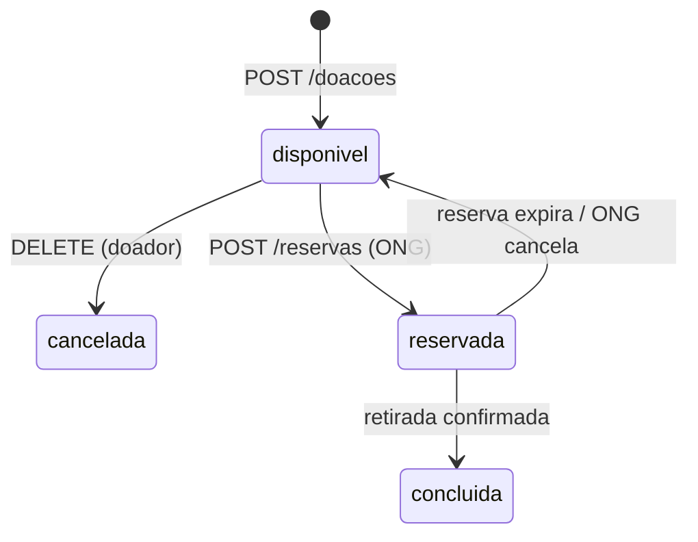

# 13 — Backend: doações do doador

> **Quem:** Pessoa 2. **Tempo:** 3 a 5 dias. **Branch:** `feat/doacoes-backend`.
> **Pré-requisito:** [11 — Backend: fundamentos](11-backend-fundamentos.md). Não precisa esperar o login: use `dart run tool/gerar_token.dart 1 doador`.

## O que vamos construir

| Rota | Quem | Faz | Resposta |
|---|---|---|---|
| `POST /doacoes` | doador | anuncia excedente | `201` Doacao |
| `GET /doacoes` | doador | lista as próprias (todos os status) | `200` `{"doacoes": [...]}` |
| `GET /doacoes/{id}` | doador dono / ONG | detalhe + reserva ativa | `200` `{"doacao": {...}, "reserva": {...} ou null}` |
| `DELETE /doacoes/{id}` | doador dono | cancela, se ainda disponível | `204` |

Erros: `400 VALIDACAO` (ex.: alimento vencido), `403 SEM_PERMISSAO` (ONG tentando criar), `404 NAO_ENCONTRADO`, `409 DOACAO_NAO_CANCELAVEL`.

```text
backend/
├── lib/doacoes/
│   ├── doacao_repository.dart
│   ├── doacao_repository_mysql.dart
│   └── doacao_service.dart
├── routes/doacoes/
│   ├── _middleware.dart
│   ├── index.dart          (GET e POST /doacoes)
│   └── [id].dart           (GET e DELETE /doacoes/{id})
└── test/doacoes/
    └── doacao_service_test.dart
```

## Regras de negócio desta fatia

1. **Só doador cria, lista e cancela** (autorização por papel → 403).
2. **Validação compartilhada:** `ValidadorDoacao.validar` (o mesmo do formulário do app). Inclui: título, quantidade, **validade não pode ser anterior a hoje** (sem alimentos vencidos, exigência do escopo), janela de retirada coerente e **declaração** de que os alimentos estão próprios para consumo.
3. **"Hoje" depende do fuso:** às 22h de Brasília já é o dia seguinte em UTC. Por isso `Calendario.dataNoFuso(agora, env.fusoHorarioUtc)`.
4. **Localização padrão:** se o app não mandar `latitude/longitude`, usamos as do **perfil** do doador.
5. **Detalhe:** o doador só vê as próprias doações. A ONG vê as que ainda podem ser reservadas **ou** a que ela mesma reservou. Fora disso, 404 (não revelamos que o id existe).
6. **Cancelamento:** só com status `disponivel`. O `UPDATE ... WHERE status = 'disponivel'` é **atômico**: se uma ONG reservar no mesmo milissegundo, só uma das duas operações vence.



## Passo 1 — Interface do repositório

```dart
// arquivo: backend/lib/doacoes/doacao_repository.dart
import 'package:shared_models/shared_models.dart';

/// Dados prontos para gravar (já validados e com a localização decidida).
class NovaDoacaoParaGravar {
  const NovaDoacaoParaGravar({
    required this.doadorId,
    required this.dados,
    required this.latitude,
    required this.longitude,
    required this.endereco,
    required this.criadoEm,
  });

  final int doadorId;
  final DadosNovaDoacao dados;
  final double latitude;
  final double longitude;
  final String? endereco;
  final DateTime criadoEm;
}

abstract interface class DoacaoRepository {
  Future<Doacao> criar(NovaDoacaoParaGravar nova);

  /// Mais recentes primeiro.
  Future<List<Doacao>> listarDoDoador(int doadorId);

  Future<Doacao?> buscar(int doacaoId);

  /// A reserva com status `ativa` dessa doação, se houver.
  Future<Reserva?> reservaAtivaDa(int doacaoId);

  /// Perfil do doador (para a localização padrão).
  Future<Perfil?> perfilDo(int usuarioId);

  /// Muda para `cancelada` SOMENTE se ainda estiver `disponivel`.
  /// Devolve `false` se o status já tinha mudado.
  Future<bool> cancelarSeDisponivel(int doacaoId);
}
```

## Passo 2 — Implementação com MySQL

```dart
// arquivo: backend/lib/doacoes/doacao_repository_mysql.dart
import 'package:shared_models/shared_models.dart';

import '../core/db/database.dart';
import '../core/db/mapeador.dart';
import '../core/utils/datas.dart';
import 'doacao_repository.dart';

class DoacaoRepositoryMysql implements DoacaoRepository {
  DoacaoRepositoryMysql(this._db);

  final Database _db;

  /// `d.*` traz as colunas com os nomes que o Mapeador espera; o alias
  /// `nome_doador` preenche o campo opcional `Doacao.nomeDoador`.
  static const _selectDoacao = '''
    SELECT d.*, p.nome_organizacao AS nome_doador
      FROM doacoes d
      JOIN perfis p ON p.usuario_id = d.doador_id
  ''';

  @override
  Future<Doacao> criar(NovaDoacaoParaGravar nova) async {
    final dados = nova.dados;
    final descricao = dados.descricao?.trim();
    final id = await _db.inserir(
      '''
      INSERT INTO doacoes (doador_id, titulo, descricao, categoria, quantidade,
                           validade, janela_inicio, janela_fim, endereco,
                           latitude, longitude, status, criado_em)
      VALUES (:doador, :titulo, :descricao, :categoria, :quantidade,
              :validade, :inicio, :fim, :endereco,
              :lat, :lng, 'disponivel', :criadoEm)
      ''',
      {
        'doador': nova.doadorId,
        'titulo': dados.titulo.trim(),
        'descricao': (descricao == null || descricao.isEmpty) ? null : descricao,
        'categoria': dados.categoria.name,
        'quantidade': dados.quantidade.trim(),
        'validade': Datas.dataParaSql(dados.validade),
        'inicio': Datas.paraSql(dados.janelaInicio),
        'fim': Datas.paraSql(dados.janelaFim),
        'endereco': nova.endereco,
        'lat': nova.latitude,
        'lng': nova.longitude,
        'criadoEm': Datas.paraSql(nova.criadoEm),
      },
    );
    // Relê do banco: garante que o app recebe exatamente o que foi gravado.
    return (await buscar(id))!;
  }

  @override
  Future<List<Doacao>> listarDoDoador(int doadorId) async {
    final linhas = await _db.consultar(
      '$_selectDoacao WHERE d.doador_id = :doador ORDER BY d.criado_em DESC',
      {'doador': doadorId},
    );
    return linhas.map(Mapeador.doacao).toList();
  }

  @override
  Future<Doacao?> buscar(int doacaoId) async {
    final linhas = await _db.consultar(
      '$_selectDoacao WHERE d.id = :id',
      {'id': doacaoId},
    );
    return linhas.isEmpty ? null : Mapeador.doacao(linhas.first);
  }

  @override
  Future<Reserva?> reservaAtivaDa(int doacaoId) async {
    final linhas = await _db.consultar(
      '''
      SELECT r.id, r.doacao_id, r.ong_id, r.status, r.reservado_em,
             r.expira_em, r.retirado_em,
             d.titulo AS titulo_doacao, p.nome_organizacao AS nome_ong
        FROM reservas r
        JOIN doacoes d ON d.id = r.doacao_id
        JOIN perfis p ON p.usuario_id = r.ong_id
       WHERE r.doacao_id = :id AND r.status = 'ativa'
      ''',
      {'id': doacaoId},
    );
    return linhas.isEmpty ? null : Mapeador.reserva(linhas.first);
  }

  @override
  Future<Perfil?> perfilDo(int usuarioId) async {
    final linhas = await _db.consultar(
      '''
      SELECT usuario_id, nome_organizacao, telefone, endereco,
             latitude, longitude
        FROM perfis WHERE usuario_id = :id
      ''',
      {'id': usuarioId},
    );
    return linhas.isEmpty ? null : Mapeador.perfil(linhas.first);
  }

  @override
  Future<bool> cancelarSeDisponivel(int doacaoId) async {
    final alteradas = await _db.executar(
      '''
      UPDATE doacoes SET status = 'cancelada'
       WHERE id = :id AND status = 'disponivel'
      ''',
      {'id': doacaoId},
    );
    return alteradas == 1;
  }
}
```

## Passo 3 — O Service

```dart
// arquivo: backend/lib/doacoes/doacao_service.dart
import 'package:shared_models/shared_models.dart';

import '../core/erros/app_exception.dart';
import '../core/seguranca/usuario_autenticado.dart';
import 'doacao_repository.dart';

class DoacaoService {
  DoacaoService({
    required DoacaoRepository doacoes,
    required Relogio relogio,
    required int fusoHorarioUtc,
  })  : _doacoes = doacoes,
        _relogio = relogio,
        _fusoHorarioUtc = fusoHorarioUtc;

  final DoacaoRepository _doacoes;
  final Relogio _relogio;
  final int _fusoHorarioUtc;

  static const _naoCancelavel = ConflitoException(
    'DOACAO_NAO_CANCELAVEL',
    'Só é possível cancelar doações que ainda não foram reservadas.',
  );

  Future<Doacao> criar(UsuarioAutenticado usuario, DadosNovaDoacao dados) async {
    usuario.exigirTipo(TipoUsuario.doador);

    final agora = _relogio.agora();
    final erros = ValidadorDoacao.validar(
      dados,
      agora: agora,
      hoje: Calendario.dataNoFuso(agora, _fusoHorarioUtc),
    );
    if (erros.isNotEmpty) {
      throw ValidacaoException(erros.first, detalhes: erros);
    }

    final perfil = await _doacoes.perfilDo(usuario.id) ??
        (throw const NaoAutenticadoException(
          codigo: 'TOKEN_INVALIDO',
          mensagem: 'Sessão inválida. Entre novamente.',
        ));

    return _doacoes.criar(
      NovaDoacaoParaGravar(
        doadorId: usuario.id,
        dados: dados,
        latitude: dados.latitude ?? perfil.latitude,
        longitude: dados.longitude ?? perfil.longitude,
        endereco: dados.endereco ?? perfil.endereco,
        criadoEm: agora,
      ),
    );
  }

  Future<List<Doacao>> listarMinhas(UsuarioAutenticado usuario) {
    usuario.exigirTipo(TipoUsuario.doador);
    return _doacoes.listarDoDoador(usuario.id);
  }

  Future<DetalheDoacao> detalhar(UsuarioAutenticado usuario, int id) async {
    final doacao = await _doacoes.buscar(id);
    if (doacao == null) throw const NaoEncontradoException();
    final reserva = await _doacoes.reservaAtivaDa(id);

    final podeVer = usuario.ehDoador
        ? doacao.doadorId == usuario.id
        : doacao.podeSerReservada(_relogio.agora()) ||
            reserva?.ongId == usuario.id;
    if (!podeVer) throw const NaoEncontradoException();

    return DetalheDoacao(doacao: doacao, reserva: reserva);
  }

  Future<void> cancelar(UsuarioAutenticado usuario, int id) async {
    usuario.exigirTipo(TipoUsuario.doador);
    final doacao = await _doacoes.buscar(id);
    if (doacao == null || doacao.doadorId != usuario.id) {
      throw const NaoEncontradoException();
    }
    if (!doacao.podeSerCancelada) throw _naoCancelavel;

    // Segunda checagem, atômica, no banco (outra ONG pode ter reservado
    // entre o buscar() acima e esta linha).
    if (!await _doacoes.cancelarSeDisponivel(id)) throw _naoCancelavel;
  }
}
```

> **POO aqui:** o Service não sabe se o repositório é MySQL ou memória (polimorfismo via interface), e as regras sobre o estado da doação (`podeSerCancelada`, `podeSerReservada`) moram no **próprio modelo** `Doacao` do `shared_models` (encapsulamento: quem tem os dados tem o comportamento).

## Passo 4 — Middleware e rotas

```dart
// arquivo: backend/routes/doacoes/_middleware.dart
import 'package:dart_frog/dart_frog.dart';
import 'package:shared_models/shared_models.dart';
import 'package:summit_backend/core/config/env.dart';
import 'package:summit_backend/core/db/database.dart';
import 'package:summit_backend/core/seguranca/autenticacao.dart';
import 'package:summit_backend/doacoes/doacao_repository_mysql.dart';
import 'package:summit_backend/doacoes/doacao_service.dart';

/// Todas as rotas de /doacoes exigem login.
Handler middleware(Handler handler) {
  return handler
      .use(
        provider<DoacaoService>(
          (context) => DoacaoService(
            doacoes: DoacaoRepositoryMysql(context.read<Database>()),
            relogio: context.read<Relogio>(),
            fusoHorarioUtc: context.read<Env>().fusoHorarioUtc,
          ),
        ),
      )
      .use(exigirAutenticacao());
}
```

```dart
// arquivo: backend/routes/doacoes/index.dart
import 'dart:io';

import 'package:dart_frog/dart_frog.dart';
import 'package:shared_models/shared_models.dart';
import 'package:summit_backend/core/erros/app_exception.dart';
import 'package:summit_backend/core/http/requisicao.dart';
import 'package:summit_backend/core/seguranca/usuario_autenticado.dart';
import 'package:summit_backend/doacoes/doacao_service.dart';

/// `GET /doacoes` (minhas doações) e `POST /doacoes` (nova doação).
Future<Response> onRequest(RequestContext context) async {
  final usuario = context.read<UsuarioAutenticado>();
  final service = context.read<DoacaoService>();

  switch (context.request.method) {
    case HttpMethod.get:
      final doacoes = await service.listarMinhas(usuario);
      return Response.json(
        body: {'doacoes': [for (final d in doacoes) d.toJson()]},
      );
    case HttpMethod.post:
      final dados = DadosNovaDoacao.fromJson(await context.lerJson());
      final doacao = await service.criar(usuario, dados);
      return Response.json(statusCode: HttpStatus.created, body: doacao.toJson());
    default:
      throw const MetodoNaoPermitidoException();
  }
}
```

```dart
// arquivo: backend/routes/doacoes/[id].dart
import 'dart:io';

import 'package:dart_frog/dart_frog.dart';
import 'package:summit_backend/core/erros/app_exception.dart';
import 'package:summit_backend/core/http/requisicao.dart';
import 'package:summit_backend/core/seguranca/usuario_autenticado.dart';
import 'package:summit_backend/doacoes/doacao_service.dart';

/// `GET /doacoes/{id}` e `DELETE /doacoes/{id}`.
Future<Response> onRequest(RequestContext context, String id) async {
  final doacaoId = idDaRota(id);
  final usuario = context.read<UsuarioAutenticado>();
  final service = context.read<DoacaoService>();

  switch (context.request.method) {
    case HttpMethod.get:
      final detalhe = await service.detalhar(usuario, doacaoId);
      return Response.json(body: detalhe.toJson());
    case HttpMethod.delete:
      await service.cancelar(usuario, doacaoId);
      return Response(statusCode: HttpStatus.noContent);
    default:
      throw const MetodoNaoPermitidoException();
  }
}
```

## Passo 5 — Testar na mão

Use a seção **DOAÇÕES DO DOADOR** do `api.http`.

| Teste | Esperado |
|---|---|
| criar com dados válidos | 201, `status: "disponivel"`, `nomeDoador` preenchido |
| criar com `validade` de ontem | 400 "Não é permitido doar alimentos vencidos." |
| criar com `declaracaoAlimentosProprios: false` | 400 |
| criar sem `titulo` | 400 (FormatException do `fromJson`) |
| criar com token de ONG | 403 `SEM_PERMISSAO` |
| `GET /doacoes` | lista só as do doador logado |
| `GET /doacoes/{id}` de outro doador | 404 |
| `DELETE` de doação disponível | 204; no banco, `status = 'cancelada'` |
| `DELETE` de novo | 409 `DOACAO_NAO_CANCELAVEL` |
| `GET /doacoes/abc` | 404 |

## Passo 6 — Testes automatizados

```dart
// arquivo: backend/test/doacoes/doacao_service_test.dart
import 'package:shared_models/shared_models.dart';
import 'package:summit_backend/core/erros/app_exception.dart';
import 'package:summit_backend/core/seguranca/usuario_autenticado.dart';
import 'package:summit_backend/doacoes/doacao_repository.dart';
import 'package:summit_backend/doacoes/doacao_service.dart';
import 'package:test/test.dart';

class DoacaoRepositoryEmMemoria implements DoacaoRepository {
  final doacoes = <Doacao>[];
  final reservas = <Reserva>[];

  @override
  Future<Doacao> criar(NovaDoacaoParaGravar nova) async {
    final d = nova.dados;
    final doacao = Doacao(
      id: doacoes.length + 1,
      doadorId: nova.doadorId,
      titulo: d.titulo,
      descricao: d.descricao,
      categoria: d.categoria,
      quantidade: d.quantidade,
      validade: d.validade,
      janelaInicio: d.janelaInicio,
      janelaFim: d.janelaFim,
      endereco: nova.endereco,
      latitude: nova.latitude,
      longitude: nova.longitude,
      status: StatusDoacao.disponivel,
      criadoEm: nova.criadoEm,
    );
    doacoes.add(doacao);
    return doacao;
  }

  @override
  Future<List<Doacao>> listarDoDoador(int doadorId) async =>
      doacoes.where((d) => d.doadorId == doadorId).toList();

  @override
  Future<Doacao?> buscar(int id) async =>
      doacoes.where((d) => d.id == id).firstOrNull;

  @override
  Future<Reserva?> reservaAtivaDa(int id) async =>
      reservas.where((r) => r.doacaoId == id && r.estaAtiva).firstOrNull;

  @override
  Future<Perfil?> perfilDo(int usuarioId) async => Perfil(
        usuarioId: usuarioId,
        nomeOrganizacao: 'Mercado Bom Preço',
        endereco: 'Rua Principal, 100',
        latitude: -23.5229,
        longitude: -46.1880,
      );

  @override
  Future<bool> cancelarSeDisponivel(int id) async {
    final i = doacoes.indexWhere((d) => d.id == id && d.estaDisponivel);
    if (i < 0) return false;
    doacoes[i] = doacoes[i].copyWith(status: StatusDoacao.cancelada);
    return true;
  }
}

void main() {
  // 15/09/2026 12:00 UTC = 09:00 em Brasília.
  final agora = DateTime.utc(2026, 9, 15, 12);
  const doador = UsuarioAutenticado(id: 1, tipo: TipoUsuario.doador);
  const outroDoador = UsuarioAutenticado(id: 2, tipo: TipoUsuario.doador);
  const ong = UsuarioAutenticado(id: 3, tipo: TipoUsuario.ong);

  late DoacaoRepositoryEmMemoria repositorio;
  late DoacaoService service;

  DadosNovaDoacao dados({DateTime? validade, bool declaracao = true}) =>
      DadosNovaDoacao(
        titulo: 'Pães do dia',
        categoria: CategoriaAlimento.padaria,
        quantidade: '20 unidades',
        validade: validade ?? DateTime.utc(2026, 9, 16),
        janelaInicio: agora,
        janelaFim: agora.add(const Duration(hours: 4)),
        declaracaoAlimentosProprios: declaracao,
      );

  setUp(() {
    repositorio = DoacaoRepositoryEmMemoria();
    service = DoacaoService(
      doacoes: repositorio,
      relogio: RelogioFixo(agora),
      fusoHorarioUtc: -3,
    );
  });

  test('cria doação usando a localização do perfil', () async {
    final doacao = await service.criar(doador, dados());

    expect(doacao.status, StatusDoacao.disponivel);
    expect(doacao.latitude, -23.5229);
    expect(doacao.endereco, 'Rua Principal, 100');
  });

  test('recusa alimento vencido', () {
    expect(
      () => service.criar(doador, dados(validade: DateTime.utc(2026, 9, 14))),
      throwsA(isA<ValidacaoException>()),
    );
  });

  test('recusa sem a declaração de alimentos próprios', () {
    expect(
      () => service.criar(doador, dados(declaracao: false)),
      throwsA(isA<ValidacaoException>()),
    );
  });

  test('ONG não pode criar doação', () {
    expect(
      () => service.criar(ong, dados()),
      throwsA(isA<SemPermissaoException>()),
    );
  });

  test('doador não vê doação de outro doador', () async {
    final doacao = await service.criar(doador, dados());

    expect(
      () => service.detalhar(outroDoador, doacao.id),
      throwsA(isA<NaoEncontradoException>()),
    );
  });

  test('cancelar: funciona uma vez; na segunda, 409', () async {
    final doacao = await service.criar(doador, dados());

    await service.cancelar(doador, doacao.id);
    expect(repositorio.doacoes.single.status, StatusDoacao.cancelada);

    expect(
      () => service.cancelar(doador, doacao.id),
      throwsA(
        isA<ConflitoException>()
            .having((e) => e.codigo, 'codigo', 'DOACAO_NAO_CANCELAVEL'),
      ),
    );
  });

  test('ONG não vê doação cancelada', () async {
    final doacao = await service.criar(doador, dados());
    await service.cancelar(doador, doacao.id);

    expect(
      () => service.detalhar(ong, doacao.id),
      throwsA(isA<NaoEncontradoException>()),
    );
  });
}
```

## Passo 7 — Pull Request

```powershell
git add desenvolvimento_app/backend/lib/doacoes desenvolvimento_app/backend/routes/doacoes desenvolvimento_app/backend/test/doacoes
git commit -m "feat(doacoes): criar, listar, detalhar e cancelar doações"
git push -u origin feat/doacoes-backend
```

## Checklist

- [ ] As 10 linhas da tabela do passo 5 conferidas
- [ ] 7 testes passando
- [ ] Sei explicar por que o cancelamento faz duas checagens (Service e `UPDATE ... WHERE status`)
- [ ] Sei explicar por que "hoje" depende do fuso horário
- [ ] PR mesclado

Próximo para a Pessoa 2: [18 — App: telas do doador](18-app-doador.md).
