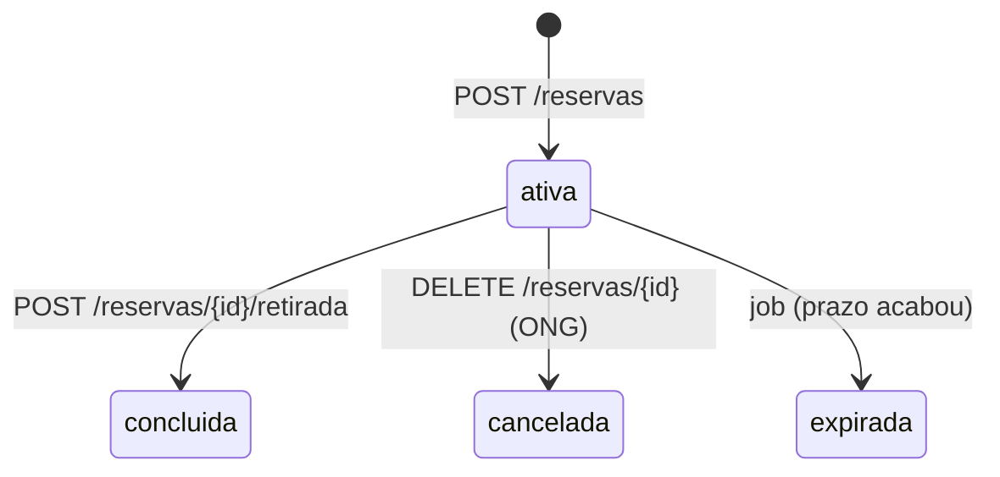

# 15 — Backend: reservas e expiração

> **Quem:** Pessoa 3. **Tempo:** 5 a 7 dias. **Branch:** `feat/reservas-backend`.
> **Pré-requisito:** [11 — Backend: fundamentos](11-backend-fundamentos.md). Token de teste: `dart run tool/gerar_token.dart 3 ong` (ONG Mãos Amigas) e `dart run tool/gerar_token.dart 4 ong` (Instituto Prato Cheio).
> **Contrato:** [docs/08-backend-apis.md](../docs/08-backend-apis.md), seção Reservas.

Esta é a fatia com a regra mais delicada do projeto: **duas ONGs nunca podem ficar com a mesma doação**, e uma reserva esquecida precisa **expirar sozinha** para a comida não se perder.

> **Calma:** esta etapa parece grande, mas o código está todo pronto e comentado. Seu trabalho é **digitar, entender e testar**, um passo por dia. Se travar, leia de novo a seção "Vocabulário" e pergunte no grupo.
> **Alinhe antes:** com a **Pessoa 5** (as telas dela usam todas as suas rotas) e com a **Pessoa 2** (reserva ativa no detalhe da doação). Ver [00_COMECE_AQUI/03 — Alinhamentos](../00_COMECE_AQUI/03-alinhamentos-entre-pessoas.md).

## Vocabulário (leia antes)

| Termo | Em palavras simples | Analogia |
|---|---|---|
| **Reserva** | A ONG diz "essa doação é minha, vou buscar" | Segurar um produto no balcão da loja |
| **Prazo / expiração** | Tempo máximo para buscar; depois disso a reserva "vence" | A loja só segura o produto até as 18h |
| **Transação** | Várias gravações no banco que acontecem **todas ou nenhuma** | Transferência bancária: sai de uma conta **e** entra na outra; nunca só uma das duas |
| **Condição de corrida** | Duas pessoas fazendo a mesma coisa no mesmo instante e "atropelando" uma à outra | Duas pessoas comprando o último ingresso ao mesmo tempo |
| **Trava (`FOR UPDATE`)** | O banco "tranca" a linha até a primeira pessoa terminar; a segunda espera na fila | Provador da loja com a porta trancada |
| **Job** | Um código que roda sozinho de tempos em tempos, sem ninguém chamar | O despertador que toca a cada 30 segundos |
| **`Timer.periodic`** | A forma do Dart de criar esse "despertador" | — |

## O que vamos construir

| Rota | Quem | Faz | Resposta |
|---|---|---|---|
| `POST /reservas` `{doacaoId}` | ONG | reserva uma doação disponível | `201` Reserva |
| `GET /reservas` | ONG | minhas reservas (ativas e histórico), mais recentes primeiro | `200` `{"reservas": [...]}` |
| `DELETE /reservas/{id}` | ONG dona | desiste da reserva; a doação volta a ficar disponível | `204` |
| `POST /reservas/{id}/retirada` | ONG dona **ou** doador dono da doação | confirma que o alimento foi retirado | `200` Reserva |

Erros: `403 SEM_PERMISSAO` (doador tentando reservar), `404 NAO_ENCONTRADO`, `409 DOACAO_INDISPONIVEL` (outra ONG chegou antes, ou a janela acabou), `409 RESERVA_NAO_ATIVA` (cancelar/confirmar algo que já expirou, foi cancelado ou concluído).

Além das rotas, um **job** (tarefa em segundo plano) roda a cada 30 segundos e expira as reservas vencidas.

```text
backend/
├── lib/reservas/
│   ├── reserva_repository.dart
│   ├── reserva_repository_mysql.dart
│   ├── reserva_service.dart
│   └── expiracao_job.dart
├── routes/reservas/
│   ├── _middleware.dart
│   ├── index.dart              (GET e POST /reservas)
│   └── [id]/
│       ├── index.dart          (DELETE /reservas/{id})
│       └── retirada.dart       (POST /reservas/{id}/retirada)
├── test/reservas/
│   └── reserva_service_test.dart
└── main.dart                   (descomentar o bloco do job — combinado com o grupo)
```

## Regras de negócio desta fatia

1. **Só ONG reserva, lista e cancela** (autorização por papel → 403).
2. **Só reserva o que pode ser reservado:** status `disponivel` **e** janela de retirada ainda aberta (`Doacao.podeSerReservada`, do `shared_models`).
3. **Prazo:** `expiraEm = mínimo(agora + RESERVA_MINUTOS, janelaFim)`. A reserva nunca dura mais do que a janela que o doador ofereceu.
4. **Reservar muda dois registros juntos:** cria a reserva **e** muda a doação para `reservada`. Isso é uma **transação**.
5. **Cancelar** (ONG): reserva → `cancelada`, doação → `disponivel`.
6. **Confirmar retirada** (ONG dona ou doador dono): reserva → `concluida` com `retirado_em`, doação → `concluida`.
7. **Expirar** (job): toda reserva `ativa` com `expira_em <= agora` vira `expirada`, e a doação volta a `disponivel`.
8. "Não é seu" responde **404**, como nas outras fatias.



## Conceito: concorrência (duas ONGs no mesmo segundo)

Imagine a Mãos Amigas e o Prato Cheio tocando em **Reservar** na mesma doação, ao mesmo tempo. Sem cuidado:

```text
Mãos Amigas: lê status → "disponivel"       Prato Cheio: lê status → "disponivel"
Mãos Amigas: grava reserva                  Prato Cheio: grava reserva     ← DUAS reservas!
```

Isso se chama **condição de corrida** (*race condition*). Usamos três camadas de proteção:

| Camada | Onde | O que faz |
|---|---|---|
| 1. Checagem no Service | `ReservaService.reservar` | `doacao.podeSerReservada(agora)`: responde rápido e com mensagem clara no caso comum |
| 2. Trava da linha | `SELECT ... FOR UPDATE` dentro da transação | A segunda transação **espera** a primeira terminar e então lê o status já atualizado (`reservada`) |
| 3. Garantia do banco | índice `UNIQUE uk_reservas_uma_ativa_por_doacao` (`database/schema.sql`) | Mesmo que alguém esqueça as camadas 1 e 2 no futuro, o MySQL **recusa** uma segunda reserva ativa para a mesma doação |

```mermaid
sequenceDiagram
    participant A as Mãos Amigas
    participant B as Prato Cheio
    participant DB as MySQL
    A->>DB: BEGIN; SELECT ... FOR UPDATE (doação 1)
    B->>DB: BEGIN; SELECT ... FOR UPDATE (doação 1)
    Note over B,DB: B fica ESPERANDO a trava
    A->>DB: UPDATE doacoes → reservada; INSERT reserva; COMMIT
    DB-->>B: agora sim: status = "reservada"
    B->>DB: ROLLBACK
    Note over B: 409 DOACAO_INDISPONIVEL
```

> **Por quê a coluna gerada no `schema.sql`?** `doacao_ativa_id` vale o `doacao_id` só enquanto a reserva está `ativa` (nos outros status, `NULL`). Um índice `UNIQUE` aceita vários `NULL`, então o histórico de reservas expiradas/canceladas da mesma doação continua permitido, mas **duas ativas** não.

## Conceito: o job de expiração

O MySQL não "avisa" quando um horário passa. Alguém precisa perguntar de tempos em tempos: *"tem reserva ativa com prazo vencido?"*. Fazemos isso com um `Timer.periodic` do Dart, iniciado **uma vez** em `main.dart` (o ponto de entrada do servidor).

Por precaução, o Service também chama a expiração **antes** de reservar e de listar. Assim, mesmo que o job ainda não tenha rodado (ele roda a cada 30 s), uma reserva vencida nunca impede outra ONG de reservar e nunca aparece como ativa.

---

## Passo 1 — A interface do repositório

```dart
// arquivo: backend/lib/reservas/reserva_repository.dart
import 'package:shared_models/shared_models.dart';

/// Dados de uma reserva nova, já calculados pelo Service.
class NovaReserva {
  const NovaReserva({
    required this.doacaoId,
    required this.ongId,
    required this.reservadoEm,
    required this.expiraEm,
  });

  final int doacaoId;
  final int ongId;
  final DateTime reservadoEm;
  final DateTime expiraEm;
}

/// CONTRATO de acesso às reservas. O ReservaService depende desta interface;
/// nos testes usamos uma versão em memória.
abstract interface class ReservaRepository {
  Future<Doacao?> buscarDoacao(int doacaoId);

  Future<Reserva?> buscar(int reservaId);

  /// Mais recentes primeiro.
  Future<List<Reserva>> listarDaOng(int ongId);

  /// Em UMA transação: confere (com trava) que a doação continua disponível
  /// e com a janela aberta, muda a doação para `reservada` e grava a reserva.
  /// Devolve `null` se outra ONG reservou antes.
  Future<Reserva?> criarSeDisponivel(NovaReserva nova);

  /// Reserva `ativa` → `cancelada` e doação → `disponivel`.
  /// Devolve `false` se a reserva não estava mais ativa.
  Future<bool> cancelarSeAtiva(int reservaId);

  /// Reserva `ativa` → `concluida` (com [retiradoEm]) e doação → `concluida`.
  /// Devolve `false` se a reserva não estava mais ativa.
  Future<bool> concluirSeAtiva(int reservaId, {required DateTime retiradoEm});

  /// Expira as reservas ativas com prazo vencido em [agora] e devolve as
  /// doações a `disponivel`. Devolve quantas reservas expiraram.
  Future<int> expirarVencidas(DateTime agora);
}
```

## Passo 2 — Implementação com MySQL

```dart
// arquivo: backend/lib/reservas/reserva_repository_mysql.dart
import 'package:mysql_client/mysql_client.dart' show MySQLServerException;
import 'package:shared_models/shared_models.dart';

import '../core/db/database.dart';
import '../core/db/mapeador.dart';
import '../core/erros/app_exception.dart';
import '../core/utils/datas.dart';
import 'reserva_repository.dart';

class ReservaRepositoryMysql implements ReservaRepository {
  ReservaRepositoryMysql(this._db);

  final Database _db;

  static const _duplicada = ConflitoException(
    'DOACAO_INDISPONIVEL',
    'Esta doação acabou de ser reservada por outra ONG.',
  );

  /// Aliases `titulo_doacao` e `nome_ong` preenchem os campos de leitura do
  /// modelo `Reserva` (veja o comentário no topo de `mapeador.dart`).
  static const _selectReserva = '''
    SELECT r.id, r.doacao_id, r.ong_id, r.status, r.reservado_em,
           r.expira_em, r.retirado_em,
           d.titulo AS titulo_doacao, p.nome_organizacao AS nome_ong
      FROM reservas r
      JOIN doacoes d ON d.id = r.doacao_id
      JOIN perfis p ON p.usuario_id = r.ong_id
  ''';

  @override
  Future<Doacao?> buscarDoacao(int doacaoId) async {
    final linhas = await _db.consultar(
      '''
      SELECT d.*, p.nome_organizacao AS nome_doador
        FROM doacoes d
        JOIN perfis p ON p.usuario_id = d.doador_id
       WHERE d.id = :id
      ''',
      {'id': doacaoId},
    );
    return linhas.isEmpty ? null : Mapeador.doacao(linhas.first);
  }

  @override
  Future<Reserva?> buscar(int reservaId) => _buscarCom(_db, reservaId);

  Future<Reserva?> _buscarCom(ExecutorSql executor, int reservaId) async {
    final linhas = await executor.consultar(
      '$_selectReserva WHERE r.id = :id',
      {'id': reservaId},
    );
    return linhas.isEmpty ? null : Mapeador.reserva(linhas.first);
  }

  @override
  Future<List<Reserva>> listarDaOng(int ongId) async {
    final linhas = await _db.consultar(
      '$_selectReserva WHERE r.ong_id = :ong ORDER BY r.reservado_em DESC',
      {'ong': ongId},
    );
    return linhas.map(Mapeador.reserva).toList();
  }

  @override
  Future<Reserva?> criarSeDisponivel(NovaReserva nova) {
    return _db.transacao((t) async {
      // FOR UPDATE: trava a linha da doação até o fim da transação. Uma
      // segunda ONG que chegue agora ESPERA aqui e depois lê o status novo.
      final linhas = await t.consultar(
        '''
        SELECT id FROM doacoes
         WHERE id = :id AND status = 'disponivel' AND janela_fim > :agora
         FOR UPDATE
        ''',
        {'id': nova.doacaoId, 'agora': Datas.paraSql(nova.reservadoEm)},
      );
      if (linhas.isEmpty) return null; // outra ONG chegou antes

      await t.executar(
        "UPDATE doacoes SET status = 'reservada' WHERE id = :id",
        {'id': nova.doacaoId},
      );
      final int id;
      try {
        id = await t.inserir(
          '''
          INSERT INTO reservas (doacao_id, ong_id, status, reservado_em, expira_em)
          VALUES (:doacao, :ong, 'ativa', :reservadoEm, :expiraEm)
          ''',
          {
            'doacao': nova.doacaoId,
            'ong': nova.ongId,
            'reservadoEm': Datas.paraSql(nova.reservadoEm),
            'expiraEm': Datas.paraSql(nova.expiraEm),
          },
        );
      } on MySQLServerException catch (erro) {
        // 1062 = "Duplicate entry": o índice UNIQUE barrou uma segunda
        // reserva ativa (camada 3). LANÇAR (e não devolver null) faz a
        // transação dar ROLLBACK, desfazendo também o UPDATE acima.
        if (erro.errorCode == 1062) throw ReservaRepositoryMysql._duplicada;
        rethrow;
      }
      // Relê dentro da transação, com os nomes da doação e da ONG.
      return _buscarCom(t, id);
    });
  }

  @override
  Future<bool> cancelarSeAtiva(int reservaId) {
    return _db.transacao((t) async {
      final alteradas = await t.executar(
        '''
        UPDATE reservas SET status = 'cancelada'
         WHERE id = :id AND status = 'ativa'
        ''',
        {'id': reservaId},
      );
      if (alteradas != 1) return false;
      await t.executar(
        '''
        UPDATE doacoes d JOIN reservas r ON r.doacao_id = d.id
           SET d.status = 'disponivel'
         WHERE r.id = :id AND d.status = 'reservada'
        ''',
        {'id': reservaId},
      );
      return true;
    });
  }

  @override
  Future<bool> concluirSeAtiva(int reservaId, {required DateTime retiradoEm}) {
    return _db.transacao((t) async {
      final alteradas = await t.executar(
        '''
        UPDATE reservas SET status = 'concluida', retirado_em = :retiradoEm
         WHERE id = :id AND status = 'ativa'
        ''',
        {'id': reservaId, 'retiradoEm': Datas.paraSql(retiradoEm)},
      );
      if (alteradas != 1) return false;
      await t.executar(
        '''
        UPDATE doacoes d JOIN reservas r ON r.doacao_id = d.id
           SET d.status = 'concluida'
         WHERE r.id = :id
        ''',
        {'id': reservaId},
      );
      return true;
    });
  }

  @override
  Future<int> expirarVencidas(DateTime agora) {
    final parametros = {'agora': Datas.paraSql(agora)};
    return _db.transacao((t) async {
      // 1º as doações (o JOIN ainda encontra as reservas como 'ativa')...
      await t.executar(
        '''
        UPDATE doacoes d JOIN reservas r ON r.doacao_id = d.id
           SET d.status = 'disponivel'
         WHERE r.status = 'ativa' AND r.expira_em <= :agora
           AND d.status = 'reservada'
        ''',
        parametros,
      );
      // ... depois as reservas.
      return t.executar(
        '''
        UPDATE reservas SET status = 'expirada'
         WHERE status = 'ativa' AND expira_em <= :agora
        ''',
        parametros,
      );
    });
  }
}
```

> **Por que a ordem importa em `expirarVencidas`?** O primeiro `UPDATE` usa o `JOIN` para achar as doações das reservas **ainda ativas**. Se mudássemos as reservas primeiro, o `JOIN` não encontraria mais nada e as doações ficariam presas em `reservada`.

## Passo 3 — O Service

```dart
// arquivo: backend/lib/reservas/reserva_service.dart
import 'package:shared_models/shared_models.dart';

import '../core/erros/app_exception.dart';
import '../core/seguranca/usuario_autenticado.dart';
import 'reserva_repository.dart';

/// Regras de reserva, cancelamento, retirada e expiração.
class ReservaService {
  ReservaService({
    required ReservaRepository reservas,
    required Relogio relogio,
    required Duration prazo,
  })  : _reservas = reservas,
        _relogio = relogio,
        _prazo = prazo;

  final ReservaRepository _reservas;
  final Relogio _relogio;
  final Duration _prazo;

  static const _indisponivel = ConflitoException(
    'DOACAO_INDISPONIVEL',
    'Esta doação acabou de ser reservada por outra ONG ou não está mais '
        'disponível.',
  );

  static const _naoAtiva = ConflitoException(
    'RESERVA_NAO_ATIVA',
    'Esta reserva não está mais ativa.',
  );

  Future<Reserva> reservar(UsuarioAutenticado usuario, int doacaoId) async {
    usuario.exigirTipo(TipoUsuario.ong);
    final agora = _relogio.agora();
    await _reservas.expirarVencidas(agora); // não espera o job

    final doacao = await _reservas.buscarDoacao(doacaoId);
    if (doacao == null) throw const NaoEncontradoException();
    if (!doacao.podeSerReservada(agora)) throw _indisponivel;

    // Regra 3: o prazo nunca passa do fim da janela de retirada.
    final limite = agora.add(_prazo);
    final expiraEm =
        limite.isBefore(doacao.janelaFim) ? limite : doacao.janelaFim;

    final reserva = await _reservas.criarSeDisponivel(
      NovaReserva(
        doacaoId: doacaoId,
        ongId: usuario.id,
        reservadoEm: agora,
        expiraEm: expiraEm,
      ),
    );
    return reserva ?? (throw _indisponivel);
  }

  Future<List<Reserva>> listarMinhas(UsuarioAutenticado usuario) async {
    usuario.exigirTipo(TipoUsuario.ong);
    await _reservas.expirarVencidas(_relogio.agora());
    return _reservas.listarDaOng(usuario.id);
  }

  Future<void> cancelar(UsuarioAutenticado usuario, int reservaId) async {
    usuario.exigirTipo(TipoUsuario.ong);
    final reserva = await _reservas.buscar(reservaId);
    if (reserva == null || reserva.ongId != usuario.id) {
      throw const NaoEncontradoException();
    }
    if (!await _reservas.cancelarSeAtiva(reservaId)) throw _naoAtiva;
  }

  Future<Reserva> confirmarRetirada(
    UsuarioAutenticado usuario,
    int reservaId,
  ) async {
    final agora = _relogio.agora();
    final reserva = await _reservas.buscar(reservaId);
    if (reserva == null) throw const NaoEncontradoException();

    final permitido = usuario.ehOng
        ? reserva.ongId == usuario.id
        : (await _reservas.buscarDoacao(reserva.doacaoId))?.doadorId ==
            usuario.id;
    if (!permitido) throw const NaoEncontradoException();

    // Prazo vencido conta como "não ativa", mesmo antes de o job rodar.
    if (!reserva.estaAtiva || reserva.estaVencida(agora)) throw _naoAtiva;
    if (!await _reservas.concluirSeAtiva(reservaId, retiradoEm: agora)) {
      throw _naoAtiva;
    }
    return (await _reservas.buscar(reservaId))!;
  }

  /// Chamado pelo [ExpiracaoJob]. Devolve quantas reservas expiraram.
  Future<int> expirarVencidas() =>
      _reservas.expirarVencidas(_relogio.agora());
}
```

> **POO aqui:** o Service não sabe nada de HTTP nem de SQL. As perguntas sobre o estado ("pode ser reservada?", "está vencida?") são respondidas pelos **próprios modelos** (`Doacao.podeSerReservada`, `Reserva.estaVencida`), que ficam no `shared_models` e são usados também pelo app.

## Passo 4 — O job de expiração

```dart
// arquivo: backend/lib/reservas/expiracao_job.dart
import 'dart:async';
import 'dart:io';

import 'reserva_service.dart';

/// Tarefa em segundo plano: a cada [intervalo], expira as reservas vencidas.
///
/// É iniciada UMA vez em `main.dart`. Erros são registrados no terminal e o
/// job continua rodando (um problema momentâneo no banco não derruba a API).
class ExpiracaoJob {
  ExpiracaoJob(
    this._service, {
    this.intervalo = const Duration(seconds: 30),
  });

  final ReservaService _service;
  final Duration intervalo;
  Timer? _timer;
  bool _rodando = false;

  void iniciar() {
    if (_timer != null) return; // já iniciado
    _timer = Timer.periodic(intervalo, (_) => executarAgora());
    unawaited(executarAgora()); // primeira rodada imediata
    stdout.writeln('Job de expiração de reservas: a cada ${intervalo.inSeconds} s.');
  }

  /// Uma rodada. Pública para facilitar testes.
  Future<void> executarAgora() async {
    if (_rodando) return; // a rodada anterior ainda não terminou
    _rodando = true;
    try {
      final quantidade = await _service.expirarVencidas();
      if (quantidade > 0) {
        stdout.writeln('[job] $quantidade reserva(s) expirada(s).');
      }
    } catch (erro, pilha) {
      stderr.writeln('[job] Falha ao expirar reservas: $erro\n$pilha');
    } finally {
      _rodando = false;
    }
  }

  void parar() {
    _timer?.cancel();
    _timer = null;
  }
}
```

## Passo 5 — Ligar o job no `main.dart`

`main.dart` é arquivo de **fundação**: combine com o grupo e faça este ajuste em um commit separado dentro do seu PR. Já existem dois trechos comentados esperando por você.

1. Acrescente os imports no topo:

```dart
import 'package:summit_backend/reservas/expiracao_job.dart';
import 'package:summit_backend/reservas/reserva_repository_mysql.dart';
import 'package:summit_backend/reservas/reserva_service.dart';
```

2. Descomente a variável global (logo abaixo de `Database? _database;`):

```dart
ExpiracaoJob? _job;
```

3. Descomente o bloco dentro de `run(...)`:

```dart
  _job ??= ExpiracaoJob(
    ReservaService(
      reservas: ReservaRepositoryMysql(database),
      relogio: relogio,
      prazo: env.prazoReserva,
    ),
  )..iniciar();
```

> **Por que `??=` e variável global?** Durante o desenvolvimento o `dart_frog dev` recarrega o código a cada arquivo salvo e chama `run` de novo. Sem o `??=`, cada recarga criaria **mais um** timer.

## Passo 6 — Middleware e rotas

```dart
// arquivo: backend/routes/reservas/_middleware.dart
import 'package:dart_frog/dart_frog.dart';
import 'package:shared_models/shared_models.dart';
import 'package:summit_backend/core/config/env.dart';
import 'package:summit_backend/core/db/database.dart';
import 'package:summit_backend/core/seguranca/autenticacao.dart';
import 'package:summit_backend/reservas/reserva_repository_mysql.dart';
import 'package:summit_backend/reservas/reserva_service.dart';

/// Todas as rotas de /reservas exigem login.
Handler middleware(Handler handler) {
  return handler
      .use(
        provider<ReservaService>(
          (context) => ReservaService(
            reservas: ReservaRepositoryMysql(context.read<Database>()),
            relogio: context.read<Relogio>(),
            prazo: context.read<Env>().prazoReserva,
          ),
        ),
      )
      .use(exigirAutenticacao());
}
```

```dart
// arquivo: backend/routes/reservas/index.dart
import 'dart:io';

import 'package:dart_frog/dart_frog.dart';
import 'package:shared_models/shared_models.dart';
import 'package:summit_backend/core/erros/app_exception.dart';
import 'package:summit_backend/core/http/requisicao.dart';
import 'package:summit_backend/core/seguranca/usuario_autenticado.dart';
import 'package:summit_backend/reservas/reserva_service.dart';

/// `GET /reservas` (minhas reservas) e `POST /reservas` (reservar).
Future<Response> onRequest(RequestContext context) async {
  final usuario = context.read<UsuarioAutenticado>();
  final service = context.read<ReservaService>();

  switch (context.request.method) {
    case HttpMethod.get:
      final reservas = await service.listarMinhas(usuario);
      return Response.json(
        body: {'reservas': [for (final r in reservas) r.toJson()]},
      );
    case HttpMethod.post:
      final dados = DadosReserva.fromJson(await context.lerJson());
      final reserva = await service.reservar(usuario, dados.doacaoId);
      return Response.json(
        statusCode: HttpStatus.created,
        body: reserva.toJson(),
      );
    default:
      throw const MetodoNaoPermitidoException();
  }
}
```

```dart
// arquivo: backend/routes/reservas/[id]/index.dart
import 'dart:io';

import 'package:dart_frog/dart_frog.dart';
import 'package:summit_backend/core/erros/app_exception.dart';
import 'package:summit_backend/core/http/requisicao.dart';
import 'package:summit_backend/core/seguranca/usuario_autenticado.dart';
import 'package:summit_backend/reservas/reserva_service.dart';

/// `DELETE /reservas/{id}` — a ONG desiste da reserva.
Future<Response> onRequest(RequestContext context, String id) async {
  if (context.request.method != HttpMethod.delete) {
    throw const MetodoNaoPermitidoException();
  }
  await context.read<ReservaService>().cancelar(
        context.read<UsuarioAutenticado>(),
        idDaRota(id),
      );
  return Response(statusCode: HttpStatus.noContent);
}
```

```dart
// arquivo: backend/routes/reservas/[id]/retirada.dart
import 'package:dart_frog/dart_frog.dart';
import 'package:summit_backend/core/erros/app_exception.dart';
import 'package:summit_backend/core/http/requisicao.dart';
import 'package:summit_backend/core/seguranca/usuario_autenticado.dart';
import 'package:summit_backend/reservas/reserva_service.dart';

/// `POST /reservas/{id}/retirada` — confirma que o alimento foi retirado.
Future<Response> onRequest(RequestContext context, String id) async {
  if (context.request.method != HttpMethod.post) {
    throw const MetodoNaoPermitidoException();
  }
  final reserva = await context.read<ReservaService>().confirmarRetirada(
        context.read<UsuarioAutenticado>(),
        idDaRota(id),
      );
  return Response.json(body: reserva.toJson());
}
```

> **Rota dentro de pasta `[id]`:** o Dart Frog entrega o trecho dinâmico da URL (`/reservas/7/retirada` → `"7"`) como parâmetro `String id` para **todos** os arquivos dentro de `[id]/`.

## Passo 7 — Testar na mão

1. Rode o **seed** (ele cria uma reserva ativa da Mãos Amigas para a doação "Cestas de mercearia").
2. Para ver a expiração sem esperar 2 horas, coloque `RESERVA_MINUTOS=2` no `.env` e reinicie o backend.
3. Use a seção **RESERVAS** do `api.http` (rode `loginOng` antes). Para testar a segunda ONG, duplique a requisição `loginOng` com o e-mail `pratocheio@exemplo.com` e dê a ela o nome `# @name loginOng2`.

| Teste | Esperado |
|---|---|
| `POST /reservas {"doacaoId": 1}` (Mãos Amigas) | 201, `status: "ativa"`, `expiraEm` ≈ agora + prazo, `tituloDoacao` e `nomeOng` preenchidos |
| mesmo `POST` com a outra ONG | 409 `DOACAO_INDISPONIVEL` |
| `POST` com token de doador | 403 `SEM_PERMISSAO` |
| `POST {"doacaoId": 999}` | 404 |
| `POST {}` | 400 (falta `doacaoId`) |
| `GET /reservas` | lista só as reservas da ONG logada, mais recentes primeiro |
| esperar o prazo (2 min) e `GET /reservas` | a reserva aparece como `expirada`; no terminal, `[job] 1 reserva(s) expirada(s).` |
| `GET /proximas` depois da expiração | a doação voltou a aparecer |
| `DELETE /reservas/{id}` de uma ativa | 204; a doação volta a `disponivel` |
| `DELETE` de novo | 409 `RESERVA_NAO_ATIVA` |
| `POST /reservas/{id}/retirada` (ONG dona) | 200, `status: "concluida"`, `retiradoEm` preenchido; doação `concluida` |
| retirada com token do doador dono (`gerar_token.dart 1 doador`) | 200 |
| retirada com token de outra ONG | 404 |

No Workbench, confira a regra do banco:

```sql
SELECT doacao_id, status, doacao_ativa_id FROM reservas;
-- doacao_ativa_id só é preenchido nas linhas com status 'ativa'
```

E tente "burlar" o código direto no banco (deve dar erro `Duplicate entry ... uk_reservas_uma_ativa_por_doacao`):

```sql
INSERT INTO reservas (doacao_id, ong_id, status, reservado_em, expira_em)
SELECT doacao_id, ong_id, 'ativa', reservado_em, expira_em
  FROM reservas WHERE status = 'ativa' LIMIT 1;
```

## Passo 8 — Testes automatizados

O `RelogioFixo.avancar` permite testar a expiração em milissegundos, sem esperar 2 horas.

```dart
// arquivo: backend/test/reservas/reserva_service_test.dart
import 'package:shared_models/shared_models.dart';
import 'package:summit_backend/core/erros/app_exception.dart';
import 'package:summit_backend/core/seguranca/usuario_autenticado.dart';
import 'package:summit_backend/reservas/reserva_repository.dart';
import 'package:summit_backend/reservas/reserva_service.dart';
import 'package:test/test.dart';

/// Mesmas regras do MySQL, em listas na memória.
class ReservaRepositoryEmMemoria implements ReservaRepository {
  ReservaRepositoryEmMemoria(this.doacoes);

  final List<Doacao> doacoes;
  final reservas = <Reserva>[];

  Doacao doacao(int id) => doacoes.firstWhere((d) => d.id == id);

  void _mudarDoacao(int id, StatusDoacao status) {
    final i = doacoes.indexWhere((d) => d.id == id);
    doacoes[i] = doacoes[i].copyWith(status: status);
  }

  void _mudarReserva(Reserva r, StatusReserva status, {DateTime? retiradoEm}) {
    reservas[reservas.indexOf(r)] = Reserva(
      id: r.id,
      doacaoId: r.doacaoId,
      ongId: r.ongId,
      status: status,
      reservadoEm: r.reservadoEm,
      expiraEm: r.expiraEm,
      retiradoEm: retiradoEm ?? r.retiradoEm,
    );
  }

  @override
  Future<Doacao?> buscarDoacao(int id) async =>
      doacoes.where((d) => d.id == id).firstOrNull;

  @override
  Future<Reserva?> buscar(int id) async =>
      reservas.where((r) => r.id == id).firstOrNull;

  @override
  Future<List<Reserva>> listarDaOng(int ongId) async =>
      reservas.where((r) => r.ongId == ongId).toList().reversed.toList();

  @override
  Future<Reserva?> criarSeDisponivel(NovaReserva nova) async {
    if (!doacao(nova.doacaoId).podeSerReservada(nova.reservadoEm)) return null;
    _mudarDoacao(nova.doacaoId, StatusDoacao.reservada);
    final reserva = Reserva(
      id: reservas.length + 1,
      doacaoId: nova.doacaoId,
      ongId: nova.ongId,
      status: StatusReserva.ativa,
      reservadoEm: nova.reservadoEm,
      expiraEm: nova.expiraEm,
    );
    reservas.add(reserva);
    return reserva;
  }

  @override
  Future<bool> cancelarSeAtiva(int id) async {
    final r = await buscar(id);
    if (r == null || !r.estaAtiva) return false;
    _mudarReserva(r, StatusReserva.cancelada);
    _mudarDoacao(r.doacaoId, StatusDoacao.disponivel);
    return true;
  }

  @override
  Future<bool> concluirSeAtiva(int id, {required DateTime retiradoEm}) async {
    final r = await buscar(id);
    if (r == null || !r.estaAtiva) return false;
    _mudarReserva(r, StatusReserva.concluida, retiradoEm: retiradoEm);
    _mudarDoacao(r.doacaoId, StatusDoacao.concluida);
    return true;
  }

  @override
  Future<int> expirarVencidas(DateTime agora) async {
    final vencidas = reservas.where((r) => r.estaVencida(agora)).toList();
    for (final r in vencidas) {
      _mudarReserva(r, StatusReserva.expirada);
      _mudarDoacao(r.doacaoId, StatusDoacao.disponivel);
    }
    return vencidas.length;
  }
}

void main() {
  final inicio = DateTime.utc(2026, 9, 15, 12);
  const prazo = Duration(hours: 2);
  const doador = UsuarioAutenticado(id: 1, tipo: TipoUsuario.doador);
  const maosAmigas = UsuarioAutenticado(id: 3, tipo: TipoUsuario.ong);
  const pratoCheio = UsuarioAutenticado(id: 4, tipo: TipoUsuario.ong);

  late RelogioFixo relogio;
  late ReservaRepositoryEmMemoria repositorio;
  late ReservaService service;

  Doacao doacao(int id, {Duration janela = const Duration(hours: 6)}) => Doacao(
        id: id,
        doadorId: doador.id,
        titulo: 'Doação $id',
        categoria: CategoriaAlimento.padaria,
        quantidade: '10 unidades',
        validade: DateTime.utc(2026, 9, 16),
        janelaInicio: inicio,
        janelaFim: inicio.add(janela),
        latitude: -23.52,
        longitude: -46.18,
        status: StatusDoacao.disponivel,
        criadoEm: inicio,
      );

  setUp(() {
    relogio = RelogioFixo(inicio);
    repositorio = ReservaRepositoryEmMemoria([
      doacao(1),
      doacao(2, janela: const Duration(minutes: 30)),
    ]);
    service = ReservaService(
      reservas: repositorio,
      relogio: relogio,
      prazo: prazo,
    );
  });

  test('reserva com prazo de agora + 2 h e muda a doação para reservada',
      () async {
    final reserva = await service.reservar(maosAmigas, 1);

    expect(reserva.status, StatusReserva.ativa);
    expect(reserva.expiraEm, inicio.add(prazo));
    expect(repositorio.doacao(1).status, StatusDoacao.reservada);
  });

  test('o prazo nunca passa do fim da janela de retirada', () async {
    final reserva = await service.reservar(maosAmigas, 2);

    expect(reserva.expiraEm, inicio.add(const Duration(minutes: 30)));
  });

  test('segunda ONG recebe DOACAO_INDISPONIVEL', () async {
    await service.reservar(maosAmigas, 1);

    expect(
      () => service.reservar(pratoCheio, 1),
      throwsA(
        isA<ConflitoException>()
            .having((e) => e.codigo, 'codigo', 'DOACAO_INDISPONIVEL'),
      ),
    );
  });

  test('doador não pode reservar', () {
    expect(
      () => service.reservar(doador, 1),
      throwsA(isA<SemPermissaoException>()),
    );
  });

  test('reserva vencida expira e a doação pode ser reservada de novo',
      () async {
    await service.reservar(maosAmigas, 1);

    relogio.avancar(prazo + const Duration(seconds: 1));
    expect(await service.expirarVencidas(), 1);
    expect(repositorio.reservas.single.status, StatusReserva.expirada);
    expect(repositorio.doacao(1).status, StatusDoacao.disponivel);

    final nova = await service.reservar(pratoCheio, 1);
    expect(nova.ongId, pratoCheio.id);
  });

  test('cancelar devolve a doação; cancelar de novo dá RESERVA_NAO_ATIVA',
      () async {
    final reserva = await service.reservar(maosAmigas, 1);

    await service.cancelar(maosAmigas, reserva.id);
    expect(repositorio.doacao(1).status, StatusDoacao.disponivel);

    expect(
      () => service.cancelar(maosAmigas, reserva.id),
      throwsA(
        isA<ConflitoException>()
            .having((e) => e.codigo, 'codigo', 'RESERVA_NAO_ATIVA'),
      ),
    );
  });

  test('doador dono confirma a retirada; outra ONG não enxerga a reserva',
      () async {
    final reserva = await service.reservar(maosAmigas, 1);

    expect(
      () => service.confirmarRetirada(pratoCheio, reserva.id),
      throwsA(isA<NaoEncontradoException>()),
    );

    final concluida = await service.confirmarRetirada(doador, reserva.id);
    expect(concluida.status, StatusReserva.concluida);
    expect(concluida.retiradoEm, inicio);
    expect(repositorio.doacao(1).status, StatusDoacao.concluida);
  });

  test('não confirma retirada depois do prazo, mesmo antes do job', () async {
    final reserva = await service.reservar(maosAmigas, 1);
    relogio.avancar(prazo);

    expect(
      () => service.confirmarRetirada(maosAmigas, reserva.id),
      throwsA(isA<ConflitoException>()),
    );
  });
}
```

Rode a tarefa **Backend: testes**.

> **O que este teste NÃO prova:** a trava `FOR UPDATE` e o índice `UNIQUE` só existem no MySQL. Eles são verificados no teste manual do passo 7 (duas ONGs e o `INSERT` direto no Workbench). Na apresentação, explique essa diferença: teste de unidade prova as **regras**; teste manual/integração prova a **infraestrutura**.

## Passo 9 — Pull Request

```powershell
git add desenvolvimento_app/backend/lib/reservas desenvolvimento_app/backend/routes/reservas desenvolvimento_app/backend/test/reservas
git commit -m "feat(reservas): reservar, listar, cancelar e confirmar retirada"
git add desenvolvimento_app/backend/main.dart
git commit -m "feat(reservas): inicia o job de expiração no main.dart"
git push -u origin feat/reservas-backend
```

No PR, avise o grupo de que o `main.dart` (fundação) foi alterado e peça revisão do líder.

## O que pode dar errado

| Sintoma | Causa provável | Solução |
|---|---|---|
| `404` em todas as rotas `/reservas` | O Dart Frog não "viu" a pasta nova | Pare o servidor (`Ctrl+C`) e rode a tarefa **Backend: iniciar** de novo |
| `StateError: A coluna "titulo_doacao" não veio na consulta` | Faltou o alias no `SELECT` | Compare seu `_selectReserva` com o do passo 2 |
| A reserva nunca expira | O bloco do job no `main.dart` continua comentado | Refaça o passo 5 e reinicie o backend |
| `Undefined name 'ExpiracaoJob'` no `main.dart` | Faltou o `import` | Passo 5, item 1 |
| Teste falha com `expiraEm` diferente | Usou `DateTime.now()` em vez do `Relogio` | Todo "agora" vem de `_relogio.agora()` |

## Checklist

- [ ] As 13 linhas da tabela do passo 7 conferidas
- [ ] O `INSERT` "burlando" o código foi recusado pelo MySQL
- [ ] O terminal mostrou `[job] ... expirada(s)` com `RESERVA_MINUTOS=2`
- [ ] 8 testes passando
- [ ] Sei explicar as três camadas contra a condição de corrida
- [ ] Sei explicar por que o job usa `??=` e por que o Service também chama `expirarVencidas`
- [ ] Voltei `RESERVA_MINUTOS=120` no meu `.env` (ou deixei 2 de propósito para a demonstração)
- [ ] PR mesclado

> **Para a apresentação:** este é o ponto técnico mais forte do projeto. Mostre ao vivo: duas ONGs tentando reservar a mesma doação, e uma reserva expirando sozinha com o prazo de 2 minutos.

Próximo para a Pessoa 3: fazer **dupla com a Pessoa 5** em [19 — App: telas da ONG](19-app-ong.md) (vocês dois conhecem as regras de reserva melhor que ninguém) e depois [21 — Integração e testes](21-integracao-e-testes.md).
