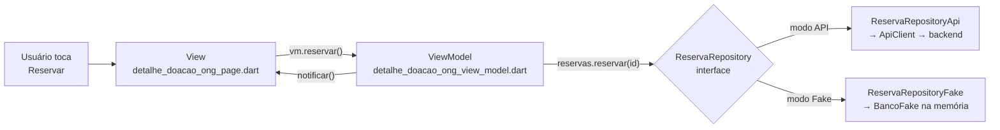

# 16 — App: fundamentos da nossa arquitetura

> **Quem:** Pessoas 1, 2, 4 e 5 (todos que vão fazer telas). A Pessoa 3 também lê, porque faz dupla com a Pessoa 5.
> **Tempo:** 2 h.
> **Pré-requisito:** [06 — Flutter essencial e MVVM](06-flutter-essencial-e-mvvm.md) e o Sprint 0 ([10](10-sprint-0-esqueleto-funcional.md)).

Esta etapa **não cria tela nova**. Ela explica as peças que já estão prontas em `desenvolvimento_app/app/lib/` e mostra a **receita** que todas as telas das etapas 17 a 20 seguem. Leia com o VS Code aberto, abrindo cada arquivo citado.

> **Se você só lembrar de uma coisa:** toda tela do projeto é um **par de arquivos**: `algo_page.dart` (desenha) + `algo_view_model.dart` (pensa). A tela inicial (`escolha_perfil_*`) é o exemplo pronto para copiar.

## Vocabulário

| Termo | Em palavras simples |
|---|---|
| **Widget** | Qualquer pedaço da tela: um texto, um botão, a tela inteira |
| **View** (`*_page.dart`) | O arquivo que **desenha**. Não sabe de onde vêm os dados |
| **ViewModel** (`*_view_model.dart`) | O arquivo que **pensa**: guarda os dados da tela e executa as ações (entrar, salvar, reservar) |
| **Repositório** | Quem **busca e grava** dados. Tem duas versões: uma fala com a API, a outra (Fake) inventa dados na memória |
| **Interface** | Um "contrato": lista **o que** uma classe sabe fazer, sem dizer **como** |
| **Injeção de dependência** | Em vez de a tela criar o repositório, alguém **entrega** o repositório pronto para ela (pelo construtor) |
| **`Future` / `async` / `await`** | Algo que demora (rede, GPS). `await` = "espere terminar antes de seguir" |
| **`notifyListeners()`** | O ViewModel gritando "mudei!"; a View escuta e se redesenha |

## 1. O caminho de um toque na tela

O que acontece quando a ONG toca em **Reservar**:



Repare: a View **não sabe** se está no modo API ou Fake. Nem o ViewModel sabe. Quem decide é **um único arquivo**: `core/dependencias.dart`.

## 2. As peças prontas (fundação)

| Arquivo | O que faz | Você vai... |
|---|---|---|
| `core/mvvm/view_model_base.dart` | Classe-mãe de todos os ViewModels: `ocupado`, `erro`, `executar(...)` | **herdar** dela (`extends ViewModelBase`) |
| `core/dependencias.dart` | Cria tudo: `Dependencias.api()` ou `Dependencias.fake()` | só ler |
| `core/routing/app_routes.dart` | Nomes das rotas (`AppRoutes.login`...) | usar as constantes para navegar |
| `core/routing/app_router.dart` | Cria cada tela e entrega as dependências | só ler (não edite!) |
| `core/sessao/sessao.dart` | Quem está logado: `iniciar`, `encerrar`, `usuario`, `perfil` | usar no login e no "Sair" |
| `data/*/..._repository.dart` | Interfaces + versões Api e Fake | chamar os métodos |
| `data/fake/banco_fake.dart` | "Backend de mentira" com as mesmas regras | usar nos testes |
| `shared/widgets/` | `PrimaryButton`, `AppTextField`, `DoacaoCard`, `ContadorRegressivo`, `CarregandoWidget`, `ErroWidget`, `VazioWidget` | montar as telas com eles |
| `core/utils/formatador.dart` | `Formatador.data`, `.hora`, `.diaHora`, `.duracao`, `.distancia` | mostrar datas e distâncias |
| `core/theme/app_theme.dart` | Cores (`AppColors.verde`, `.laranja`, `.erro`...) | usar as cores |

## 3. A `ViewModelBase` em detalhe

Abra `core/mvvm/view_model_base.dart`. O método mais importante é o `executar`:

```dart
Future<bool> executar(Future<void> Function() acao) async {
  if (_ocupado) return false;   // 1. já tem algo rodando? ignora (evita clique duplo)
  _ocupado = true;              // 2. liga o "carregando"
  _erro = null;
  notificar();                  //    e avisa a tela (o botão vira spinner)
  try {
    await acao();               // 3. faz o trabalho de verdade
    return true;                //    deu certo
  } on ErroAmigavel catch (e) {
    _erro = e.mensagem;         // 4. erro conhecido → mensagem em português
    return false;
  } catch (e, pilha) {
    _erro = 'Algo deu errado. Tente novamente.'; // erro inesperado (bug)
    return false;
  } finally {
    _ocupado = false;           // 5. desliga o "carregando"
    notificar();                //    e avisa a tela de novo
  }
}
```

Com isso, um ViewModel de verdade fica curto:

```dart
Future<bool> carregar() => executar(() async {
      _doacoes = await _repositorio.listarMinhas();
    });
```

E a tela só precisa olhar `vm.ocupado` (mostrar spinner) e `vm.erro` (mostrar mensagem).

> **Armadilha nº 1 (todo mundo cai):** dentro de um `executar`, **não chame outro método que também usa `executar`**. O segundo vai ver `ocupado == true` e **não faz nada**. Solução: crie um método privado sem `executar` (ex.: `_buscar()`) e chame-o dos dois lugares:
>
> ```dart
> Future<bool> carregar() => executar(_buscar);
> Future<bool> cancelar() => executar(() async {
>       await _doacoes.cancelar(doacaoId);
>       await _buscar();            // ✅ privado, sem executar
>     });
> Future<void> _buscar() async { _detalhe = await _doacoes.detalhar(doacaoId); }
> ```

> **Por que `ErroAmigavel`?** É uma interface implementada por `ApiException` (erro da API), `LocalizacaoException` (GPS) e `ErroDeRegra` (regra do próprio app). O `executar` trata as três **do mesmo jeito**, sem saber qual é qual. Isso é **polimorfismo**. Para você, basta: *se quiser mostrar uma mensagem de erro, lance `ErroDeRegra('mensagem')`*.

## 4. A receita de uma tela (copie sempre)

### 4.1 O ViewModel

```dart
// arquivo de exemplo: features/<pasta>/presentation/exemplo_view_model.dart
import 'package:shared_models/shared_models.dart';

import '../../../core/mvvm/view_model_base.dart';
import '../../../data/doacoes/doacao_repository.dart';

class ExemploViewModel extends ViewModelBase {
  // (a) Dependências chegam pelo construtor, tipadas pela INTERFACE.
  ExemploViewModel({required DoacaoRepository doacoes}) : _doacoes = doacoes;

  final DoacaoRepository _doacoes;

  // (b) Estado PRIVADO (com _) + getter público: a tela lê, mas não altera.
  List<Doacao> _itens = const [];
  List<Doacao> get itens => _itens;

  // (c) Ações usam executar(...): "carregando" e erro saem de graça.
  Future<bool> carregar() => executar(() async {
        _itens = await _doacoes.listarMinhas();
      });
}
```

### 4.2 A página

```dart
// arquivo de exemplo: features/<pasta>/presentation/exemplo_page.dart
import 'package:flutter/material.dart';

import '../../../data/doacoes/doacao_repository.dart';
import '../../../shared/widgets/doacao_card.dart';
import '../../../shared/widgets/estados.dart';
import 'exemplo_view_model.dart';

class ExemploPage extends StatefulWidget {
  // (1) O CONSTRUTOR é o contrato com o AppRouter: NÃO mude.
  const ExemploPage({super.key, required this.doacoes});

  final DoacaoRepository doacoes;

  @override
  State<ExemploPage> createState() => _ExemploPageState();
}

class _ExemploPageState extends State<ExemploPage> {
  late final ExemploViewModel _vm;

  @override
  void initState() {
    super.initState();
    // (2) A página CRIA o ViewModel uma vez...
    _vm = ExemploViewModel(doacoes: widget.doacoes);
    _vm.carregar();
  }

  @override
  void dispose() {
    _vm.dispose(); // (3) ... e o DESCARTA quando a tela fecha.
    super.dispose();
  }

  @override
  Widget build(BuildContext context) {
    return Scaffold(
      appBar: AppBar(title: const Text('Exemplo')),
      // (4) ListenableBuilder: redesenha sempre que o ViewModel notificar.
      body: ListenableBuilder(
        listenable: _vm,
        builder: (context, _) {
          // (5) Os 4 estados de toda lista: carregando, erro, vazio, com dados.
          if (_vm.ocupado && _vm.itens.isEmpty) return const CarregandoWidget();
          if (_vm.erro != null && _vm.itens.isEmpty) {
            return ErroWidget(mensagem: _vm.erro!, onTentar: _vm.carregar);
          }
          if (_vm.itens.isEmpty) return const VazioWidget(texto: 'Nada por aqui.');
          return ListView(
            children: [for (final d in _vm.itens) DoacaoCard(doacao: d)],
          );
        },
      ),
    );
  }
}
```

### 4.3 As regras da receita

1. A página é `StatefulWidget` só para **criar e descartar** o ViewModel. Os dados ficam no ViewModel, **não** em `setState`.
2. `setState` só é aceitável para coisas puramente visuais (ex.: mostrar/esconder senha).
3. `TextEditingController` (campos de texto) fica na página e também é descartado no `dispose`.
4. Navegação (`Navigator`), `SnackBar` e diálogos ficam **na página**, porque precisam do `context`. O ViewModel só devolve `true`/`false` ou expõe um estado.
5. Depois de um `await`, antes de usar o `context`, confira `if (!mounted) return;` (a tela pode ter sido fechada enquanto esperava).

## 5. Navegação entre telas

Sempre pelos nomes de `AppRoutes`:

```dart
// abrir uma tela (empilha)
Navigator.pushNamed(context, AppRoutes.novaDoacao);

// abrir passando um argumento (o AppRouter entrega para o construtor da página)
Navigator.pushNamed(context, AppRoutes.detalheDoacaoOng, arguments: doacao.id);

// voltar
Navigator.pop(context);

// depois do login: limpa a pilha e vai para o início do perfil
Navigator.pushNamedAndRemoveUntil(
  context,
  AppRoutes.inicioDoTipo(TipoUsuario.ong),
  (_) => false,
);
```

> **Recarregar ao voltar:** `pushNamed` devolve um `Future` que termina quando a tela aberta é fechada. Use isso para atualizar a lista:
>
> ```dart
> await Navigator.pushNamed(context, AppRoutes.novaDoacao);
> _vm.carregar(); // a nova doação aparece na lista
> ```

O `AppRouter` também **protege** as rotas: sem login, qualquer rota que não seja início/login/cadastro volta para a tela inicial.

## 6. Modo Fake: trabalhar sem backend

No VS Code, *Run and Debug* (`Ctrl+Shift+D`) → **App — dados fictícios (sem backend)** → `F5`.

- Usuários: `mercado@exemplo.com`, `padaria@exemplo.com` (doadores), `maosamigas@exemplo.com`, `pratocheio@exemplo.com`, `distante@exemplo.com` (ONGs). Senha: `senha123`.
- O prazo de reserva é de **2 minutos** (para ver a expiração acontecer).
- A cada 45 segundos aparece uma **"doação surpresa"** para a ONG (para testar o aviso de novidade).
- Os dados somem quando o app fecha.

> **Quando usar o quê:** faça a tela no modo Fake (rápido, sem depender de ninguém). Quando o backend da sua fatia estiver pronto, teste no modo **API local** antes de abrir o PR final.

## 7. Testando um ViewModel (sem tela, sem backend)

O teste cria as dependências Fake, sem atraso de rede e sem doações surpresa:

```dart
// arquivo de exemplo: test/features/exemplo_view_model_test.dart
import 'package:flutter_test/flutter_test.dart';
import 'package:shared_models/shared_models.dart';
import 'package:summit_app/core/dependencias.dart';
import 'package:summit_app/data/fake/banco_fake.dart';

void main() {
  late Dependencias deps;

  setUp(() {
    deps = Dependencias.fake(
      banco: BancoFake(atrasoDeRede: Duration.zero, simularNovasDoacoes: false),
    );
  });

  /// Faz login no Fake, igual a tela de login faria.
  Future<void> entrarComo(String email) async {
    final resposta = await deps.auth.entrar(
      DadosLogin(email: email, senha: BancoFake.senhaPadrao),
    );
    await deps.sessao.iniciar(resposta);
  }

  test('o doador vê as próprias doações', () async {
    await entrarComo('mercado@exemplo.com');
    final vm = ExemploViewModel(doacoes: deps.doacoes);

    final deuCerto = await vm.carregar();

    expect(deuCerto, isTrue);
    expect(vm.itens, isNotEmpty);
    expect(vm.erro, isNull);
  });
}
```

Esse `entrarComo` aparece em todos os testes das etapas 17 a 20. O teste de referência completo está em `test/features/auth/escolha_perfil_test.dart`.

Rode com a tarefa **App: testes** (ou `flutter test` dentro de `app`).

## 8. Onde cada pessoa cria arquivos

| Pessoa | Pasta | Telas (os placeholders já existem; você **substitui o conteúdo**) |
|---|---|---|
| 1 | `features/auth/presentation/` | `login_page.dart`, `cadastro_page.dart` + ViewModels |
| 2 | `features/doador/presentation/` | `home_doador_page.dart`, `nova_doacao_page.dart`, `detalhe_doacao_doador_page.dart` + ViewModels |
| 5 (+3) | `features/ong/presentation/` | `home_ong_page.dart`, `detalhe_doacao_ong_page.dart`, `minhas_reservas_page.dart` + ViewModels |
| 4 | `features/mapa/presentation/` | `mapa_page.dart` + ViewModel |

Os testes de cada pessoa vão em `test/features/<a mesma pasta>/`.

## O que pode dar errado

| Sintoma | Causa | Solução |
|---|---|---|
| A tela não atualiza depois de carregar | Esqueceu o `ListenableBuilder` (ou mudou o estado fora do `executar` sem `notificar()`) | Envolva o conteúdo no `ListenableBuilder` |
| A ação não faz nada | Chamou um método com `executar` de dentro de outro `executar` | Armadilha nº 1 (seção 3) |
| `A ViewModel was used after being disposed` | Criou o ViewModel no `build` | Crie no `initState` |
| `Looking up a deactivated widget's ancestor is unsafe` | Usou `context` depois de um `await` com a tela já fechada | `if (!mounted) return;` antes de usar o `context` |
| Erro no `AppRouter` depois de mexer na página | Mudou o construtor da página | Volte o construtor ao original |

## Checklist

- [ ] Sei explicar a diferença entre View e ViewModel com as minhas palavras
- [ ] Sei o que o `executar` faz e qual é a "armadilha nº 1"
- [ ] Abri e li `escolha_perfil_page.dart` e `escolha_perfil_view_model.dart`
- [ ] Rodei o app no modo Fake e entrei com um usuário de exemplo
- [ ] Rodei a tarefa **App: testes** e tudo passou

Próximo: a etapa da sua fatia — [17](17-app-autenticacao.md) (P1), [18](18-app-doador.md) (P2), [19](19-app-ong.md) (P5 + P3), [20](20-app-mapa.md) (P4).
