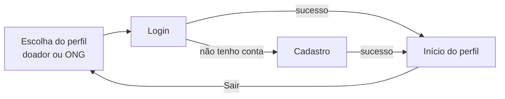

# 17 — App: login e cadastro

> **Quem:** Pessoa 1. **Tempo:** 3 a 5 dias. **Branch:** `feat/auth-app`.
> **Pré-requisito:** [16 — App: fundamentos](16-app-fundamentos.md). Não precisa esperar o backend: comece no **modo Fake**.
> **Alinhe antes:** com a **Pessoa 4** (a localização do cadastro é o centro da busca e do mapa) e com as **Pessoas 2 e 5** (botão Sair). Ver [00_COMECE_AQUI/03 — Alinhamentos](../00_COMECE_AQUI/03-alinhamentos-entre-pessoas.md).

## O que vamos construir

| Tela | Arquivos | O usuário... |
|---|---|---|
| Login | `login_page.dart` + `login_view_model.dart` | digita e-mail e senha e entra |
| Cadastro | `cadastro_page.dart` + `cadastro_view_model.dart` | cria a conta da organização, com a localização |

```text
app/
├── lib/features/auth/presentation/
│   ├── escolha_perfil_page.dart        (já pronta — exemplo)
│   ├── escolha_perfil_view_model.dart  (já pronta — exemplo)
│   ├── login_page.dart                 ← substituir o placeholder
│   ├── login_view_model.dart           ← novo
│   ├── cadastro_page.dart              ← substituir o placeholder
│   └── cadastro_view_model.dart        ← novo
└── test/features/auth/
    ├── escolha_perfil_test.dart        (já pronto)
    └── login_cadastro_test.dart        ← novo
```



## Vocabulário

| Termo | Em palavras simples |
|---|---|
| **`Form` + `GlobalKey<FormState>`** | Agrupa os campos; `_form.currentState!.validate()` roda o `validator` de todos e mostra as mensagens em vermelho |
| **`validator`** | Função que recebe o texto e devolve `null` (ok) ou a mensagem de erro |
| **`TextEditingController`** | "Controle remoto" de um campo: lê (`.text`) e escreve no campo |
| **Token** | A "pulseira do evento" que o backend entrega no login. O app guarda e mostra em cada requisição |
| **Sessão** | Quem está logado agora (`Sessao` em `core/sessao/sessao.dart`) |

> **Validação em dois lugares, mesma regra:** os `validator` usam `ValidadorUsuario` do `shared_models`, **a mesma classe** que o backend usa (etapa 12). O app valida para ajudar o usuário; o backend valida de novo por segurança.

---

## Passo 1 — LoginViewModel

```dart
// arquivo: app/lib/features/auth/presentation/login_view_model.dart
import 'package:shared_models/shared_models.dart';

import '../../../core/erros/erro_amigavel.dart';
import '../../../core/mvvm/view_model_base.dart';
import '../../../core/sessao/sessao.dart';
import '../../../data/auth/auth_repository.dart';

class LoginViewModel extends ViewModelBase {
  LoginViewModel({
    required this.tipo,
    required AuthRepository auth,
    required Sessao sessao,
  })  : _auth = auth,
        _sessao = sessao;

  /// Perfil escolhido na tela inicial (doador ou ONG).
  final TipoUsuario tipo;
  final AuthRepository _auth;
  final Sessao _sessao;

  /// Devolve `true` se entrou. Em caso de erro, a mensagem fica em [erro].
  Future<bool> entrar({required String email, required String senha}) =>
      executar(() async {
        final resposta = await _auth.entrar(
          DadosLogin(email: email.trim(), senha: senha),
        );
        // Escolheu "Sou ONG" mas a conta é de doador (ou o contrário)?
        final tipoDaConta = resposta.conta.usuario.tipo;
        if (tipoDaConta != tipo) {
          throw ErroDeRegra(
            'Esta conta é de ${tipoDaConta.rotulo}. Volte e escolha o perfil '
            '"${tipoDaConta.rotulo}".',
          );
        }
        await _sessao.iniciar(resposta); // guarda o token e a conta
      });
}
```

> **Por que lançar `ErroDeRegra`?** Porque o `executar` já sabe transformar qualquer `ErroAmigavel` na mensagem de `erro`. Não precisamos de `if` na tela.

## Passo 2 — LoginPage

```dart
// arquivo: app/lib/features/auth/presentation/login_page.dart
import 'package:flutter/material.dart';
import 'package:shared_models/shared_models.dart';

import '../../../core/routing/app_routes.dart';
import '../../../core/sessao/sessao.dart';
import '../../../core/theme/app_theme.dart';
import '../../../data/auth/auth_repository.dart';
import '../../../shared/widgets/app_text_field.dart';
import '../../../shared/widgets/primary_button.dart';
import 'login_view_model.dart';

/// TELA: Login (doador ou ONG).
/// O CONSTRUTOR é o contrato com o AppRouter: não mude.
class LoginPage extends StatefulWidget {
  const LoginPage({
    super.key,
    required this.tipo,
    required this.auth,
    required this.sessao,
  });

  final TipoUsuario tipo;
  final AuthRepository auth;
  final Sessao sessao;

  @override
  State<LoginPage> createState() => _LoginPageState();
}

class _LoginPageState extends State<LoginPage> {
  late final LoginViewModel _vm;
  final _form = GlobalKey<FormState>();
  final _email = TextEditingController();
  final _senha = TextEditingController();

  @override
  void initState() {
    super.initState();
    _vm = LoginViewModel(
      tipo: widget.tipo,
      auth: widget.auth,
      sessao: widget.sessao,
    );
  }

  @override
  void dispose() {
    _vm.dispose();
    _email.dispose();
    _senha.dispose();
    super.dispose();
  }

  Future<void> _entrar() async {
    // 1. Valida os campos (mostra as mensagens em vermelho).
    if (!_form.currentState!.validate()) return;
    // 2. Pede ao ViewModel para entrar.
    final ok = await _vm.entrar(email: _email.text, senha: _senha.text);
    // 3. Se deu certo, vai para o início do perfil e limpa a pilha de telas.
    if (!ok || !mounted) return;
    Navigator.pushNamedAndRemoveUntil(
      context,
      AppRoutes.inicioDoTipo(widget.tipo),
      (_) => false,
    );
  }

  @override
  Widget build(BuildContext context) {
    return Scaffold(
      appBar: AppBar(title: Text('Entrar como ${widget.tipo.rotulo}')),
      body: SafeArea(
        child: SingleChildScrollView(
          padding: const EdgeInsets.all(24),
          child: Form(
            key: _form,
            child: Column(
              crossAxisAlignment: CrossAxisAlignment.stretch,
              children: [
                Icon(
                  widget.tipo == TipoUsuario.doador
                      ? Icons.storefront
                      : Icons.groups,
                  size: 64,
                  color: AppColors.verde,
                ),
                const SizedBox(height: 24),
                AppTextField(
                  key: const Key('campo_email'),
                  label: 'E-mail',
                  controller: _email,
                  keyboardType: TextInputType.emailAddress,
                  prefixIcon: Icons.email_outlined,
                  validator: ValidadorUsuario.email,
                ),
                AppTextField(
                  key: const Key('campo_senha'),
                  label: 'Senha',
                  controller: _senha,
                  obscure: true,
                  prefixIcon: Icons.lock_outline,
                  validator: ValidadorUsuario.senha,
                ),
                const SizedBox(height: 8),
                ListenableBuilder(
                  listenable: _vm,
                  builder: (context, _) => Column(
                    crossAxisAlignment: CrossAxisAlignment.stretch,
                    children: [
                      if (_vm.erro != null)
                        Padding(
                          padding: const EdgeInsets.only(bottom: 12),
                          child: Text(
                            _vm.erro!,
                            key: const Key('erro_login'),
                            textAlign: TextAlign.center,
                            style: const TextStyle(color: AppColors.erro),
                          ),
                        ),
                      PrimaryButton(
                        key: const Key('botao_entrar'),
                        texto: 'Entrar',
                        carregando: _vm.ocupado,
                        onPressed: _entrar,
                      ),
                    ],
                  ),
                ),
                const SizedBox(height: 16),
                TextButton(
                  onPressed: () => Navigator.pushNamed(
                    context,
                    AppRoutes.cadastro,
                    arguments: widget.tipo,
                  ),
                  child: const Text('Ainda não tenho conta. Cadastrar'),
                ),
              ],
            ),
          ),
        ),
      ),
    );
  }
}
```

**Teste agora:** rode o app no modo Fake, toque em *Sou estabelecimento doador* e entre com `mercado@exemplo.com` / `senha123`. Você deve cair na tela "Minhas doações" (ainda em construção, da Pessoa 2), com o botão **Sair** no topo.

## Passo 3 — CadastroViewModel

O cadastro precisa da **localização** da organização (é ela que permite à ONG achar doações perto). O ViewModel pede ao `LocalizacaoService` e guarda o resultado.

```dart
// arquivo: app/lib/features/auth/presentation/cadastro_view_model.dart
import 'package:shared_models/shared_models.dart';

import '../../../core/erros/erro_amigavel.dart';
import '../../../core/mvvm/view_model_base.dart';
import '../../../core/sessao/sessao.dart';
import '../../../data/auth/auth_repository.dart';
import '../../../data/localizacao/localizacao_service.dart';

class CadastroViewModel extends ViewModelBase {
  CadastroViewModel({
    required this.tipo,
    required AuthRepository auth,
    required Sessao sessao,
    required LocalizacaoService localizacao,
  })  : _auth = auth,
        _sessao = sessao,
        _localizacao = localizacao;

  final TipoUsuario tipo;
  final AuthRepository _auth;
  final Sessao _sessao;
  final LocalizacaoService _localizacao;

  Coordenadas? _coordenadas;

  /// Última localização obtida pelo GPS (a tela copia para os campos).
  Coordenadas? get coordenadas => _coordenadas;

  /// Botão "Usar minha localização".
  Future<bool> usarMinhaLocalizacao() => executar(() async {
        _coordenadas = await _localizacao.obterAtual();
      });

  Future<bool> cadastrar({
    required String nome,
    required String nomeOrganizacao,
    required String email,
    required String senha,
    required String telefone,
    required String endereco,
    required String latitude,
    required String longitude,
  }) =>
      executar(() async {
        final lat = _numero(latitude);
        final lng = _numero(longitude);
        final erroLocal = ValidadorUsuario.coordenadas(lat, lng);
        if (erroLocal != null) {
          throw ErroDeRegra(
            '$erroLocal Toque em "Usar minha localização" ou digite os números.',
          );
        }
        final resposta = await _auth.cadastrar(
          DadosCadastro(
            tipo: tipo,
            nome: nome,
            nomeOrganizacao: nomeOrganizacao,
            email: email,
            senha: senha,
            telefone: telefone,
            endereco: endereco,
            latitude: lat!,
            longitude: lng!,
          ),
        );
        await _sessao.iniciar(resposta); // já entra logado
      });

  /// Aceita vírgula ou ponto: "-23,52" e "-23.52".
  static double? _numero(String texto) =>
      double.tryParse(texto.trim().replaceAll(',', '.'));
}
```

## Passo 4 — CadastroPage

```dart
// arquivo: app/lib/features/auth/presentation/cadastro_page.dart
import 'package:flutter/material.dart';
import 'package:shared_models/shared_models.dart';

import '../../../core/routing/app_routes.dart';
import '../../../core/sessao/sessao.dart';
import '../../../core/theme/app_theme.dart';
import '../../../data/auth/auth_repository.dart';
import '../../../data/localizacao/localizacao_service.dart';
import '../../../shared/widgets/app_text_field.dart';
import '../../../shared/widgets/primary_button.dart';
import 'cadastro_view_model.dart';

/// TELA: Cadastro (doador ou ONG).
/// O CONSTRUTOR é o contrato com o AppRouter: não mude.
class CadastroPage extends StatefulWidget {
  const CadastroPage({
    super.key,
    required this.tipo,
    required this.auth,
    required this.sessao,
    required this.localizacao,
  });

  final TipoUsuario tipo;
  final AuthRepository auth;
  final Sessao sessao;
  final LocalizacaoService localizacao;

  @override
  State<CadastroPage> createState() => _CadastroPageState();
}

class _CadastroPageState extends State<CadastroPage> {
  late final CadastroViewModel _vm;
  final _form = GlobalKey<FormState>();
  final _nome = TextEditingController();
  final _organizacao = TextEditingController();
  final _email = TextEditingController();
  final _senha = TextEditingController();
  final _telefone = TextEditingController();
  final _endereco = TextEditingController();
  final _latitude = TextEditingController();
  final _longitude = TextEditingController();

  @override
  void initState() {
    super.initState();
    _vm = CadastroViewModel(
      tipo: widget.tipo,
      auth: widget.auth,
      sessao: widget.sessao,
      localizacao: widget.localizacao,
    );
  }

  @override
  void dispose() {
    _vm.dispose();
    for (final campo in [
      _nome, _organizacao, _email, _senha,
      _telefone, _endereco, _latitude, _longitude,
    ]) {
      campo.dispose();
    }
    super.dispose();
  }

  Future<void> _usarLocalizacao() async {
    final ok = await _vm.usarMinhaLocalizacao();
    final local = _vm.coordenadas;
    if (!ok || local == null) return;
    // Copia para os campos: o usuário vê e pode corrigir.
    _latitude.text = local.latitude.toStringAsFixed(6);
    _longitude.text = local.longitude.toStringAsFixed(6);
  }

  Future<void> _cadastrar() async {
    if (!_form.currentState!.validate()) return;
    final ok = await _vm.cadastrar(
      nome: _nome.text,
      nomeOrganizacao: _organizacao.text,
      email: _email.text,
      senha: _senha.text,
      telefone: _telefone.text,
      endereco: _endereco.text,
      latitude: _latitude.text,
      longitude: _longitude.text,
    );
    if (!ok || !mounted) return;
    Navigator.pushNamedAndRemoveUntil(
      context,
      AppRoutes.inicioDoTipo(widget.tipo),
      (_) => false,
    );
  }

  @override
  Widget build(BuildContext context) {
    final ehDoador = widget.tipo == TipoUsuario.doador;
    const tecladoNumerico =
        TextInputType.numberWithOptions(signed: true, decimal: true);

    return Scaffold(
      appBar: AppBar(title: Text('Cadastro de ${widget.tipo.rotulo}')),
      body: SafeArea(
        child: SingleChildScrollView(
          padding: const EdgeInsets.all(24),
          child: Form(
            key: _form,
            child: Column(
              crossAxisAlignment: CrossAxisAlignment.stretch,
              children: [
                const _Titulo('Seus dados'),
                AppTextField(
                  label: 'Seu nome',
                  controller: _nome,
                  prefixIcon: Icons.person_outline,
                  validator: ValidadorUsuario.nome,
                ),
                AppTextField(
                  label: 'E-mail',
                  controller: _email,
                  keyboardType: TextInputType.emailAddress,
                  prefixIcon: Icons.email_outlined,
                  validator: ValidadorUsuario.email,
                ),
                AppTextField(
                  label: 'Senha (mínimo 6 caracteres)',
                  controller: _senha,
                  obscure: true,
                  prefixIcon: Icons.lock_outline,
                  validator: ValidadorUsuario.senha,
                ),
                _Titulo(ehDoador ? 'Seu estabelecimento' : 'Sua ONG'),
                AppTextField(
                  label: ehDoador
                      ? 'Nome do estabelecimento'
                      : 'Nome da ONG',
                  controller: _organizacao,
                  prefixIcon: ehDoador ? Icons.storefront : Icons.groups,
                  validator: ValidadorUsuario.nomeOrganizacao,
                ),
                AppTextField(
                  label: 'Telefone com DDD (opcional)',
                  controller: _telefone,
                  keyboardType: TextInputType.phone,
                  prefixIcon: Icons.phone_outlined,
                  validator: ValidadorUsuario.telefone,
                ),
                AppTextField(
                  label: 'Endereço (opcional)',
                  controller: _endereco,
                  prefixIcon: Icons.home_outlined,
                ),
                const _Titulo('Localização'),
                const Text(
                  'Usada para mostrar as doações perto da ONG. No emulador, '
                  'defina a posição em "Extended controls > Location".',
                  style: TextStyle(color: AppColors.cinza),
                ),
                const SizedBox(height: 12),
                ListenableBuilder(
                  listenable: _vm,
                  builder: (context, _) => OutlinedButton.icon(
                    onPressed: _vm.ocupado ? null : _usarLocalizacao,
                    icon: const Icon(Icons.my_location),
                    label: const Text('Usar minha localização'),
                  ),
                ),
                const SizedBox(height: 12),
                Row(
                  children: [
                    Expanded(
                      child: AppTextField(
                        label: 'Latitude',
                        controller: _latitude,
                        keyboardType: tecladoNumerico,
                      ),
                    ),
                    const SizedBox(width: 12),
                    Expanded(
                      child: AppTextField(
                        label: 'Longitude',
                        controller: _longitude,
                        keyboardType: tecladoNumerico,
                      ),
                    ),
                  ],
                ),
                ListenableBuilder(
                  listenable: _vm,
                  builder: (context, _) => Column(
                    crossAxisAlignment: CrossAxisAlignment.stretch,
                    children: [
                      if (_vm.erro != null)
                        Padding(
                          padding: const EdgeInsets.only(bottom: 12),
                          child: Text(
                            _vm.erro!,
                            textAlign: TextAlign.center,
                            style: const TextStyle(color: AppColors.erro),
                          ),
                        ),
                      PrimaryButton(
                        texto: 'Criar conta',
                        carregando: _vm.ocupado,
                        onPressed: _cadastrar,
                      ),
                    ],
                  ),
                ),
              ],
            ),
          ),
        ),
      ),
    );
  }
}

class _Titulo extends StatelessWidget {
  const _Titulo(this.texto);

  final String texto;

  @override
  Widget build(BuildContext context) => Padding(
        padding: const EdgeInsets.only(top: 8, bottom: 12),
        child: Text(texto, style: Theme.of(context).textTheme.titleMedium),
      );
}
```

> **Dica:** se o `dart format` reorganizar a lista do `dispose` em várias linhas, tudo bem: é só estilo.

## Passo 5 — O botão "Sair"

As telas iniciais dos perfis (Pessoas 2 e 5) terão um botão **Sair** que chama `sessao.encerrar()` e volta para a tela inicial. Enquanto elas não existem, o placeholder `EmConstrucao` já tem esse botão: teste com ele. Combine com as Pessoas 2 e 5 para usarem o mesmo ícone (`Icons.logout`) e o mesmo texto ("Sair").

## Passo 6 — Testar na mão

**Modo Fake** (perfil *App — dados fictícios*):

| Teste | Esperado |
|---|---|
| Entrar sem preencher nada | "Informe o e-mail." e "Informe a senha." em vermelho |
| `mercado@exemplo.com` / `errada` | "E-mail ou senha incorretos." |
| `mercado@exemplo.com` / `senha123` pelo botão "Sou estabelecimento doador" | vai para "Minhas doações" |
| `mercado@exemplo.com` pelo botão "Sou ONG" | "Esta conta é de Doador..." |
| Cadastro com e-mail `mercado@exemplo.com` | "Este e-mail já está cadastrado." |
| Cadastro sem localização | mensagem pedindo a localização |
| "Usar minha localização" | latitude/longitude preenchidas |
| Cadastro completo | entra direto no início do perfil |
| Sair e abrir de novo | volta para a escolha de perfil |

**Modo API** (backend da etapa 12 rodando, perfil *App — API local (emulador)*): repita a tabela. Depois **feche o app e abra de novo**: com o token salvo, ele deve pular direto para o início do perfil (isso é feito pela `EscolhaPerfilPage`, usando `GET /auth/me`).

## Passo 7 — Testes automatizados

```dart
// arquivo: app/test/features/auth/login_cadastro_test.dart
import 'package:flutter/material.dart';
import 'package:flutter_test/flutter_test.dart';
import 'package:shared_models/shared_models.dart';
import 'package:summit_app/core/dependencias.dart';
import 'package:summit_app/data/fake/banco_fake.dart';
import 'package:summit_app/features/auth/presentation/cadastro_view_model.dart';
import 'package:summit_app/features/auth/presentation/login_page.dart';
import 'package:summit_app/features/auth/presentation/login_view_model.dart';

void main() {
  late Dependencias deps;

  setUp(() {
    deps = Dependencias.fake(
      banco: BancoFake(atrasoDeRede: Duration.zero, simularNovasDoacoes: false),
    );
  });

  LoginViewModel login(TipoUsuario tipo) =>
      LoginViewModel(tipo: tipo, auth: deps.auth, sessao: deps.sessao);

  group('LoginViewModel', () {
    test('com a senha certa, entra e inicia a sessão', () async {
      final vm = login(TipoUsuario.doador);

      final ok = await vm.entrar(
        email: ' mercado@exemplo.com ',
        senha: 'senha123',
      );

      expect(ok, isTrue);
      expect(deps.sessao.logado, isTrue);
      expect(deps.sessao.perfil?.nomeOrganizacao, 'Mercado Bom Preço');
    });

    test('com a senha errada, mostra a mensagem e não loga', () async {
      final vm = login(TipoUsuario.doador);

      final ok = await vm.entrar(email: 'mercado@exemplo.com', senha: 'x');

      expect(ok, isFalse);
      expect(vm.erro, 'E-mail ou senha incorretos.');
      expect(deps.sessao.logado, isFalse);
    });

    test('conta de doador entrando pelo botão da ONG é recusada', () async {
      final vm = login(TipoUsuario.ong);

      final ok = await vm.entrar(
        email: 'mercado@exemplo.com',
        senha: 'senha123',
      );

      expect(ok, isFalse);
      expect(vm.erro, contains('Doador'));
      expect(deps.sessao.logado, isFalse);
    });
  });

  group('CadastroViewModel', () {
    CadastroViewModel cadastro() => CadastroViewModel(
          tipo: TipoUsuario.ong,
          auth: deps.auth,
          sessao: deps.sessao,
          localizacao: deps.localizacao,
        );

    test('a localização do GPS (Fake) fica disponível', () async {
      final vm = cadastro();

      await vm.usarMinhaLocalizacao();

      expect(vm.coordenadas, isNotNull);
    });

    test('cadastra com vírgula na latitude e já entra logado', () async {
      final vm = cadastro();

      final ok = await vm.cadastrar(
        nome: 'Ana Lima',
        nomeOrganizacao: 'ONG Nova Esperança',
        email: 'nova@exemplo.com',
        senha: 'senha123',
        telefone: '',
        endereco: '',
        latitude: '-23,53',
        longitude: '-46,19',
      );

      expect(ok, isTrue, reason: vm.erro);
      expect(deps.sessao.usuario?.tipo, TipoUsuario.ong);
    });

    test('sem localização, não cadastra', () async {
      final vm = cadastro();

      final ok = await vm.cadastrar(
        nome: 'Ana Lima',
        nomeOrganizacao: 'ONG Nova Esperança',
        email: 'nova@exemplo.com',
        senha: 'senha123',
        telefone: '',
        endereco: '',
        latitude: '',
        longitude: '',
      );

      expect(ok, isFalse);
      expect(vm.erro, contains('localização'));
    });
  });

  testWidgets('login vazio mostra as mensagens dos validadores',
      (tester) async {
    await tester.pumpWidget(
      MaterialApp(
        home: LoginPage(
          tipo: TipoUsuario.doador,
          auth: deps.auth,
          sessao: deps.sessao,
        ),
      ),
    );

    await tester.tap(find.byKey(const Key('botao_entrar')));
    await tester.pump();

    expect(find.text('Informe o e-mail.'), findsOneWidget);
    expect(find.text('Informe a senha.'), findsOneWidget);
  });
}
```

Rode a tarefa **App: testes**.

## Passo 8 — Pull Request

```powershell
git add desenvolvimento_app/app/lib/features/auth desenvolvimento_app/app/test/features/auth
git commit -m "feat(auth): telas de login e cadastro"
git push -u origin feat/auth-app
```

## O que pode dar errado

| Sintoma | Causa | Solução |
|---|---|---|
| "Não foi possível falar com o servidor" | Backend desligado ou `API_URL` errada | Rode a tarefa **Backend: iniciar**; no emulador, a URL é `http://10.0.2.2:8080` |
| "Rota não encontrada no servidor" | O backend da etapa 12 ainda não foi mesclado | Use o modo Fake por enquanto |
| GPS devolve a Califórnia | Emulador sem posição definida | *Extended controls (⋯) > Location*, digite `-23.5235, -46.1870`, *Set location* |
| "Permissão de localização negada" | Tocou em "Não permitir" | Configurações do Android > Apps > Doação de Alimentos > Permissões |
| `Null check operator used on a null value` no `_form.currentState!` | Esqueceu o `key: _form` no `Form` | Confira o `Form(key: _form, ...)` |

## Checklist

- [ ] As 9 linhas da tabela do passo 6 conferidas no modo Fake
- [ ] Testado no modo API (com o backend da etapa 12)
- [ ] Reabrir o app com sessão salva pula direto para o início
- [ ] 7 testes novos passando
- [ ] PR mesclado

> **Para a apresentação:** saiba explicar por que a mesma regra de validação roda no app e no backend, e onde o token fica guardado no celular (`flutter_secure_storage`, que usa o Keystore do Android).

Próximo para a Pessoa 1: ajudar no [21 — Integração e testes](21-integracao-e-testes.md) e revisar os PRs de quem usa o login.
