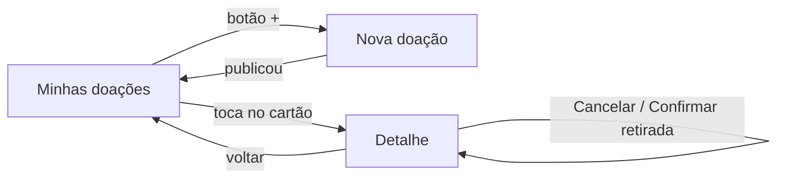

# 18 — App: telas do doador

> **Quem:** Pessoa 2. **Tempo:** 5 a 7 dias. **Branch:** `feat/doador-app`.
> **Pré-requisito:** [16 — App: fundamentos](16-app-fundamentos.md). Comece no **modo Fake** com `mercado@exemplo.com` / `senha123`.
> **Alinhe antes:** com a **Pessoa 3** (reserva ativa e Confirmar retirada no detalhe) e com a **Pessoa 5** (o `DoacaoCard` é compartilhado). Ver [00_COMECE_AQUI/03 — Alinhamentos](../00_COMECE_AQUI/03-alinhamentos-entre-pessoas.md).

## O que vamos construir

| Tela | Arquivos | O doador... |
|---|---|---|
| Minhas doações | `home_doador_page.dart` + `home_doador_view_model.dart` | vê o que já anunciou, puxa para atualizar, toca em "Nova doação" |
| Nova doação | `nova_doacao_page.dart` + `nova_doacao_view_model.dart` | preenche o formulário e publica |
| Detalhe | `detalhe_doacao_doador_page.dart` + `detalhe_doacao_doador_view_model.dart` | vê qual ONG reservou, cancela ou confirma a retirada |

```text
app/
├── lib/features/doador/presentation/
│   ├── home_doador_page.dart               ← substituir o placeholder
│   ├── home_doador_view_model.dart         ← novo
│   ├── nova_doacao_page.dart               ← substituir o placeholder
│   ├── nova_doacao_view_model.dart         ← novo
│   ├── detalhe_doacao_doador_page.dart     ← substituir o placeholder
│   └── detalhe_doacao_doador_view_model.dart ← novo
└── test/features/doador/
    └── doador_view_models_test.dart        ← novo
```



## Vocabulário

| Termo | Em palavras simples |
|---|---|
| **`RefreshIndicator`** | O "puxar a lista para baixo para atualizar" |
| **`FloatingActionButton`** | O botão redondo flutuante no canto da tela |
| **`showDatePicker` / `showTimePicker`** | Abrem o calendário e o relógio do Android. Devolvem a data/hora escolhida (ou `null` se cancelar) |
| **`DropdownButtonFormField`** | Campo com lista de opções (a categoria) |
| **`CheckboxListTile`** | Caixa de marcar com texto ao lado (a declaração) |
| **UTC x horário local** | O backend guarda tudo em UTC (horário "universal"). O app converte para o horário do celular **só para mostrar** ([ADR-010](../docs/adr/ADR-010-datas-utc-relogio.md)) |

> **Regra do escopo aprovado:** a plataforma **não aceita alimentos vencidos ou impróprios**. Por isso o formulário tem a data de validade (não pode ser antes de hoje) e uma **declaração obrigatória**. As duas regras estão no `ValidadorDoacao`, usado aqui e no backend.

---

## Passo 1 — Minhas doações (ViewModel)

```dart
// arquivo: app/lib/features/doador/presentation/home_doador_view_model.dart
import 'package:shared_models/shared_models.dart';

import '../../../core/mvvm/view_model_base.dart';
import '../../../core/sessao/sessao.dart';
import '../../../data/doacoes/doacao_repository.dart';

class HomeDoadorViewModel extends ViewModelBase {
  HomeDoadorViewModel({
    required DoacaoRepository doacoes,
    required Sessao sessao,
  })  : _doacoes = doacoes,
        _sessao = sessao;

  final DoacaoRepository _doacoes;
  final Sessao _sessao;

  List<Doacao> _lista = const [];

  List<Doacao> get doacoes => _lista;

  /// Nome do estabelecimento, para o título.
  String get nomeOrganizacao => _sessao.perfil?.nomeOrganizacao ?? '';

  /// Quantas ainda esperam uma ONG (mostrado no topo).
  int get disponiveis => _lista.where((d) => d.estaDisponivel).length;

  Future<bool> carregar() => executar(() async {
        _lista = await _doacoes.listarMinhas();
      });

  Future<void> sair() => _sessao.encerrar();
}
```

## Passo 2 — Minhas doações (página)

```dart
// arquivo: app/lib/features/doador/presentation/home_doador_page.dart
import 'package:flutter/material.dart';

import '../../../core/routing/app_routes.dart';
import '../../../core/sessao/sessao.dart';
import '../../../data/doacoes/doacao_repository.dart';
import '../../../shared/widgets/doacao_card.dart';
import '../../../shared/widgets/estados.dart';
import 'home_doador_view_model.dart';

/// TELA: Minhas doações (início do doador).
/// O CONSTRUTOR é o contrato com o AppRouter: não mude.
class HomeDoadorPage extends StatefulWidget {
  const HomeDoadorPage({
    super.key,
    required this.doacoes,
    required this.sessao,
  });

  final DoacaoRepository doacoes;
  final Sessao sessao;

  @override
  State<HomeDoadorPage> createState() => _HomeDoadorPageState();
}

class _HomeDoadorPageState extends State<HomeDoadorPage> {
  late final HomeDoadorViewModel _vm;

  @override
  void initState() {
    super.initState();
    _vm = HomeDoadorViewModel(doacoes: widget.doacoes, sessao: widget.sessao);
    _vm.carregar();
  }

  @override
  void dispose() {
    _vm.dispose();
    super.dispose();
  }

  Future<void> _abrir(String rota, {Object? argumento}) async {
    await Navigator.pushNamed(context, rota, arguments: argumento);
    _vm.carregar(); // ao voltar, atualiza (algo pode ter mudado)
  }

  Future<void> _sair() async {
    await _vm.sair();
    if (!mounted) return;
    Navigator.pushNamedAndRemoveUntil(context, AppRoutes.inicio, (_) => false);
  }

  @override
  Widget build(BuildContext context) {
    return Scaffold(
      appBar: AppBar(
        title: const Text('Minhas doações'),
        actions: [
          IconButton(
            tooltip: 'Sair',
            icon: const Icon(Icons.logout),
            onPressed: _sair,
          ),
        ],
      ),
      floatingActionButton: FloatingActionButton.extended(
        onPressed: () => _abrir(AppRoutes.novaDoacao),
        icon: const Icon(Icons.add),
        label: const Text('Nova doação'),
      ),
      body: ListenableBuilder(
        listenable: _vm,
        builder: (context, _) {
          if (_vm.ocupado && _vm.doacoes.isEmpty) {
            return const CarregandoWidget();
          }
          if (_vm.erro != null && _vm.doacoes.isEmpty) {
            return ErroWidget(mensagem: _vm.erro!, onTentar: _vm.carregar);
          }
          if (_vm.doacoes.isEmpty) {
            return const VazioWidget(
              icone: Icons.volunteer_activism,
              texto: 'Você ainda não anunciou nenhuma doação.\n'
                  'Toque em "Nova doação" para começar.',
            );
          }
          return RefreshIndicator(
            onRefresh: _vm.carregar,
            child: ListView.builder(
              // espaço no fim para o botão flutuante não cobrir o último card
              padding: const EdgeInsets.only(top: 8, bottom: 96),
              itemCount: _vm.doacoes.length + 1,
              itemBuilder: (context, i) {
                if (i == 0) {
                  return Padding(
                    padding: const EdgeInsets.fromLTRB(16, 8, 16, 8),
                    child: Text(
                      '${_vm.nomeOrganizacao} • ${_vm.disponiveis} '
                      'aguardando ONG',
                      style: Theme.of(context).textTheme.titleSmall,
                    ),
                  );
                }
                final doacao = _vm.doacoes[i - 1];
                return DoacaoCard(
                  doacao: doacao,
                  onTap: () => _abrir(
                    AppRoutes.detalheDoacaoDoador,
                    argumento: doacao.id,
                  ),
                );
              },
            ),
          );
        },
      ),
    );
  }
}
```

> **Por que `itemCount + 1`?** O item 0 é o cabeçalho ("Mercado Bom Preço • 3 aguardando ONG"); os outros são as doações (`i - 1`).

## Passo 3 — Nova doação (ViewModel)

O ViewModel guarda o que **não é texto** (categoria, datas, declaração). Os textos ficam nos `TextEditingController` da página e chegam no `salvar`.

```dart
// arquivo: app/lib/features/doador/presentation/nova_doacao_view_model.dart
import 'package:shared_models/shared_models.dart';

import '../../../core/erros/erro_amigavel.dart';
import '../../../core/mvvm/view_model_base.dart';
import '../../../data/doacoes/doacao_repository.dart';

class NovaDoacaoViewModel extends ViewModelBase {
  NovaDoacaoViewModel({
    required DoacaoRepository doacoes,
    required Relogio relogio,
  })  : _doacoes = doacoes,
        _relogio = relogio {
    // Valores iniciais sugeridos: retirar de agora até daqui a 3 horas,
    // validade amanhã.
    final agora = relogio.agora();
    _inicio = agora;
    _fim = agora.add(const Duration(hours: 3));
    _validade = hoje.add(const Duration(days: 1));
  }

  final DoacaoRepository _doacoes;
  final Relogio _relogio;

  CategoriaAlimento _categoria = CategoriaAlimento.hortifruti;
  late DateTime _validade; // data (meia-noite UTC)
  late DateTime _inicio; // instante em UTC
  late DateTime _fim; // instante em UTC
  bool _declaracao = false;

  CategoriaAlimento get categoria => _categoria;
  DateTime get validade => _validade;
  DateTime get inicio => _inicio;
  DateTime get fim => _fim;
  bool get declaracao => _declaracao;

  /// "Hoje" no calendário do CELULAR (não em UTC).
  DateTime get hoje => Calendario.somenteData(_relogio.agora().toLocal());

  set categoria(CategoriaAlimento valor) {
    _categoria = valor;
    notificar();
  }

  set validade(DateTime valor) {
    _validade = Calendario.somenteData(valor);
    notificar();
  }

  set inicio(DateTime valor) {
    _inicio = valor.toUtc();
    notificar();
  }

  set fim(DateTime valor) {
    _fim = valor.toUtc();
    notificar();
  }

  set declaracao(bool valor) {
    _declaracao = valor;
    notificar();
  }

  Future<bool> salvar({
    required String titulo,
    required String quantidade,
    required String descricao,
  }) =>
      executar(() async {
        final dados = DadosNovaDoacao(
          titulo: titulo.trim(),
          descricao: descricao.trim().isEmpty ? null : descricao.trim(),
          categoria: _categoria,
          quantidade: quantidade.trim(),
          validade: _validade,
          janelaInicio: _inicio,
          janelaFim: _fim,
          declaracaoAlimentosProprios: _declaracao,
          // sem latitude/longitude: o backend usa as do perfil do doador
        );
        // As MESMAS regras do backend, antes de gastar uma requisição.
        final erros = ValidadorDoacao.validar(
          dados,
          agora: _relogio.agora(),
          hoje: hoje,
        );
        if (erros.isNotEmpty) throw ErroDeRegra(erros.first);

        await _doacoes.criar(dados);
      });
}
```

> **`set categoria(...)`** é um *setter*: na página escrevemos `_vm.categoria = valor;` como se fosse um campo, mas na verdade roda um método que também chama `notificar()`. Encapsulamento sem perder a praticidade.

## Passo 4 — Nova doação (página)

```dart
// arquivo: app/lib/features/doador/presentation/nova_doacao_page.dart
import 'package:flutter/material.dart';
import 'package:shared_models/shared_models.dart';

import '../../../core/sessao/sessao.dart';
import '../../../core/theme/app_theme.dart';
import '../../../core/utils/formatador.dart';
import '../../../data/doacoes/doacao_repository.dart';
import '../../../shared/widgets/app_text_field.dart';
import '../../../shared/widgets/primary_button.dart';
import 'nova_doacao_view_model.dart';

/// TELA: Nova doação.
/// O CONSTRUTOR é o contrato com o AppRouter: não mude.
class NovaDoacaoPage extends StatefulWidget {
  const NovaDoacaoPage({
    super.key,
    required this.doacoes,
    required this.sessao,
    required this.relogio,
  });

  final DoacaoRepository doacoes;
  final Sessao sessao;
  final Relogio relogio;

  @override
  State<NovaDoacaoPage> createState() => _NovaDoacaoPageState();
}

class _NovaDoacaoPageState extends State<NovaDoacaoPage> {
  late final NovaDoacaoViewModel _vm;
  final _form = GlobalKey<FormState>();
  final _titulo = TextEditingController();
  final _quantidade = TextEditingController();
  final _descricao = TextEditingController();

  @override
  void initState() {
    super.initState();
    _vm = NovaDoacaoViewModel(doacoes: widget.doacoes, relogio: widget.relogio);
  }

  @override
  void dispose() {
    _vm.dispose();
    _titulo.dispose();
    _quantidade.dispose();
    _descricao.dispose();
    super.dispose();
  }

  Future<void> _escolherValidade() async {
    final escolhida = await showDatePicker(
      context: context,
      initialDate: _vm.validade,
      firstDate: _vm.hoje,
      lastDate: _vm.hoje.add(const Duration(days: 365)),
      helpText: 'Data de validade',
    );
    if (escolhida != null) _vm.validade = escolhida;
  }

  /// Abre o calendário e depois o relógio. Devolve a data e hora LOCAIS.
  Future<DateTime?> _escolherDataHora(DateTime atualUtc) async {
    final atual = atualUtc.toLocal();
    final dia = await showDatePicker(
      context: context,
      initialDate: atual,
      firstDate: _vm.hoje,
      lastDate: _vm.hoje.add(const Duration(days: 30)),
    );
    if (dia == null || !mounted) return null;
    final hora = await showTimePicker(
      context: context,
      initialTime: TimeOfDay.fromDateTime(atual),
    );
    if (hora == null) return null;
    return DateTime(dia.year, dia.month, dia.day, hora.hour, hora.minute);
  }

  Future<void> _salvar() async {
    if (!_form.currentState!.validate()) return;
    final ok = await _vm.salvar(
      titulo: _titulo.text,
      quantidade: _quantidade.text,
      descricao: _descricao.text,
    );
    if (!ok || !mounted) return;
    ScaffoldMessenger.of(context).showSnackBar(
      const SnackBar(content: Text('Doação publicada! As ONGs próximas já podem ver.')),
    );
    Navigator.pop(context);
  }

  @override
  Widget build(BuildContext context) {
    return Scaffold(
      appBar: AppBar(title: const Text('Nova doação')),
      body: SafeArea(
        child: Form(
          key: _form,
          child: ListenableBuilder(
            listenable: _vm,
            builder: (context, _) => ListView(
              padding: const EdgeInsets.all(24),
              children: [
                AppTextField(
                  label: 'Título (ex.: Frutas do dia)',
                  controller: _titulo,
                  prefixIcon: Icons.restaurant,
                  validator: ValidadorDoacao.titulo,
                ),
                AppTextField(
                  label: 'Quantidade (ex.: 5 caixas)',
                  controller: _quantidade,
                  prefixIcon: Icons.scale_outlined,
                  validator: ValidadorDoacao.quantidade,
                ),
                AppTextField(
                  label: 'Descrição (opcional)',
                  controller: _descricao,
                  prefixIcon: Icons.notes,
                  validator: ValidadorDoacao.descricao,
                ),
                DropdownButtonFormField<CategoriaAlimento>(
                  initialValue: _vm.categoria,
                  decoration: const InputDecoration(
                    labelText: 'Categoria',
                    prefixIcon: Icon(Icons.category_outlined),
                  ),
                  items: [
                    for (final c in CategoriaAlimento.values)
                      DropdownMenuItem(value: c, child: Text(c.rotulo)),
                  ],
                  onChanged: (c) {
                    if (c != null) _vm.categoria = c;
                  },
                ),
                const SizedBox(height: 16),
                _CampoData(
                  icone: Icons.event_available,
                  rotulo: 'Validade',
                  valor: Formatador.data(_vm.validade),
                  onTap: _escolherValidade,
                ),
                _CampoData(
                  icone: Icons.schedule,
                  rotulo: 'Retirar a partir de',
                  valor: Formatador.diaHora(_vm.inicio),
                  onTap: () async {
                    final valor = await _escolherDataHora(_vm.inicio);
                    if (valor != null) _vm.inicio = valor;
                  },
                ),
                _CampoData(
                  icone: Icons.schedule_send,
                  rotulo: 'Retirar até',
                  valor: Formatador.diaHora(_vm.fim),
                  onTap: () async {
                    final valor = await _escolherDataHora(_vm.fim);
                    if (valor != null) _vm.fim = valor;
                  },
                ),
                const SizedBox(height: 8),
                CheckboxListTile(
                  key: const Key('declaracao'),
                  value: _vm.declaracao,
                  onChanged: (v) => _vm.declaracao = v ?? false,
                  controlAffinity: ListTileControlAffinity.leading,
                  contentPadding: EdgeInsets.zero,
                  title: const Text(
                    'Declaro que os alimentos estão dentro da validade e '
                    'próprios para consumo.',
                  ),
                ),
                if (_vm.erro != null)
                  Padding(
                    padding: const EdgeInsets.symmetric(vertical: 8),
                    child: Text(
                      _vm.erro!,
                      textAlign: TextAlign.center,
                      style: const TextStyle(color: AppColors.erro),
                    ),
                  ),
                const SizedBox(height: 8),
                PrimaryButton(
                  texto: 'Publicar doação',
                  carregando: _vm.ocupado,
                  onPressed: _salvar,
                ),
              ],
            ),
          ),
        ),
      ),
    );
  }
}

/// Linha clicável que mostra uma data e abre o seletor.
class _CampoData extends StatelessWidget {
  const _CampoData({
    required this.icone,
    required this.rotulo,
    required this.valor,
    required this.onTap,
  });

  final IconData icone;
  final String rotulo;
  final String valor;
  final VoidCallback onTap;

  @override
  Widget build(BuildContext context) => ListTile(
        contentPadding: EdgeInsets.zero,
        leading: Icon(icone, color: AppColors.verde),
        title: Text(rotulo),
        subtitle: Text(valor),
        trailing: const Icon(Icons.edit_calendar),
        onTap: onTap,
      );
}
```

> **Por que o `ListenableBuilder` envolve o formulário inteiro?** Porque datas, categoria, declaração, erro e "carregando" mudam no ViewModel e todos precisam aparecer. Os campos de texto não perdem o que foi digitado, porque o conteúdo está nos `TextEditingController`, que ficam fora do `builder`.

## Passo 5 — Detalhe da doação (ViewModel)

Aqui está a **armadilha nº 1** da [etapa 16](16-app-fundamentos.md): `cancelar` e `confirmarRetirada` precisam recarregar o detalhe **dentro** do mesmo `executar`, usando o método privado `_buscar`.

```dart
// arquivo: app/lib/features/doador/presentation/detalhe_doacao_doador_view_model.dart
import 'package:shared_models/shared_models.dart';

import '../../../core/mvvm/view_model_base.dart';
import '../../../data/doacoes/doacao_repository.dart';
import '../../../data/reservas/reserva_repository.dart';

class DetalheDoacaoDoadorViewModel extends ViewModelBase {
  DetalheDoacaoDoadorViewModel({
    required this.doacaoId,
    required DoacaoRepository doacoes,
    required ReservaRepository reservas,
    required Relogio relogio,
  })  : _doacoes = doacoes,
        _reservas = reservas,
        _relogio = relogio;

  final int doacaoId;
  final DoacaoRepository _doacoes;
  final ReservaRepository _reservas;
  final Relogio _relogio;

  DetalheDoacao? _detalhe;

  Doacao? get doacao => _detalhe?.doacao;

  /// A reserva ATIVA (qual ONG vem buscar e até quando), se houver.
  Reserva? get reserva => _detalhe?.reserva;

  bool get podeCancelar => doacao?.podeSerCancelada ?? false;

  bool get podeConfirmarRetirada {
    final r = reserva;
    return r != null && r.estaAtiva && !r.estaVencida(_relogio.agora());
  }

  Future<bool> carregar() => executar(_buscar);

  Future<bool> cancelar() => executar(() async {
        await _doacoes.cancelar(doacaoId);
        await _buscar();
      });

  Future<bool> confirmarRetirada() => executar(() async {
        await _reservas.confirmarRetirada(reserva!.id);
        await _buscar();
      });

  Future<void> _buscar() async {
    _detalhe = await _doacoes.detalhar(doacaoId);
  }
}
```

## Passo 6 — Detalhe da doação (página)

```dart
// arquivo: app/lib/features/doador/presentation/detalhe_doacao_doador_page.dart
import 'package:flutter/material.dart';
import 'package:shared_models/shared_models.dart';

import '../../../core/theme/app_theme.dart';
import '../../../core/utils/formatador.dart';
import '../../../data/doacoes/doacao_repository.dart';
import '../../../data/reservas/reserva_repository.dart';
import '../../../shared/widgets/contador_regressivo.dart';
import '../../../shared/widgets/estados.dart';
import '../../../shared/widgets/primary_button.dart';
import 'detalhe_doacao_doador_view_model.dart';

/// TELA: Detalhe da doação (doador).
/// O CONSTRUTOR é o contrato com o AppRouter: não mude.
class DetalheDoacaoDoadorPage extends StatefulWidget {
  const DetalheDoacaoDoadorPage({
    super.key,
    required this.doacaoId,
    required this.doacoes,
    required this.reservas,
    required this.relogio,
  });

  final int doacaoId;
  final DoacaoRepository doacoes;
  final ReservaRepository reservas;
  final Relogio relogio;

  @override
  State<DetalheDoacaoDoadorPage> createState() =>
      _DetalheDoacaoDoadorPageState();
}

class _DetalheDoacaoDoadorPageState extends State<DetalheDoacaoDoadorPage> {
  late final DetalheDoacaoDoadorViewModel _vm;

  @override
  void initState() {
    super.initState();
    _vm = DetalheDoacaoDoadorViewModel(
      doacaoId: widget.doacaoId,
      doacoes: widget.doacoes,
      reservas: widget.reservas,
      relogio: widget.relogio,
    );
    _vm.carregar();
  }

  @override
  void dispose() {
    _vm.dispose();
    super.dispose();
  }

  /// Pergunta "tem certeza?" antes de ações que não podem ser desfeitas.
  Future<bool> _confirmar(String pergunta) async {
    final resposta = await showDialog<bool>(
      context: context,
      builder: (context) => AlertDialog(
        content: Text(pergunta),
        actions: [
          TextButton(
            onPressed: () => Navigator.pop(context, false),
            child: const Text('Não'),
          ),
          TextButton(
            onPressed: () => Navigator.pop(context, true),
            child: const Text('Sim'),
          ),
        ],
      ),
    );
    return resposta ?? false;
  }

  Future<void> _cancelar() async {
    if (!await _confirmar('Cancelar esta doação? As ONGs deixarão de vê-la.')) {
      return;
    }
    await _vm.cancelar();
  }

  Future<void> _confirmarRetirada() async {
    if (!await _confirmar('A ONG já retirou os alimentos?')) return;
    await _vm.confirmarRetirada();
  }

  @override
  Widget build(BuildContext context) {
    return Scaffold(
      appBar: AppBar(title: Text('Doação #${widget.doacaoId}')),
      body: ListenableBuilder(
        listenable: _vm,
        builder: (context, _) {
          final doacao = _vm.doacao;
          if (doacao == null) {
            return _vm.erro != null
                ? ErroWidget(mensagem: _vm.erro!, onTentar: _vm.carregar)
                : const CarregandoWidget();
          }
          final reserva = _vm.reserva;
          return ListView(
            padding: const EdgeInsets.all(24),
            children: [
              Text(doacao.titulo,
                  style: Theme.of(context).textTheme.headlineSmall),
              const SizedBox(height: 4),
              Text('Status: ${doacao.status.rotulo}',
                  style: const TextStyle(color: AppColors.cinza)),
              const Divider(height: 32),
              _Linha(Icons.category_outlined, 'Categoria',
                  doacao.categoria.rotulo),
              _Linha(Icons.scale_outlined, 'Quantidade', doacao.quantidade),
              _Linha(Icons.event_available, 'Validade',
                  Formatador.data(doacao.validade)),
              _Linha(Icons.schedule, 'Retirada',
                  '${Formatador.diaHora(doacao.janelaInicio)} até '
                      '${Formatador.diaHora(doacao.janelaFim)}'),
              if (doacao.descricao != null)
                _Linha(Icons.notes, 'Descrição', doacao.descricao!),
              const Divider(height: 32),
              if (reserva != null) ...[
                Text('Reservada por',
                    style: Theme.of(context).textTheme.titleMedium),
                const SizedBox(height: 8),
                Text(reserva.nomeOng ?? 'ONG #${reserva.ongId}',
                    style: const TextStyle(fontSize: 16)),
                const SizedBox(height: 8),
                Row(children: [
                  const Text('Prazo para retirar: '),
                  ContadorRegressivo(
                    expiraEm: reserva.expiraEm,
                    aoExpirar: _vm.carregar,
                  ),
                ]),
                const SizedBox(height: 24),
              ],
              if (_vm.erro != null)
                Padding(
                  padding: const EdgeInsets.only(bottom: 12),
                  child: Text(_vm.erro!,
                      textAlign: TextAlign.center,
                      style: const TextStyle(color: AppColors.erro)),
                ),
              if (_vm.podeConfirmarRetirada)
                PrimaryButton(
                  texto: 'Confirmar retirada',
                  carregando: _vm.ocupado,
                  onPressed: _confirmarRetirada,
                ),
              if (_vm.podeCancelar)
                OutlinedButton.icon(
                  onPressed: _vm.ocupado ? null : _cancelar,
                  icon: const Icon(Icons.cancel_outlined),
                  label: const Text('Cancelar doação'),
                  style: OutlinedButton.styleFrom(
                    foregroundColor: AppColors.erro,
                    minimumSize: const Size.fromHeight(52),
                  ),
                ),
            ],
          );
        },
      ),
    );
  }
}

class _Linha extends StatelessWidget {
  const _Linha(this.icone, this.rotulo, this.valor);

  final IconData icone;
  final String rotulo;
  final String valor;

  @override
  Widget build(BuildContext context) => Padding(
        padding: const EdgeInsets.only(bottom: 12),
        child: Row(
          crossAxisAlignment: CrossAxisAlignment.start,
          children: [
            Icon(icone, size: 20, color: AppColors.verde),
            const SizedBox(width: 12),
            Expanded(
              child: Text.rich(TextSpan(children: [
                TextSpan(
                    text: '$rotulo: ',
                    style: const TextStyle(fontWeight: FontWeight.w600)),
                TextSpan(text: valor),
              ])),
            ),
          ],
        ),
      );
}
```

## Passo 7 — Testar na mão

**Modo Fake**, `mercado@exemplo.com`:

| Teste | Esperado |
|---|---|
| Abrir o app logado | lista com "Frutas e verduras do dia", "Iogurtes...", "Cestas de mercearia" (reservada) |
| Puxar a lista para baixo | spinner rápido e lista atualizada |
| Nova doação sem marcar a declaração | "Confirme que os alimentos estão próprios para consumo." |
| Nova doação com "Retirar até" antes de "Retirar a partir de" | "O fim da retirada deve ser depois do início." |
| Nova doação válida | SnackBar, volta para a lista e a doação aparece no topo |
| Detalhe de uma disponível | botão "Cancelar doação"; ao confirmar, status vira Cancelada |
| Detalhe de "Cestas de mercearia" | "Reservada por ONG Mãos Amigas", contador regressivo, botão "Confirmar retirada" |
| Confirmar retirada | status vira Concluída e os botões somem |
| Esperar 2 min numa reserva ativa (Fake) | contador chega a "Prazo esgotado" e a tela recarrega sem a reserva |

**Modo API**: repita com o backend das etapas 13 e 15.

## Passo 8 — Testes automatizados

```dart
// arquivo: app/test/features/doador/doador_view_models_test.dart
import 'package:flutter_test/flutter_test.dart';
import 'package:shared_models/shared_models.dart';
import 'package:summit_app/core/dependencias.dart';
import 'package:summit_app/data/fake/banco_fake.dart';
import 'package:summit_app/features/doador/presentation/detalhe_doacao_doador_view_model.dart';
import 'package:summit_app/features/doador/presentation/home_doador_view_model.dart';
import 'package:summit_app/features/doador/presentation/nova_doacao_view_model.dart';

void main() {
  late Dependencias deps;

  setUp(() async {
    deps = Dependencias.fake(
      banco: BancoFake(atrasoDeRede: Duration.zero, simularNovasDoacoes: false),
    );
    final resposta = await deps.auth.entrar(
      const DadosLogin(email: 'mercado@exemplo.com', senha: 'senha123'),
    );
    await deps.sessao.iniciar(resposta);
  });

  test('Minhas doações: lista só as do doador logado', () async {
    final vm = HomeDoadorViewModel(doacoes: deps.doacoes, sessao: deps.sessao);

    await vm.carregar();

    expect(vm.doacoes, isNotEmpty);
    final meuId = deps.sessao.usuario!.id;
    expect(vm.doacoes.every((d) => d.doadorId == meuId), isTrue);
  });

  group('Nova doação', () {
    NovaDoacaoViewModel criar() =>
        NovaDoacaoViewModel(doacoes: deps.doacoes, relogio: deps.relogio);

    test('sem a declaração, não publica', () async {
      final vm = criar();

      final ok = await vm.salvar(
        titulo: 'Pães',
        quantidade: '10',
        descricao: '',
      );

      expect(ok, isFalse);
      expect(vm.erro, contains('próprios para consumo'));
    });

    test('com tudo certo, publica', () async {
      final vm = criar()..declaracao = true;

      final ok = await vm.salvar(
        titulo: 'Pães do dia',
        quantidade: '10 unidades',
        descricao: '',
      );

      expect(ok, isTrue, reason: vm.erro);
      final minhas = await deps.doacoes.listarMinhas();
      expect(minhas.first.titulo, 'Pães do dia');
    });

    test('janela que termina antes de começar é recusada', () async {
      final vm = criar()
        ..declaracao = true
        ..fim = deps.relogio.agora().subtract(const Duration(hours: 1));

      final ok = await vm.salvar(
        titulo: 'Pães do dia',
        quantidade: '10 unidades',
        descricao: '',
      );

      expect(ok, isFalse);
    });
  });

  group('Detalhe', () {
    Future<DetalheDoacaoDoadorViewModel> abrir(String titulo) async {
      final doacao =
          (await deps.doacoes.listarMinhas()).firstWhere((d) => d.titulo == titulo);
      final vm = DetalheDoacaoDoadorViewModel(
        doacaoId: doacao.id,
        doacoes: deps.doacoes,
        reservas: deps.reservas,
        relogio: deps.relogio,
      );
      await vm.carregar();
      return vm;
    }

    test('cancelar uma disponível muda o status e esconde o botão', () async {
      final vm = await abrir('Frutas e verduras do dia');
      expect(vm.podeCancelar, isTrue);

      await vm.cancelar();

      expect(vm.doacao!.status, StatusDoacao.cancelada);
      expect(vm.podeCancelar, isFalse);
    });

    test('reservada mostra a ONG e permite confirmar a retirada', () async {
      final vm = await abrir('Cestas de mercearia');
      expect(vm.reserva?.nomeOng, 'ONG Mãos Amigas');
      expect(vm.podeConfirmarRetirada, isTrue);

      await vm.confirmarRetirada();

      expect(vm.doacao!.status, StatusDoacao.concluida);
      expect(vm.reserva, isNull);
    });
  });
}
```

> **`..declaracao = true`** é o operador **cascata** do Dart: cria o objeto e já altera uma propriedade dele, devolvendo o próprio objeto.

## Passo 9 — Pull Request

```powershell
git add desenvolvimento_app/app/lib/features/doador desenvolvimento_app/app/test/features/doador
git commit -m "feat(doador): minhas doações, nova doação e detalhe"
git push -u origin feat/doador-app
```

## O que pode dar errado

| Sintoma | Causa | Solução |
|---|---|---|
| "Não é permitido doar alimentos vencidos" com a data de hoje | Data convertida para UTC antes de comparar | Use o `hoje` do ViewModel (horário do celular) |
| Horários 3 h adiantados na tela | Mostrou o instante UTC sem converter | Use sempre `Formatador.diaHora(...)`, que chama `toLocal()` |
| A lista não atualiza depois de criar | Não recarregou ao voltar | `await Navigator.pushNamed(...)` e depois `_vm.carregar()` |
| Cancelar/confirmar não recarrega a tela | Chamou `carregar()` dentro de outro `executar` | Use `_buscar()` (armadilha nº 1) |
| Aviso amarelo de `initialValue` ou `value` no Dropdown | Versão do Flutter diferente | Siga a sugestão do `flutter analyze` (versões antigas usam `value:`) |

## Checklist

- [ ] As 9 linhas da tabela do passo 7 conferidas no modo Fake
- [ ] Testado no modo API
- [ ] 7 testes novos passando
- [ ] Sei explicar por que "hoje" usa o horário do celular e o banco usa UTC
- [ ] PR mesclado

Próximo para a Pessoa 2: [21 — Integração e testes](21-integracao-e-testes.md).
