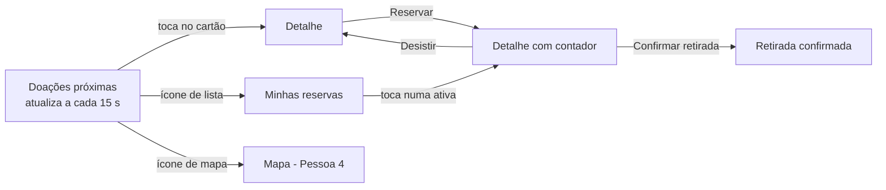

# 19 — App: telas da ONG

> **Quem:** Pessoa 5 (com a Pessoa 3 em dupla, que fez as reservas no backend). **Tempo:** 5 a 7 dias. **Branch:** `feat/ong-app`.
> **Pré-requisito:** [16 — App: fundamentos](16-app-fundamentos.md). Comece no **modo Fake** com `maosamigas@exemplo.com` / `senha123`.
> **Alinhe antes:** esta é a etapa com mais dependências. Converse com a **Pessoa 4** (`GET /proximas`), com a **Pessoa 3** (rotas de reserva) e faça a conversa **a três com as Pessoas 2 e 3** sobre o detalhe da doação. Ver [00_COMECE_AQUI/03 — Alinhamentos](../00_COMECE_AQUI/03-alinhamentos-entre-pessoas.md).

## O que vamos construir

| Tela | Arquivos | A ONG... |
|---|---|---|
| Doações próximas | `home_ong_page.dart` + `home_ong_view_model.dart` | vê as doações perto dela, da mais perto para a mais longe, e é **avisada quando surge uma nova** |
| Detalhe | `detalhe_doacao_ong_page.dart` + `detalhe_doacao_ong_view_model.dart` | reserva, acompanha o prazo, desiste ou confirma a retirada |
| Minhas reservas | `minhas_reservas_page.dart` + `minhas_reservas_view_model.dart` | vê as reservas ativas (com contador) e o histórico |

```text
app/
├── lib/features/ong/presentation/
│   ├── home_ong_page.dart                 ← substituir o placeholder
│   ├── home_ong_view_model.dart           ← novo
│   ├── detalhe_doacao_ong_page.dart       ← substituir o placeholder
│   ├── detalhe_doacao_ong_view_model.dart ← novo
│   ├── minhas_reservas_page.dart          ← substituir o placeholder
│   └── minhas_reservas_view_model.dart    ← novo
└── test/features/ong/
    └── ong_view_models_test.dart          ← novo
```



## Vocabulário

| Termo | Em palavras simples |
|---|---|
| **Polling (atualização periódica)** | Perguntar ao servidor "tem novidade?" de tempos em tempos (aqui, a cada 15 s). Simples e suficiente para o MVP ([ADR-008](../docs/adr/ADR-008-polling-no-mvp.md)) |
| **`Timer.periodic`** | O "despertador" do Dart que chama uma função a cada intervalo |
| **`Set<int>`** | Um conjunto sem repetição; usamos para lembrar quais doações a ONG **já viu** |
| **`SnackBar`** | A mensagem que aparece rapidinho na parte de baixo da tela |
| **`addListener`** | Pedir para ser avisado quando o ViewModel mudar (usado para mostrar o SnackBar) |
| **`DefaultTabController` / `TabBar`** | As abas "Ativas" e "Histórico" |
| **409 `DOACAO_INDISPONIVEL`** | O backend dizendo "outra ONG reservou um instante antes de você" |

---

## Passo 1 — Doações próximas (ViewModel)

Como funciona o **aviso de novidade**:

1. Na primeira carga, todos os ids vão para `_vistas` (nada é "novo").
2. A cada 15 s, o ViewModel busca de novo. Os ids que **não estavam** em `_vistas` são novidades: ganham destaque (`_novas`) e o contador `novidadesParaAvisar` sobe.
3. A página escuta o ViewModel e, quando `novidadesParaAvisar > 0`, mostra um SnackBar e chama `avisoMostrado()`.

```dart
// arquivo: app/lib/features/ong/presentation/home_ong_view_model.dart
import 'dart:async';

import 'package:shared_models/shared_models.dart';

import '../../../core/config/app_config.dart';
import '../../../core/mvvm/view_model_base.dart';
import '../../../core/sessao/sessao.dart';
import '../../../data/doacoes/doacao_repository.dart';

class HomeOngViewModel extends ViewModelBase {
  HomeOngViewModel({
    required DoacaoRepository doacoes,
    required Sessao sessao,
  })  : _repositorio = doacoes,
        _sessao = sessao;

  /// Opções de raio de busca mostradas no menu.
  static const opcoesDeRaioKm = [2.0, 5.0, 10.0, 20.0];

  final DoacaoRepository _repositorio;
  final Sessao _sessao;

  List<Doacao> _doacoes = const [];
  final Set<int> _vistas = {};
  final Set<int> _novas = {};
  bool _primeiraCarga = true;
  int _novidadesParaAvisar = 0;
  double _raioKm = 10;
  Timer? _timer;

  List<Doacao> get doacoes => _doacoes;
  double get raioKm => _raioKm;
  String get nomeOrganizacao => _sessao.perfil?.nomeOrganizacao ?? '';

  /// Esta doação apareceu depois que a ONG abriu a tela?
  bool ehNova(Doacao doacao) => _novas.contains(doacao.id);

  /// Quantas doações novas ainda não foram avisadas com o SnackBar.
  int get novidadesParaAvisar => _novidadesParaAvisar;

  Future<bool> carregar() => executar(_buscar);

  Future<bool> alterarRaio(double km) {
    _raioKm = km;
    return carregar();
  }

  /// Liga o "despertador" que procura doações novas.
  void iniciarAtualizacaoAutomatica() {
    _timer ??= Timer.periodic(AppConfig.intervaloAtualizacao, (_) => carregar());
  }

  /// A página chama depois de mostrar o SnackBar.
  /// Não chama notificar(): não há nada novo para desenhar.
  void avisoMostrado() => _novidadesParaAvisar = 0;

  Future<void> sair() => _sessao.encerrar();

  Future<void> _buscar() async {
    final lista = await _repositorio.listarProximas(raioKm: _raioKm);
    if (!_primeiraCarga) {
      final novas = [
        for (final d in lista)
          if (!_vistas.contains(d.id)) d.id,
      ];
      _novas.addAll(novas);
      _novidadesParaAvisar += novas.length;
    }
    _primeiraCarga = false;
    _vistas.addAll(lista.map((d) => d.id));
    _doacoes = lista;
  }

  @override
  void dispose() {
    _timer?.cancel(); // sem isso, o timer continuaria rodando com a tela fechada
    super.dispose();
  }
}
```

> **A ordem das linhas em `_buscar` importa:** primeiro descobrimos quais ids são novos, **depois** acrescentamos todos em `_vistas`. Se inverter, nenhum id parece novo e o aviso nunca aparece. O teste do passo 8 pega esse erro.
>
> **`[for (...) if (...) d.id]`** é uma *collection for* do Dart: monta a lista filtrando, em uma linha. Equivale a um `for` com `if` e `lista.add(...)`.

## Passo 2 — Doações próximas (página)

```dart
// arquivo: app/lib/features/ong/presentation/home_ong_page.dart
import 'package:flutter/material.dart';

import '../../../core/routing/app_routes.dart';
import '../../../core/sessao/sessao.dart';
import '../../../data/doacoes/doacao_repository.dart';
import '../../../shared/widgets/doacao_card.dart';
import '../../../shared/widgets/estados.dart';
import 'home_ong_view_model.dart';

/// TELA: Doações próximas (início da ONG).
/// O CONSTRUTOR é o contrato com o AppRouter: não mude.
class HomeOngPage extends StatefulWidget {
  const HomeOngPage({
    super.key,
    required this.doacoes,
    required this.sessao,
  });

  final DoacaoRepository doacoes;
  final Sessao sessao;

  @override
  State<HomeOngPage> createState() => _HomeOngPageState();
}

class _HomeOngPageState extends State<HomeOngPage> {
  late final HomeOngViewModel _vm;

  @override
  void initState() {
    super.initState();
    _vm = HomeOngViewModel(doacoes: widget.doacoes, sessao: widget.sessao)
      ..addListener(_avisarNovidades);
    _vm.carregar();
    _vm.iniciarAtualizacaoAutomatica();
  }

  @override
  void dispose() {
    _vm.removeListener(_avisarNovidades);
    _vm.dispose(); // cancela o timer
    super.dispose();
  }

  /// Chamado a cada notificação do ViewModel.
  void _avisarNovidades() {
    final quantidade = _vm.novidadesParaAvisar;
    if (quantidade == 0 || !mounted) return;
    _vm.avisoMostrado();
    ScaffoldMessenger.of(context).showSnackBar(
      SnackBar(
        content: Text(
          quantidade == 1
              ? 'Nova doação perto de você!'
              : '$quantidade novas doações perto de você!',
        ),
      ),
    );
  }

  Future<void> _abrir(String rota, {Object? argumento}) async {
    await Navigator.pushNamed(context, rota, arguments: argumento);
    _vm.carregar();
  }

  Future<void> _sair() async {
    await _vm.sair();
    if (!mounted) return;
    Navigator.pushNamedAndRemoveUntil(context, AppRoutes.inicio, (_) => false);
  }

  @override
  Widget build(BuildContext context) {
    return Scaffold(
      appBar: AppBar(
        title: const Text('Doações próximas'),
        actions: [
          IconButton(
            tooltip: 'Mapa',
            icon: const Icon(Icons.map_outlined),
            onPressed: () => _abrir(AppRoutes.mapa),
          ),
          IconButton(
            tooltip: 'Minhas reservas',
            icon: const Icon(Icons.bookmark_border),
            onPressed: () => _abrir(AppRoutes.minhasReservas),
          ),
          PopupMenuButton<double>(
            tooltip: 'Raio de busca',
            icon: const Icon(Icons.tune),
            onSelected: _vm.alterarRaio,
            itemBuilder: (context) => [
              for (final km in HomeOngViewModel.opcoesDeRaioKm)
                CheckedPopupMenuItem(
                  value: km,
                  checked: km == _vm.raioKm,
                  child: Text('Até ${km.toStringAsFixed(0)} km'),
                ),
            ],
          ),
          IconButton(
            tooltip: 'Sair',
            icon: const Icon(Icons.logout),
            onPressed: _sair,
          ),
        ],
      ),
      body: ListenableBuilder(
        listenable: _vm,
        builder: (context, _) {
          if (_vm.ocupado && _vm.doacoes.isEmpty) {
            return const CarregandoWidget();
          }
          if (_vm.erro != null && _vm.doacoes.isEmpty) {
            return ErroWidget(mensagem: _vm.erro!, onTentar: _vm.carregar);
          }
          return RefreshIndicator(
            onRefresh: _vm.carregar,
            child: ListView(
              padding: const EdgeInsets.symmetric(vertical: 8),
              children: [
                Padding(
                  padding: const EdgeInsets.fromLTRB(16, 8, 16, 8),
                  child: Text(
                    '${_vm.nomeOrganizacao} • até '
                    '${_vm.raioKm.toStringAsFixed(0)} km',
                    style: Theme.of(context).textTheme.titleSmall,
                  ),
                ),
                if (_vm.doacoes.isEmpty)
                  const Padding(
                    padding: EdgeInsets.only(top: 48),
                    child: VazioWidget(
                      icone: Icons.search_off,
                      texto: 'Nenhuma doação disponível perto de você agora.\n'
                          'A lista atualiza sozinha; você será avisado.',
                    ),
                  ),
                for (final doacao in _vm.doacoes)
                  DoacaoCard(
                    doacao: doacao,
                    novidade: _vm.ehNova(doacao),
                    onTap: () => _abrir(
                      AppRoutes.detalheDoacaoOng,
                      argumento: doacao.id,
                    ),
                  ),
              ],
            ),
          );
        },
      ),
    );
  }
}
```

> **Por que a lista vazia fica dentro do `ListView`?** O `RefreshIndicator` só funciona se houver algo rolável. Assim a ONG consegue "puxar para atualizar" mesmo com a lista vazia.

## Passo 3 — Detalhe da doação (ViewModel)

Três situações especiais:

- **Outra ONG reservou antes** (409 `DOACAO_INDISPONIVEL`): mostramos uma mensagem amigável e marcamos `perdeuParaOutraOng`, para a tela oferecer "voltar para a lista".
- **Depois de confirmar a retirada**, a doação fica `concluida` e o backend **não mostra mais** o detalhe para a ONG (regra da etapa 13). Por isso não recarregamos: marcamos `retiradaConfirmada`.
- **O prazo acaba com a tela aberta**: o `ContadorRegressivo` chama `carregar()` e a tela mostra a doação de novo disponível (ou some, se a janela também acabou).

```dart
// arquivo: app/lib/features/ong/presentation/detalhe_doacao_ong_view_model.dart
import 'package:shared_models/shared_models.dart';

import '../../../core/api/api_exception.dart';
import '../../../core/erros/erro_amigavel.dart';
import '../../../core/mvvm/view_model_base.dart';
import '../../../data/doacoes/doacao_repository.dart';
import '../../../data/reservas/reserva_repository.dart';

class DetalheDoacaoOngViewModel extends ViewModelBase {
  DetalheDoacaoOngViewModel({
    required this.doacaoId,
    required DoacaoRepository doacoes,
    required ReservaRepository reservas,
    required Relogio relogio,
  })  : _doacoes = doacoes,
        _reservas = reservas,
        _relogio = relogio;

  final int doacaoId;
  final DoacaoRepository _doacoes;
  final ReservaRepository _reservas;
  final Relogio _relogio;

  DetalheDoacao? _detalhe;
  bool _perdeuParaOutraOng = false;
  bool _retiradaConfirmada = false;

  Doacao? get doacao => _detalhe?.doacao;

  /// Para a ONG, o backend só devolve a reserva se ela for DESTA ONG.
  Reserva? get minhaReserva => _detalhe?.reserva;

  bool get perdeuParaOutraOng => _perdeuParaOutraOng;
  bool get retiradaConfirmada => _retiradaConfirmada;

  bool get podeReservar =>
      minhaReserva == null &&
      (doacao?.podeSerReservada(_relogio.agora()) ?? false);

  bool get temReservaAtiva {
    final r = minhaReserva;
    return r != null && r.estaAtiva && !r.estaVencida(_relogio.agora());
  }

  Future<bool> carregar() => executar(_buscar);

  Future<bool> reservar() => executar(() async {
        try {
          await _reservas.reservar(doacaoId);
        } on ApiException catch (e) {
          if (e.codigo != 'DOACAO_INDISPONIVEL') rethrow;
          _perdeuParaOutraOng = true;
          throw const ErroDeRegra(
            'Que pena! Outra ONG reservou esta doação um instante antes. '
            'Volte para a lista e escolha outra.',
          );
        }
        await _buscar(); // mostra o contador
      });

  Future<bool> cancelarReserva() => executar(() async {
        await _reservas.cancelar(minhaReserva!.id);
        await _buscar(); // a doação volta a ficar disponível
      });

  Future<bool> confirmarRetirada() => executar(() async {
        await _reservas.confirmarRetirada(minhaReserva!.id);
        _retiradaConfirmada = true; // não recarrega (ver explicação acima)
      });

  Future<void> _buscar() async {
    _detalhe = await _doacoes.detalhar(doacaoId);
  }
}
```

## Passo 4 — Detalhe da doação (página)

```dart
// arquivo: app/lib/features/ong/presentation/detalhe_doacao_ong_page.dart
import 'package:flutter/material.dart';
import 'package:shared_models/shared_models.dart';

import '../../../core/theme/app_theme.dart';
import '../../../core/utils/formatador.dart';
import '../../../data/doacoes/doacao_repository.dart';
import '../../../data/reservas/reserva_repository.dart';
import '../../../shared/widgets/contador_regressivo.dart';
import '../../../shared/widgets/estados.dart';
import '../../../shared/widgets/primary_button.dart';
import 'detalhe_doacao_ong_view_model.dart';

/// TELA: Detalhe da doação (ONG), com o botão Reservar.
/// O CONSTRUTOR é o contrato com o AppRouter: não mude.
class DetalheDoacaoOngPage extends StatefulWidget {
  const DetalheDoacaoOngPage({
    super.key,
    required this.doacaoId,
    required this.doacoes,
    required this.reservas,
    required this.relogio,
  });

  final int doacaoId;
  final DoacaoRepository doacoes;
  final ReservaRepository reservas;
  final Relogio relogio;

  @override
  State<DetalheDoacaoOngPage> createState() => _DetalheDoacaoOngPageState();
}

class _DetalheDoacaoOngPageState extends State<DetalheDoacaoOngPage> {
  late final DetalheDoacaoOngViewModel _vm;

  @override
  void initState() {
    super.initState();
    _vm = DetalheDoacaoOngViewModel(
      doacaoId: widget.doacaoId,
      doacoes: widget.doacoes,
      reservas: widget.reservas,
      relogio: widget.relogio,
    );
    _vm.carregar();
  }

  @override
  void dispose() {
    _vm.dispose();
    super.dispose();
  }

  Future<bool> _confirmar(String pergunta) async {
    final resposta = await showDialog<bool>(
      context: context,
      builder: (context) => AlertDialog(
        content: Text(pergunta),
        actions: [
          TextButton(
            onPressed: () => Navigator.pop(context, false),
            child: const Text('Não'),
          ),
          TextButton(
            onPressed: () => Navigator.pop(context, true),
            child: const Text('Sim'),
          ),
        ],
      ),
    );
    return resposta ?? false;
  }

  @override
  Widget build(BuildContext context) {
    return Scaffold(
      appBar: AppBar(title: const Text('Detalhe da doação')),
      body: ListenableBuilder(
        listenable: _vm,
        builder: (context, _) {
          if (_vm.retiradaConfirmada) {
            return _Mensagem(
              icone: Icons.check_circle,
              cor: AppColors.verde,
              texto: 'Retirada confirmada. Obrigado por evitar o desperdício!',
              aoVoltar: () => Navigator.pop(context),
            );
          }
          if (_vm.perdeuParaOutraOng) {
            return _Mensagem(
              icone: Icons.sentiment_dissatisfied,
              cor: AppColors.laranja,
              texto: _vm.erro ?? 'Esta doação não está mais disponível.',
              aoVoltar: () => Navigator.pop(context),
            );
          }
          final doacao = _vm.doacao;
          if (doacao == null) {
            return _vm.erro != null
                ? ErroWidget(mensagem: _vm.erro!, onTentar: _vm.carregar)
                : const CarregandoWidget();
          }
          final reserva = _vm.minhaReserva;
          return ListView(
            padding: const EdgeInsets.all(24),
            children: [
              Text(doacao.titulo,
                  style: Theme.of(context).textTheme.headlineSmall),
              if (doacao.nomeDoador != null)
                Text(doacao.nomeDoador!,
                    style: const TextStyle(color: AppColors.cinza)),
              const Divider(height: 32),
              Text('${doacao.categoria.rotulo} • ${doacao.quantidade}'),
              const SizedBox(height: 8),
              Text('Validade: ${Formatador.data(doacao.validade)}'),
              const SizedBox(height: 8),
              Text('Retirada: ${Formatador.diaHora(doacao.janelaInicio)} até '
                  '${Formatador.diaHora(doacao.janelaFim)}'),
              if (doacao.endereco != null) ...[
                const SizedBox(height: 8),
                Text('Endereço: ${doacao.endereco}'),
              ],
              if (doacao.descricao != null) ...[
                const SizedBox(height: 8),
                Text(doacao.descricao!),
              ],
              const Divider(height: 32),
              if (_vm.temReservaAtiva && reserva != null) ...[
                const Text('Reservada por você. Prazo para retirar:'),
                const SizedBox(height: 8),
                ContadorRegressivo(
                  expiraEm: reserva.expiraEm,
                  aoExpirar: _vm.carregar,
                ),
                const SizedBox(height: 24),
              ],
              if (_vm.erro != null)
                Padding(
                  padding: const EdgeInsets.only(bottom: 12),
                  child: Text(_vm.erro!,
                      textAlign: TextAlign.center,
                      style: const TextStyle(color: AppColors.erro)),
                ),
              if (_vm.podeReservar)
                PrimaryButton(
                  key: const Key('botao_reservar'),
                  texto: 'Reservar',
                  carregando: _vm.ocupado,
                  onPressed: _vm.reservar,
                ),
              if (_vm.temReservaAtiva) ...[
                PrimaryButton(
                  texto: 'Confirmar retirada',
                  carregando: _vm.ocupado,
                  onPressed: () async {
                    if (await _confirmar('Vocês já retiraram os alimentos?')) {
                      await _vm.confirmarRetirada();
                    }
                  },
                ),
                const SizedBox(height: 12),
                OutlinedButton(
                  onPressed: _vm.ocupado
                      ? null
                      : () async {
                          if (await _confirmar(
                              'Desistir da reserva? Outra ONG poderá reservar.')) {
                            await _vm.cancelarReserva();
                          }
                        },
                  style: OutlinedButton.styleFrom(
                    foregroundColor: AppColors.erro,
                    minimumSize: const Size.fromHeight(52),
                  ),
                  child: const Text('Desistir da reserva'),
                ),
              ],
            ],
          );
        },
      ),
    );
  }
}

class _Mensagem extends StatelessWidget {
  const _Mensagem({
    required this.icone,
    required this.cor,
    required this.texto,
    required this.aoVoltar,
  });

  final IconData icone;
  final Color cor;
  final String texto;
  final VoidCallback aoVoltar;

  @override
  Widget build(BuildContext context) => Center(
        child: Padding(
          padding: const EdgeInsets.all(24),
          child: Column(
            mainAxisSize: MainAxisSize.min,
            children: [
              Icon(icone, size: 72, color: cor),
              const SizedBox(height: 16),
              Text(texto, textAlign: TextAlign.center),
              const SizedBox(height: 24),
              OutlinedButton(
                onPressed: aoVoltar,
                child: const Text('Voltar para a lista'),
              ),
            ],
          ),
        ),
      );
}
```

## Passo 5 — Minhas reservas (ViewModel)

```dart
// arquivo: app/lib/features/ong/presentation/minhas_reservas_view_model.dart
import 'package:shared_models/shared_models.dart';

import '../../../core/mvvm/view_model_base.dart';
import '../../../data/reservas/reserva_repository.dart';

class MinhasReservasViewModel extends ViewModelBase {
  MinhasReservasViewModel({
    required ReservaRepository reservas,
    required Relogio relogio,
  })  : _reservas = reservas,
        _relogio = relogio;

  final ReservaRepository _reservas;
  final Relogio _relogio;

  List<Reserva> _todas = const [];

  /// Ativas e ainda dentro do prazo.
  List<Reserva> get ativas => _todas
      .where((r) => r.estaAtiva && !r.estaVencida(_relogio.agora()))
      .toList();

  /// Todo o resto: retiradas, expiradas, canceladas.
  List<Reserva> get historico => _todas
      .where((r) => !r.estaAtiva || r.estaVencida(_relogio.agora()))
      .toList();

  Future<bool> carregar() => executar(() async {
        _todas = await _reservas.listarMinhas();
      });
}
```

## Passo 6 — Minhas reservas (página)

```dart
// arquivo: app/lib/features/ong/presentation/minhas_reservas_page.dart
import 'package:flutter/material.dart';
import 'package:shared_models/shared_models.dart';

import '../../../core/routing/app_routes.dart';
import '../../../core/theme/app_theme.dart';
import '../../../core/utils/formatador.dart';
import '../../../data/reservas/reserva_repository.dart';
import '../../../shared/widgets/contador_regressivo.dart';
import '../../../shared/widgets/estados.dart';
import 'minhas_reservas_view_model.dart';

/// TELA: Minhas reservas (ativas + histórico).
/// O CONSTRUTOR é o contrato com o AppRouter: não mude.
class MinhasReservasPage extends StatefulWidget {
  const MinhasReservasPage({
    super.key,
    required this.reservas,
    required this.relogio,
  });

  final ReservaRepository reservas;
  final Relogio relogio;

  @override
  State<MinhasReservasPage> createState() => _MinhasReservasPageState();
}

class _MinhasReservasPageState extends State<MinhasReservasPage> {
  late final MinhasReservasViewModel _vm;

  @override
  void initState() {
    super.initState();
    _vm = MinhasReservasViewModel(
      reservas: widget.reservas,
      relogio: widget.relogio,
    );
    _vm.carregar();
  }

  @override
  void dispose() {
    _vm.dispose();
    super.dispose();
  }

  Future<void> _abrir(Reserva reserva) async {
    await Navigator.pushNamed(
      context,
      AppRoutes.detalheDoacaoOng,
      arguments: reserva.doacaoId,
    );
    _vm.carregar();
  }

  @override
  Widget build(BuildContext context) {
    return DefaultTabController(
      length: 2,
      child: Scaffold(
        appBar: AppBar(
          title: const Text('Minhas reservas'),
          bottom: const TabBar(
            labelColor: Colors.white,
            unselectedLabelColor: Colors.white70,
            indicatorColor: Colors.white,
            tabs: [Tab(text: 'Ativas'), Tab(text: 'Histórico')],
          ),
        ),
        body: ListenableBuilder(
          listenable: _vm,
          builder: (context, _) {
            if (_vm.ocupado && _vm.ativas.isEmpty && _vm.historico.isEmpty) {
              return const CarregandoWidget();
            }
            if (_vm.erro != null) {
              return ErroWidget(mensagem: _vm.erro!, onTentar: _vm.carregar);
            }
            return TabBarView(
              children: [
                _Lista(
                  reservas: _vm.ativas,
                  vazio: 'Nenhuma reserva ativa.',
                  aoTocar: _abrir,
                  aoExpirar: _vm.carregar,
                ),
                _Lista(
                  reservas: _vm.historico,
                  vazio: 'O histórico aparece aqui.',
                ),
              ],
            );
          },
        ),
      ),
    );
  }
}

class _Lista extends StatelessWidget {
  const _Lista({
    required this.reservas,
    required this.vazio,
    this.aoTocar,
    this.aoExpirar,
  });

  final List<Reserva> reservas;
  final String vazio;
  final void Function(Reserva)? aoTocar;
  final VoidCallback? aoExpirar;

  @override
  Widget build(BuildContext context) {
    if (reservas.isEmpty) return VazioWidget(texto: vazio);
    return ListView.separated(
      padding: const EdgeInsets.symmetric(vertical: 8),
      itemCount: reservas.length,
      separatorBuilder: (_, __) => const Divider(height: 1),
      itemBuilder: (context, i) {
        final r = reservas[i];
        return ListTile(
          leading: Icon(
            r.estaAtiva ? Icons.timer : Icons.history,
            color: r.estaAtiva ? AppColors.laranja : AppColors.cinza,
          ),
          title: Text(r.tituloDoacao ?? 'Doação #${r.doacaoId}'),
          subtitle: Text(
            r.estaAtiva
                ? 'Reservada em ${Formatador.diaHora(r.reservadoEm)}'
                : '${r.status.rotulo} • ${Formatador.diaHora(r.retiradoEm ?? r.expiraEm)}',
          ),
          trailing: r.estaAtiva
              ? ContadorRegressivo(expiraEm: r.expiraEm, aoExpirar: aoExpirar)
              : null,
          onTap: aoTocar == null ? null : () => aoTocar!(r),
        );
      },
    );
  }
}
```

## Passo 7 — Testar na mão

**Modo Fake**, `maosamigas@exemplo.com`:

| Teste | Esperado |
|---|---|
| Abrir o app logado | 3 doações, da mais perto para a mais longe, com a distância |
| Esperar ~45 s | aparece "Doação surpresa nº ..." com a etiqueta **NOVA** e um SnackBar |
| Raio "Até 2 km" | a lista muda (pode ficar menor) |
| Reservar uma doação | contador regressivo de ~2 min e botões "Confirmar retirada" / "Desistir" |
| Voltar para a lista | a doação reservada não aparece mais |
| Minhas reservas → Ativas | a reserva com contador; "Cestas de mercearia" (do seed) também |
| Esperar o contador zerar | a reserva vai para o Histórico como "Expirada" |
| Desistir da reserva | a doação volta a ficar disponível |
| Confirmar retirada | tela "Retirada confirmada"; no Histórico, "Retirada" |
| `distante@exemplo.com` | lista vazia com a mensagem |

**Concorrência (modo API, duas pessoas):** cada uma loga com uma ONG diferente (`maosamigas@` e `pratocheio@`), abrem o detalhe da **mesma** doação e tocam em **Reservar** juntas, contando "3, 2, 1". Uma vê o contador; a outra vê "Que pena! Outra ONG reservou...". Faça isso na apresentação!

## Passo 8 — Testes automatizados

```dart
// arquivo: app/test/features/ong/ong_view_models_test.dart
import 'package:flutter_test/flutter_test.dart';
import 'package:shared_models/shared_models.dart';
import 'package:summit_app/core/dependencias.dart';
import 'package:summit_app/data/fake/banco_fake.dart';
import 'package:summit_app/features/ong/presentation/detalhe_doacao_ong_view_model.dart';
import 'package:summit_app/features/ong/presentation/home_ong_view_model.dart';
import 'package:summit_app/features/ong/presentation/minhas_reservas_view_model.dart';

void main() {
  late BancoFake banco;
  late Dependencias deps;

  setUp(() {
    banco = BancoFake(atrasoDeRede: Duration.zero, simularNovasDoacoes: false);
    deps = Dependencias.fake(banco: banco);
  });

  Future<void> entrarComo(String email) async {
    final resposta = await deps.auth.entrar(
      DadosLogin(email: email, senha: BancoFake.senhaPadrao),
    );
    await deps.sessao.iniciar(resposta);
  }

  DetalheDoacaoOngViewModel detalhe(int id) => DetalheDoacaoOngViewModel(
        doacaoId: id,
        doacoes: deps.doacoes,
        reservas: deps.reservas,
        relogio: deps.relogio,
      );

  group('HomeOngViewModel', () {
    test('lista ordenada pela distância', () async {
      await entrarComo('maosamigas@exemplo.com');
      final vm = HomeOngViewModel(doacoes: deps.doacoes, sessao: deps.sessao);

      await vm.carregar();

      expect(vm.doacoes, isNotEmpty);
      final distancias = vm.doacoes.map((d) => d.distanciaKm!).toList();
      expect(distancias, [...distancias]..sort());
      expect(vm.novidadesParaAvisar, 0); // primeira carga não é novidade
    });

    test('doação criada depois da primeira carga vira novidade', () async {
      await entrarComo('maosamigas@exemplo.com');
      final vm = HomeOngViewModel(doacoes: deps.doacoes, sessao: deps.sessao);
      await vm.carregar();

      // Um doador publica uma doação nova...
      await entrarComo('padaria@exemplo.com');
      final agora = DateTime.now().toUtc();
      final nova = await deps.doacoes.criar(
        DadosNovaDoacao(
          titulo: 'Sonhos fresquinhos',
          categoria: CategoriaAlimento.padaria,
          quantidade: '12 unidades',
          validade: agora.add(const Duration(days: 2)),
          janelaInicio: agora,
          janelaFim: agora.add(const Duration(hours: 2)),
          declaracaoAlimentosProprios: true,
        ),
      );

      // ... e a ONG atualiza a lista.
      await entrarComo('maosamigas@exemplo.com');
      await vm.carregar();

      expect(vm.novidadesParaAvisar, 1);
      expect(vm.ehNova(vm.doacoes.firstWhere((d) => d.id == nova.id)), isTrue);

      vm.avisoMostrado();
      expect(vm.novidadesParaAvisar, 0);
    });
  });

  group('DetalheDoacaoOngViewModel', () {
    test('reservar mostra a reserva ativa', () async {
      await entrarComo('maosamigas@exemplo.com');
      final id = (await deps.doacoes.listarProximas()).first.id;
      final vm = detalhe(id);
      await vm.carregar();
      expect(vm.podeReservar, isTrue);

      await vm.reservar();

      expect(vm.temReservaAtiva, isTrue);
      expect(vm.podeReservar, isFalse);
    });

    test('segunda ONG recebe a mensagem amigável', () async {
      await entrarComo('maosamigas@exemplo.com');
      final id = (await deps.doacoes.listarProximas()).first.id;

      // A tela da Prato Cheio abre ANTES da Mãos Amigas reservar.
      await entrarComo('pratocheio@exemplo.com');
      final vmPratoCheio = detalhe(id);
      await vmPratoCheio.carregar();

      await entrarComo('maosamigas@exemplo.com');
      await deps.reservas.reservar(id);

      await entrarComo('pratocheio@exemplo.com');
      final ok = await vmPratoCheio.reservar();

      expect(ok, isFalse);
      expect(vmPratoCheio.perdeuParaOutraOng, isTrue);
      expect(vmPratoCheio.erro, contains('Outra ONG'));
    });

    test('confirmar retirada marca a tela como concluída', () async {
      await entrarComo('maosamigas@exemplo.com');
      final id = (await deps.doacoes.listarProximas()).first.id;
      final vm = detalhe(id);
      await vm.carregar();
      await vm.reservar();

      await vm.confirmarRetirada();

      expect(vm.retiradaConfirmada, isTrue);
    });
  });

  test('Minhas reservas separa ativas e histórico', () async {
    await entrarComo('pratocheio@exemplo.com');
    final vm = MinhasReservasViewModel(
      reservas: deps.reservas,
      relogio: deps.relogio,
    );

    await vm.carregar();

    // O seed do Fake tem uma reserva concluída do Prato Cheio.
    expect(vm.ativas, isEmpty);
    expect(vm.historico.single.status, StatusReserva.concluida);
  });
}
```

> **Por que trocar de usuário com `entrarComo` no meio do teste?** O `BancoFake` lembra quem está logado (como o token faria no backend). Trocar de usuário simula duas pessoas usando o sistema.

## Passo 9 — Pull Request

```powershell
git add desenvolvimento_app/app/lib/features/ong desenvolvimento_app/app/test/features/ong
git commit -m "feat(ong): doações próximas com aviso, detalhe com reserva e minhas reservas"
git push -u origin feat/ong-app
```

Coloque a Pessoa 3 como coautora de um commit (ela ajudou): na mensagem do commit, pule uma linha e escreva `Co-authored-by: Nome <email-do-github>`. O GitHub mostra os dois nomes.

## O que pode dar errado

| Sintoma | Causa | Solução |
|---|---|---|
| SnackBar aparece várias vezes | Não chamou `avisoMostrado()` | Chame **antes** de mostrar o SnackBar |
| O app fica lento depois de entrar e sair várias vezes | Timer não cancelado | Confira o `dispose` do ViewModel e o da página |
| `setState() called after dispose()` no contador | Tela fechada com timer ativo | O `ContadorRegressivo` já cancela; não crie timers próprios na página |
| Detalhe dá "Recurso não encontrado" depois de confirmar | Recarregou após concluir | Não recarregue (passo 3) |
| A lista não mostra a etiqueta NOVA | Criou a doação com o mesmo usuário logado como ONG | No Fake, espere a "doação surpresa" ou troque de usuário |

## Checklist

- [ ] As 10 linhas da tabela do passo 7 conferidas no modo Fake
- [ ] Teste de concorrência com duas pessoas no modo API
- [ ] 6 testes novos passando
- [ ] Sei explicar como o aviso de novidade funciona (polling + conjunto de ids vistos)
- [ ] PR mesclado

Próximo para as Pessoas 5 e 3: [21 — Integração e testes](21-integracao-e-testes.md).
