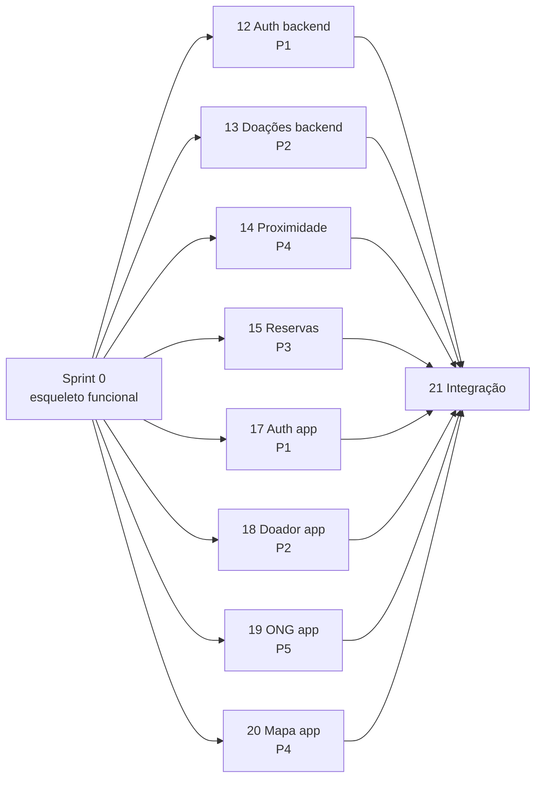

# Trilha de desenvolvimento — do zero à entrega

Este é o **caminho principal** do projeto. Ele foi escrito para quem está no 4º semestre de Engenharia de Software, conhece lógica e alguma linguagem (Java, C#, Python ou JavaScript), mas **nunca usou Dart, Flutter, Dart Frog, MySQL Workbench nem trabalhou em equipe no GitHub**.

Cada etapa explica o **porquê** antes do **como**, mostra o código completo e termina com um checklist. Siga em ordem: cada etapa usa o que foi aprendido nas anteriores.

> **Primeira vez aqui?** Leia antes o [`00_COMECE_AQUI`](../00_COMECE_AQUI/README.md): ele explica o projeto em 1 minuto, a divisão das 5 pessoas e a ordem de leitura.

> A pasta [`docs/`](../docs/00-indice.md) é a **referência** (requisitos, API, banco, decisões). A trilha é o **passo a passo**. Quando a trilha disser "veja docs/08", é para consultar, não para ler inteiro.

## Mapa da trilha

| Fase | Etapa | Quem | Tempo estimado |
|---|---|---|---|
| **A. Entender e planejar** | [01 — Entendendo o projeto](01-entendendo-o-projeto.md) | Todos | 1 h |
| | [02 — Processo e planejamento (Scrum + GitHub Projects)](02-processo-e-planejamento.md) | Todos | 2 h |
| **B. Preparar** | [03 — Ambiente no Windows com VS Code](03-ambiente-windows-vscode.md) | Todos | 2 a 3 h |
| | [04 — Git e GitHub do zero](04-git-e-github-do-zero.md) | Todos | 2 h |
| | [05 — Dart para quem vem de outras linguagens](05-dart-para-quem-vem-de-outras-linguagens.md) | Todos | 4 a 6 h |
| | [06 — Flutter essencial e MVVM](06-flutter-essencial-e-mvvm.md) | Todos | 4 a 6 h |
| **C. Projetar** | [07 — Arquitetura e POO no projeto](07-arquitetura-e-poo.md) | Todos | 2 h |
| | [08 — Banco de dados passo a passo](08-banco-de-dados-passo-a-passo.md) | Todos (P4 lidera) | 2 h |
| | [09 — Design de telas (UX/UI)](09-design-de-telas.md) | Todos (P5 lidera) | 2 h |
| **D. Construir** | [10 — Sprint 0: esqueleto funcional](10-sprint-0-esqueleto-funcional.md) | Líder + P4 (todos conferem) | 1 dia |
| | [11 — Backend: fundamentos do Dart Frog](11-backend-fundamentos.md) | Quem mexe no backend | 2 h |
| | [12 — Backend: autenticação](12-backend-autenticacao.md) | **Pessoa 1** | 3 a 5 dias |
| | [13 — Backend: doações](13-backend-doacoes.md) | **Pessoa 2** | 3 a 5 dias |
| | [14 — Backend: proximidade](14-backend-proximidade.md) | **Pessoa 4** | 2 a 3 dias |
| | [15 — Backend: reservas e expiração](15-backend-reservas.md) | **Pessoa 3** | 5 a 7 dias |
| | [16 — App: fundamentos da nossa arquitetura](16-app-fundamentos.md) | Quem mexe no app | 2 h |
| | [17 — App: login e cadastro](17-app-autenticacao.md) | **Pessoa 1** | 3 a 5 dias |
| | [18 — App: telas do doador](18-app-doador.md) | **Pessoa 2** | 5 a 7 dias |
| | [19 — App: telas da ONG](19-app-ong.md) | **Pessoa 5** | 5 a 7 dias |
| | [20 — App: mapa](20-app-mapa.md) | **Pessoa 4** | 2 a 3 dias |
| **E. Validar e entregar** | [21 — Integração e testes](21-integracao-e-testes.md) | Todos | 1 semana |
| | [22 — Documentação e entrega no GitHub](22-documentacao-e-entrega.md) | Todos | 3 dias |
| **Apêndices** | [A — Docker (opcional)](apendice-a-docker-opcional.md) · [B — WebSocket (opcional)](apendice-b-websocket-opcional.md) · [C — Comandos rápidos](apendice-c-comandos.md) | Consulta | — |

## Quem faz o quê

| Pessoa | Fatia vertical | Backend | App |
|---|---|---|---|
| 1 | Autenticação | [12](12-backend-autenticacao.md) | [17](17-app-autenticacao.md) |
| 2 | Doador | [13](13-backend-doacoes.md) | [18](18-app-doador.md) |
| 3 | Reservas e expiração | [15](15-backend-reservas.md) | (dupla da Pessoa 5) |
| 4 | Infra, proximidade e mapa | [10](10-sprint-0-esqueleto-funcional.md), [14](14-backend-proximidade.md) | [20](20-app-mapa.md) |
| 5 | Telas da ONG | (dupla da Pessoa 3) | [19](19-app-ong.md) |

> Uma **fatia vertical** é uma funcionalidade inteira, do banco à tela. Cada pessoa é dona dos arquivos da sua fatia, então ninguém edita o mesmo arquivo que o colega. Isso é explicado em [07](07-arquitetura-e-poo.md).

## Como as fatias andam em paralelo

Ninguém espera ninguém: o backend usa `tool/gerar_token.dart` para testar rotas antes do login existir, e o app usa o **modo Fake** para funcionar antes do backend existir.

## Convenções desta trilha

- Comandos são para **PowerShell** (o terminal padrão do VS Code no Windows).
- `> Dica`, `> Atenção` e `> Por quê?` destacam pontos importantes.
- Blocos de código com o caminho no topo (`// arquivo: ...`) são arquivos completos para criar.
- Ao final de cada etapa há um **checklist**: só avance quando todos os itens estiverem marcados.

## Sobre o código pronto

O código das fatias está completo nesta trilha porque o grupo nunca usou essas tecnologias. A regra é: **digite (ou cole) e entenda cada bloco antes de seguir**. Ao apresentar, cada pessoa precisa saber explicar o próprio código, e o histórico do GitHub mostrará quem fez o quê.
