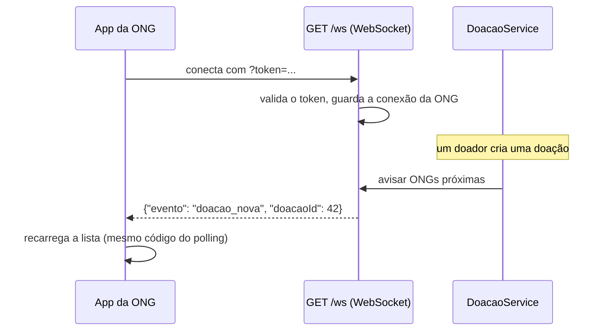

# Apêndice B — WebSocket (opcional, evolução futura)

> **Não faz parte do MVP.** O aviso de doação nova funciona com **atualização periódica** (polling a cada 15 s, [etapa 19](19-app-ong.md)), decisão registrada no [ADR-008](../docs/adr/ADR-008-polling-no-mvp.md). Só leia este apêndice se o grupo terminar tudo com folga **e** quiser estudar um tema a mais. Se for implementar, faça numa branch separada e só mescle se estiver estável antes do congelamento ([etapa 21](21-integracao-e-testes.md)).

## A diferença, em palavras simples

| | Polling (o que usamos) | WebSocket |
|---|---|---|
| Analogia | Ligar para a loja a cada 15 minutos: "chegou meu pedido?" | Deixar o telefone na linha: a loja avisa na hora |
| Quem inicia | Sempre o app | O servidor pode mandar a qualquer momento |
| Atraso do aviso | Até 15 s | Quase instantâneo |
| Complexidade | Um `Timer` | Conexão aberta, reconexão, autenticação no canal, servidor guardando quem está conectado |
| Funciona com o app fechado? | Não | Também não (para isso existe **push**, com Firebase Cloud Messaging) |

Para o tamanho deste projeto, 15 s de atraso não prejudica ninguém. Por isso o polling foi escolhido.

## Como seria (visão geral)



Repare no último passo: o WebSocket **não substitui** a busca. Ele só avisa "tem novidade"; o app chama o mesmo `GET /proximas` de sempre. Isso mantém o resto do código igual.

## O que precisaria mudar

| Onde | Mudança |
|---|---|
| `backend/pubspec.yaml` | pacote `dart_frog_web_socket` (combinar com o grupo, é fundação) |
| `backend/lib/avisos/` (novo) | classe `CentralDeAvisos` que guarda as conexões abertas por id da ONG e sabe enviar uma mensagem para as ONGs num raio |
| `backend/routes/ws.dart` (novo) | aceita a conexão, valida o token (o navegador não manda cabeçalho `Authorization` no WebSocket, por isso o token vai na URL) e registra na central |
| `DoacaoService.criar` | depois de gravar, chama a central para avisar |
| `app/pubspec.yaml` | pacote `web_socket_channel` |
| `HomeOngViewModel` | ao receber `doacao_nova`, chama `carregar()`; **mantém** o timer como plano B, caso a conexão caia |

## Esboço do backend (para estudo)

```dart
// esboço: backend/routes/ws.dart
import 'package:dart_frog/dart_frog.dart';
import 'package:dart_frog_web_socket/dart_frog_web_socket.dart';

Future<Response> onRequest(RequestContext context) async {
  final handler = webSocketHandler((channel, protocol) {
    // 1. Ler o token de context.request.uri.queryParameters['token']
    //    e validar com context.read<TokenService>().validar(token).
    // 2. Registrar o canal numa central de avisos, pelo id da ONG.
    // 3. Quando o canal fechar (channel.stream terminar), remover da central.
  });
  return handler(context);
}
```

## Cuidados que tornam isso difícil

1. **Reconexão:** o celular troca de Wi-Fi para 4G e a conexão cai. O app precisa perceber e reconectar, sem duplicar conexões.
2. **Hot reload do `dart_frog dev`:** a central de avisos precisa ser criada uma única vez (como o `_database` no `main.dart`).
3. **Escala:** a central fica na memória de **um** servidor. Com dois servidores, um não saberia das conexões do outro.
4. **Testes:** muito mais difíceis que os de um `Timer`.

## Para a apresentação

Mesmo sem implementar, é uma ótima resposta para "o que vocês fariam a seguir?": *"Trocaríamos o polling por WebSocket para avisos instantâneos com o app aberto, e usaríamos push (Firebase Cloud Messaging) para avisar com o app fechado. Não fizemos no MVP porque o polling resolve o problema com muito menos complexidade, como registramos no ADR-008."*
